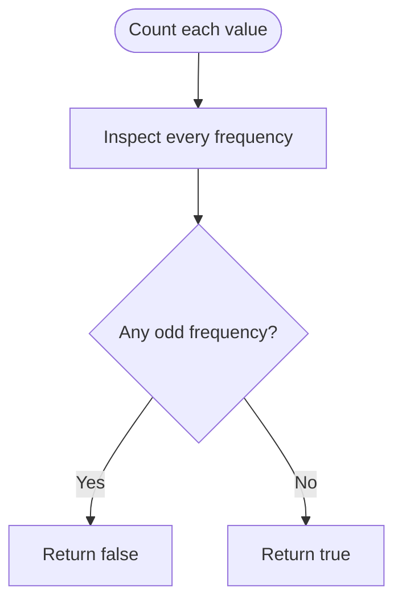

# Divide Array Into Equal Pairs — LeetCode 2206

Source: `2206.cpp` includes sorting-based and frequency-counting methods.

## 1. Understanding — समजून घ्या

Determine whether every array element can be used exactly once in a pair whose two values are equal.

## 2. Worked examples and edge cases

> **मराठी:** प्रश्नात काय दिले आहे आणि नेमके काय शोधायचे आहे, हे आधी स्पष्ट करा.
> `[1,2,3,4,2,1,4,3]` is valid: every frequency is even. `[1,1,2]` is invalid because the 2 has odd frequency (the problem normally guarantees even array length). Empty input is vacuously pairable mathematically, though the judge requires nonempty even-length input.

## 3. Pattern identification + cheat sheet

> **मराठी:** या clues मुळे योग्य pattern ओळखता येतो; constraints आणि relations नीट तपासा.
> | Clue | Pattern |
> |---|---|
> | Pair only equal values | Frequency counting |
> | Need matching adjacent values | Sort then compare pairs |
> | Every item used once | Even frequency for each value |

## 4. Approaches

> **मराठी:** सोप्या उपायापासून सुरुवात करा आणि constraints नुसार योग्य optimization निवडा.
> Sorting then checking positions `(0,1),(2,3),...` is correct at O(n log n) time. Counting each value's frequency is expected O(n) and is the optimal source alternative. Checking only whether each value occurs at least twice is incorrect when a value occurs three times.

## 5. Flowchart

> **मराठी:** Flowchart मधील decision, loop आणि termination condition क्रमाने समजून घ्या.

## 6. Algorithm and intuition

> **मराठी:** मुख्य observation समजल्यावर algorithm चे steps लक्षात ठेवणे सोपे होते.
> Equal values can pair among themselves iff their count is even. Thus build a frequency map and reject as soon as any count is odd. The sorting variant puts equal values adjacent and checks each consecutive pair.

## 7. Code explanation

> **मराठी:** Code मधील variable आणि condition यांचा algorithm मधील उद्देश समजून घ्या.
> `divideArrayFrequency` increments `freq[num]` and checks `entry.second % 2`. `divideArraySorting` sorts `ns` in place, then compares `ns[i]` with `ns[i+1]` for even `i`.

## 8. Dry run

> **मराठी:** प्रत्येक महत्त्वाच्या step नंतर variable ची value trace करा.
> For `[1,2,1,2]`, counts are `1→2`, `2→2`, both even → `true`. For `[1,2,1,3]`, count of 2 and 3 is odd → `false`.

## 9. Complexity

> **मराठी:** Input size आणि प्रत्येक operation कितीदा चालतो यावरून complexity ठरवा.
> Frequency version: expected **O(n)** time, **O(u)** space for `u` distinct values. Sorting version: **O(n log n)** time and implementation-dependent sort stack space; it mutates the input.

## 10. Correctness

> **मराठी:** Invariant किंवा तर्क वापरून algorithm योग्य उत्तर देतो हे समजून घ्या.
> A value with odd frequency always leaves one occurrence unpaired; if every frequency is even, occurrences of each value can be partitioned into pairs. These independent per-value pairings cover every element exactly once.

## 11. Mistakes and interview traps

> **मराठी:** Boundary, duplicate आणि off-by-one cases स्वतंत्रपणे तपासा.

- Check parity of frequency, not just presence.
- The array must have even length; an odd-length array cannot be fully paired.
- Sorting-based method changes input order.
- Pairing arbitrary equal-looking values is not possible if their counts are odd.

## 12. Quick revision — झटपट उजळणी

> **मराठी सारांश:** प्रत्येक संख्येची वारंवारता सम असली पाहिजे.
> Every distinct number must occur an even number of times.

## 13. Related problems and variations

> **मराठी:** प्रश्नात काय दिले आहे आणि नेमके काय शोधायचे आहे, हे आधी स्पष्ट करा.
> Pair array elements by value; find unpaired element; count minimum deletions to make all frequencies even; pair items with a target sum using a frequency map.

## 14. Self-assessment

> **मराठी:** उत्तर न पाहता प्रश्न सोडवा आणि तुमच्या निवडीचे कारण सांगा.

1. Why is even frequency sufficient?
2. What is the runtime difference between the two source methods?
3. Does frequency counting preserve the input?
