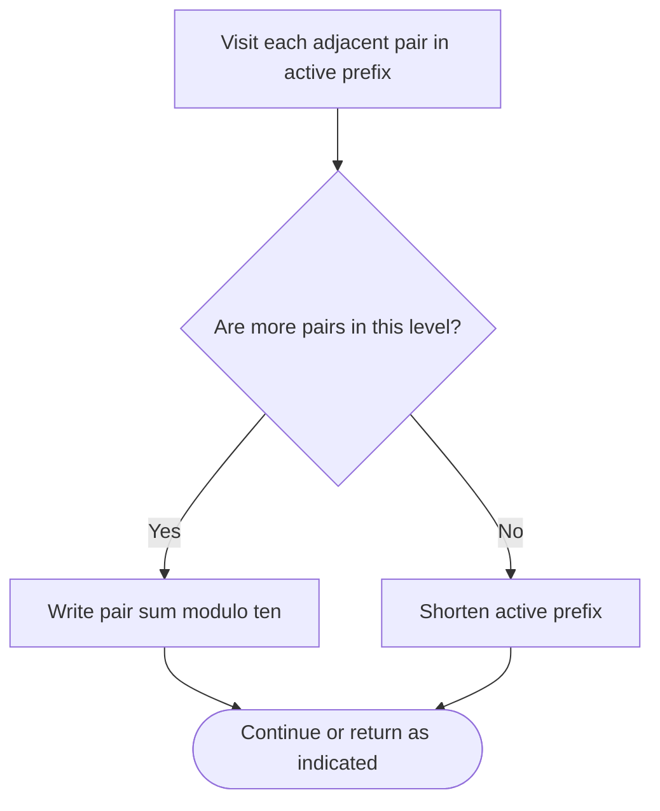

# Find Triangular Sum of an Array — LeetCode 2221

## Problem and judge interface

int triangularSum(vector<int>& nums); repeatedly replace adjacent values by their sum modulo 10 until one remains.

## Identification evidence

In-place adjacent-pair modulo-10 reduction uniquely matches problem 2221.

## Main flow

```mermaid
flowchart TD
 A([Start]) --> B[Set active length to input size]
 B --> C[Reduce adjacent pairs modulo ten]
 C --> D{Is active length greater than zero?}
 D -- Yes --> E[Combine adjacent entries and shorten prefix]
 D -- No --> F[Return nums[0]]
 E --> G{More work remains?}
 F --> G
 G -- Yes --> C
 G -- No --> H([Return result])
```

## Important branch / loop



## Core logic and invariants

For each active prefix, replace nums[i-1] with (nums[i-1]+nums[i])%10, then shorten the active length. The first element is the final result. Input is modified and must be nonempty.

## Complexity

O(n^2) time and O(1) auxiliary space.

## Comparison and optimization

In-place reduction avoids allocating a new row at each level.

## Compile and run

The `.cpp` is the original standalone source, including its local `main()` demonstration where present. Compile and run from the repository root with a C++17 compiler:

```text
g++ -std=c++17 LeetCode\2221\2221.cpp -o solution.exe
.\solution.exe
```

For LeetCode, adapt the implementation to the required class/method signature and omit the local `main()` and demonstration helpers; use the judge-provided node types. Notes above identify method-name or behavior differences. The moved source bytes have not been edited.
