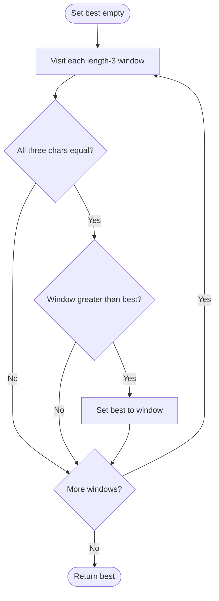

# Largest 3-Same-Digit Number in String — LeetCode 2264

Source: `2264.cpp` provides `largestGoodIntegerOptimized` and `largestGoodIntegerOriginal`.

## 1. Understanding — समजून घ्या

Find the lexicographically/numerically largest length-3 substring made of the same digit. Return the three-character string, or `""` if no such substring exists.

## 2. Worked examples and edge cases

> **मराठी:** प्रश्नात काय दिले आहे आणि नेमके काय शोधायचे आहे, हे आधी स्पष्ट करा.
> `"6777133339"` contains `"777"` and `"333"`; return `"777"`. `"0000000"` returns `"000"`—do not parse it as integer zero and lose width. `"123456"` has no triple, so return empty.

## 3. Pattern identification + cheat sheet

> **मराठी:** या clues मुळे योग्य pattern ओळखता येतो; constraints आणि relations नीट तपासा.
> | Clue | Pattern |
> |---|---|
> | Fixed length 3 | Sliding window |
> | All characters equal | Adjacent comparisons |
> | Largest digit triplet | Lexicographic comparison (digits) |

## 4. Approaches

> **मराठी:** सोप्या उपायापासून सुरुवात करा आणि constraints नुसार योग्य optimization निवडा.
> Check all windows of length 3 and keep the largest: O(n), optimal. An inefficient method can construct and sort all matching triplets. Do not compare parsed integer results if the required output must preserve leading zeroes.

## 5. Flowchart

> **मराठी:** Flowchart मधील decision, loop आणि termination condition क्रमाने समजून घ्या.

## 6. Algorithm and intuition

> **मराठी:** मुख्य observation समजल्यावर algorithm चे steps लक्षात ठेवणे सोपे होते.
> Every possible answer is one of the `n-2` consecutive windows. Test whether its three characters match. Since all candidates have equal length and contain decimal digits, lexicographic order matches digit-value order; keep the maximum string.

## 7. Code explanation

> **मराठी:** Code मधील variable आणि condition यांचा algorithm मधील उद्देश समजून घ्या.
> The optimized method scans windows, extracts `num.substr(i,3)` when all three characters match, and updates `res` if it is greater. The original method stores the best digit as an integer and skips the rest of a found run; both are intended to return the same string for valid input.

## 8. Dry run

> **मराठी:** प्रत्येक महत्त्वाच्या step नंतर variable ची value trace करा.
> For `"6777133339"`: window `"777"` sets best to `"777"`; later `"333"` is smaller; final best remains `"777"`.

## 9. Complexity

> **मराठी:** Input size आणि प्रत्येक operation कितीदा चालतो यावरून complexity ठरवा.
> **O(n)** time and **O(1)** auxiliary space; returned strings are length 3. The source assumes the problem's input length is at least 3.

## 10. Correctness

> **मराठी:** Invariant किंवा तर्क वापरून algorithm योग्य उत्तर देतो हे समजून घ्या.
> The scan visits every contiguous length-3 substring exactly once. It accepts exactly those whose characters are all equal and retains the greatest accepted candidate. Therefore the final best is the largest good integer, or remains empty if none exists.

## 11. Mistakes and interview traps

> **मराठी:** Boundary, duplicate आणि off-by-one cases स्वतंत्रपणे तपासा.

- Compare characters at `i`, `i+1`, and `i+2`.
- Return a three-character string; `"000"` is valid.
- Include the final starting index `n-3`.
- Empty result is `""`, not `"0"`.

## 12. Quick revision — झटपट उजळणी

> **मराठी सारांश:** प्रत्येक तीन अक्षरांची खिडकी तपासा आणि मोठा triplet ठेवा.
> Scan `i=0..n-3`; if `s[i]==s[i+1]==s[i+2]`, keep the largest substring.

## 13. Related problems and variations

> **मराठी:** प्रश्नात काय दिले आहे आणि नेमके काय शोधायचे आहे, हे आधी स्पष्ट करा.
> Longest run of equal characters; largest fixed-width substring meeting a predicate; sliding-window maximum over character patterns.

## 14. Self-assessment

> **मराठी:** उत्तर न पाहता प्रश्न सोडवा आणि तुमच्या निवडीचे कारण सांगा.

1. Why is string comparison valid for these equal-length digit strings?
2. Why must `"000"` remain a string?
3. What is the last valid window start?
