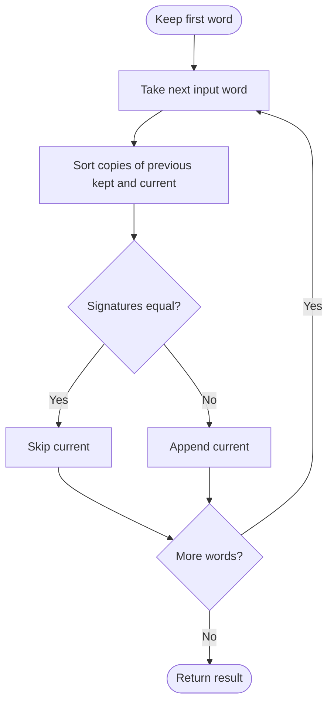

# Find Resultant Array After Removing Anagrams — LeetCode 2273

Source: `2273.cpp`; it keeps the first word and removes each subsequent word anagrammatic to the last retained word.

## 1. Understanding — समजून घ्या

Given words in order, remove a word if it is an anagram of the previous word in the original sequence. Keep the remaining words in original order.

## 2. Worked examples and edge cases

> **मराठी:** प्रश्नात काय दिले आहे आणि नेमके काय शोधायचे आहे, हे आधी स्पष्ट करा.
> `["abba","baba","bbaa","cd","cd"]` → `["abba","cd"]`: the first two later words are anagrams of the preceding retained word; the last `"cd"` is also an adjacent anagram. A singleton list is unchanged. The source assumes `words` is nonempty.

## 3. Pattern identification + cheat sheet

> **मराठी:** या clues मुळे योग्य pattern ओळखता येतो; constraints आणि relations नीट तपासा.
> | Clue | Pattern |
> |---|---|
> | Compare adjacent words by anagram class | Canonical signature |
> | Preserve first in each consecutive run | Scan and filter |
> | Small words | Sort a copy as signature |

## 4. Approaches

> **मराठी:** सोप्या उपायापासून सुरुवात करा आणि constraints नुसार योग्य optimization निवडा.
> Sorting each word copy gives a simple canonical form; the source does this on the previous retained word and current word. Counting letters can avoid sorting, especially for longer words. Comparing each word with every earlier result is unnecessary. Do not remove all anagrams globally—the task removes only consecutive anagram groups.

## 5. Flowchart

> **मराठी:** Flowchart मधील decision, loop आणि termination condition क्रमाने समजून घ्या.

## 6. Algorithm and intuition

> **मराठी:** मुख्य observation समजल्यावर algorithm चे steps लक्षात ठेवणे सोपे होते.
> Anagrams have the same sorted-character signature. Compare each current word's signature with the last retained word's signature; if equal, the current word belongs to the same consecutive run and can be dropped, otherwise retain it.

## 7. Code explanation

> **मराठी:** Code मधील variable आणि condition यांचा algorithm मधील उद्देश समजून घ्या.
> `removeAnagrams` seeds `result` with `words[0]`. For each remaining word it copies `result.back()` and `words[i]`, sorts both copies, and appends the original current word only when signatures differ. Original spellings are preserved.

## 8. Dry run

> **मराठी:** प्रत्येक महत्त्वाच्या step नंतर variable ची value trace करा.
> `["listen","silent","google"]`: signatures of `listen` and `silent` are equal → skip `silent`; compare `google` with retained `listen`, signatures differ → keep. Result `["listen","google"]`.

## 9. Complexity

> **मराठी:** Input size आणि प्रत्येक operation कितीदा चालतो यावरून complexity ठरवा.
> For total character count `S` and maximum word length `L`, time is **O(Σ |word| log |word|)**, bounded by **O(S log L)**; result storage is **O(number of kept words)**, plus copied/sorted temporary words.

## 10. Correctness

> **मराठी:** Invariant किंवा तर्क वापरून algorithm योग्य उत्तर देतो हे समजून घ्या.
> Sorting preserves the multiset of characters, so two sorted copies are equal exactly when their words are anagrams. Comparing against the last kept word represents the preceding word in the reduced sequence; within a consecutive anagram run, all signatures match. Appending only on a signature change keeps exactly the first word of each run.

## 11. Mistakes and interview traps

> **मराठी:** Boundary, duplicate आणि off-by-one cases स्वतंत्रपणे तपासा.

- Remove only consecutive anagrams, not all repeated signatures globally.
- Compare to the last retained word, not a stale original index.
- Sort copies so input spellings remain unchanged.
- For empty input, this source would access `words[0]`; judge guarantees nonempty.

## 12. Quick revision — झटपट उजळणी

> **मराठी सारांश:** शेवटच्या ठेवलेल्या शब्दाशी anagram signature तुलना करा.
> Keep first; compare sorted signatures with last kept; skip equal, append different.

## 13. Related problems and variations

> **मराठी:** प्रश्नात काय दिले आहे आणि नेमके काय शोधायचे आहे, हे आधी स्पष्ट करा.
> Group anagrams; canonicalize strings; remove consecutive duplicate runs; use a 26-count signature instead of sorting.

## 14. Self-assessment

> **मराठी:** उत्तर न पाहता प्रश्न सोडवा आणि तुमच्या निवडीचे कारण सांगा.

1. Why can comparison use the last retained word?
2. How does a sorted signature detect anagrams?
3. Does this remove non-adjacent anagrams?
