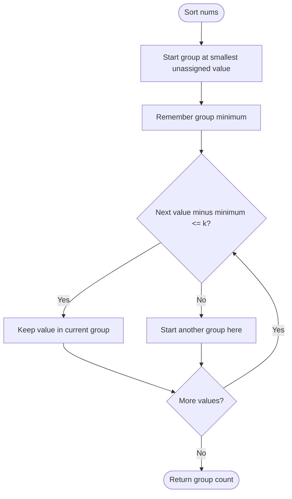

# Partition Array Such That Maximum Difference Is K — LeetCode 2294

Source: `2294.cpp` includes a sorted greedy solution and a bounded counting-array alternative.

## 1. Understanding — समजून घ्या

Partition all values into the fewest groups so that within each group, `max-min <= k`.

## 2. Worked examples and edge cases

> **मराठी:** प्रश्नात काय दिले आहे आणि नेमके काय शोधायचे आहे, हे आधी स्पष्ट करा.
> For sorted `[1,2,3,4,5]`, `k=2`: group `[1,2,3]`, then `[4,5]` → 2 groups. Duplicates fit together. A single value needs one group. The source's methods assume nonempty input.

## 3. Pattern identification + cheat sheet

> **मराठी:** या clues मुळे योग्य pattern ओळखता येतो; constraints आणि relations नीट तपासा.
> | Clue | Pattern |
> |---|---|
> | Minimize number of groups under max-min bound | Sort + greedy |
> | Group constraint depends on smallest value | Fix group minimum |
> | Values are bounded nonnegative integers | Counting array alternative |

## 4. Approaches

> **मराठी:** सोप्या उपायापासून सुरुवात करा आणि constraints नुसार योग्य optimization निवडा.
> Trying all partitions is exponential. Sorting and greedily extend each group as far as its minimum allows; this is optimal. The counting implementation is also valid under the stated value bound, but scans a fixed range up to 100000. Starting a new group at every value instead of comparing to the current minimum can over-partition.

## 5. Flowchart

> **मराठी:** Flowchart मधील decision, loop आणि termination condition क्रमाने समजून घ्या.

## 6. Algorithm and intuition

> **मराठी:** मुख्य observation समजल्यावर algorithm चे steps लक्षात ठेवणे सोपे होते.
> Sort ascending. The smallest remaining number must belong to some group; putting every following number with difference at most `k` into that group cannot hurt, and using fewer members could only leave more groups. Start a new group at the first number whose difference from this group's minimum exceeds `k`.

## 7. Code explanation

> **मराठी:** Code मधील variable आणि condition यांचा algorithm मधील उद्देश समजून घ्या.
> `SolutionSort::partitionArray` sorts `nums`, initializes one group and `MinVal=nums[0]`, then increments the group count and resets `MinVal` whenever `nums[i]-MinVal>k`. `SolutionCounting` marks frequencies in a fixed-size array and consumes each covered range.

## 8. Dry run

> **मराठी:** प्रत्येक महत्त्वाच्या step नंतर variable ची value trace करा.
> `[1,2,3,4,5], k=2`: minimum 1 accepts 2 and 3; 4 exceeds the limit, start group 2 at 4; 5 fits. Answer 2.

## 9. Complexity

> **मराठी:** Input size आणि प्रत्येक operation कितीदा चालतो यावरून complexity ठरवा.
> Sort method: **O(n log n)** time, O(1) auxiliary space aside from sort implementation. Counting method: **O(n+U)** time and **O(U)** space for value range `U=100001`.

## 10. Correctness

> **मराठी:** Invariant किंवा तर्क वापरून algorithm योग्य उत्तर देतो हे समजून घ्या.
> After sorting, each group starts with its minimum. Any number at most `minimum+k` can join without violating the bound. Once a number exceeds it, it cannot fit in this group; making it the next group's minimum is the earliest possible boundary. Repeating this greedy choice yields the minimum number of groups.

## 11. Mistakes and interview traps

> **मराठी:** Boundary, duplicate आणि off-by-one cases स्वतंत्रपणे तपासा.

- Compare against group minimum, not the previous number.
- Use `>` to start a new group; difference exactly `k` is allowed.
- The counting version relies on the input value range.
- The provided methods assume at least one input element.
- Sorting mutates the input vector.

## 12. Quick revision — झटपट उजळणी

> **मराठी सारांश:** Sort करा; गटातील किमान मूल्यापासून फरक `k` पेक्षा वाढल्यास नवा गट.
> Sort; fix `start=nums[i]`; absorb while `nums[j]-start<=k`; count groups.

## 13. Related problems and variations

> **मराठी:** प्रश्नात काय दिले आहे आणि नेमके काय शोधायचे आहे, हे आधी स्पष्ट करा.
> Minimum range partitioning; interval grouping; minimize groups with bounded spread; use coordinate compression when values are not in a small range.

## 14. Self-assessment

> **मराठी:** उत्तर न पाहता प्रश्न सोडवा आणि तुमच्या निवडीचे कारण सांगा.

1. Why compare every value to the group minimum?
2. Is a difference equal to `k` allowed?
3. What input assumption does the counting method need?
