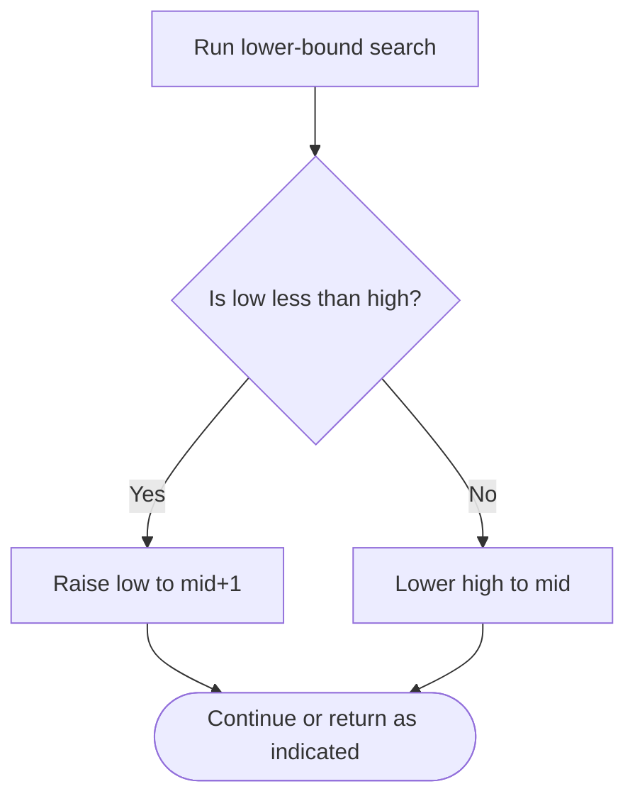

# Successful Pairs of Spells and Potions — LeetCode 2300

## Problem and judge interface

vector<int> successfulPairs(vector<int>& spells, vector<int>& potions, long long success); count qualifying potions for each spell.

## Identification evidence

Sorting potions and finding a per-spell product threshold via binary search uniquely matches problem 2300.

## Main flow

```mermaid
flowchart TD
 A([Start]) --> B[Sort potions ascending]
 B --> C[For each spell, compute threshold and lower bound]
 C --> D{Is potion[mid] below threshold?}
 D -- Yes --> E[Move low past midpoint]
 D -- No --> F[Keep midpoint in possible suffix]
 E --> G{More work remains?}
 F --> G
 G -- Yes --> C
 G -- No --> H([Return result])
```

## Important branch / loop



## Core logic and invariants

For each positive spell, compute ceil(success/spell), binary-search the first potion reaching that threshold, and count the sorted suffix. The source sorts potions in place.

## Complexity

For P potions and S spells: O(P log P + S log P) time and O(S) result space.

## Comparison and optimization

Binary search replaces an all-pairs scan; potions is mutated by sorting.

## Compile and run

The `.cpp` is the original standalone source, including its local `main()` demonstration where present. Compile and run from the repository root with a C++17 compiler:

```text
g++ -std=c++17 LeetCode\2300\2300.cpp -o solution.exe
.\solution.exe
```

For LeetCode, adapt the implementation to the required class/method signature and omit the local `main()` and demonstration helpers; use the judge-provided node types. Notes above identify method-name or behavior differences. The moved source bytes have not been edited.
