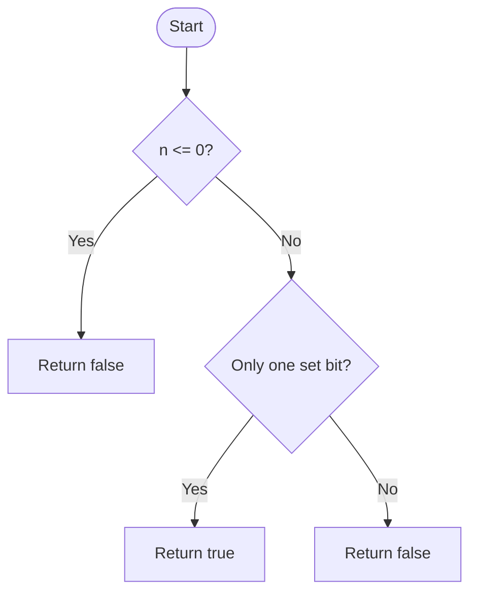

# Power of Two — LeetCode 231

## 1. Understanding

दिलेला signed integer positive power of two आहे का ते तपासा: `1,2,4,8,...`. Zero आणि negative numbers false.

## 2. Worked examples and edges

- `1=2^0`, `1024=2^10` → true.
- `3`, `0`, `-2` → false.
- Positive power of twoच्या binary representationमध्ये एकच set bit असतो.

## 3. Pattern identification + cheat sheet

| Clue                             | Pattern           | कारण                               |
| -------------------------------- | ----------------- | ---------------------------------- |
| Repeated multiplication/division | Number theory     | Powers sequence                    |
| Exactly one set bit              | Bit manipulation  | `n & (n-1)` bit clear करतो         |
| Positive input guard             | Boundary handling | 0 वर bit identityही true दिसू शकते |

## 4. Approaches

- Iterative doubling: O(log n) time/O(1) space; source method.
- Recursive doubling: O(log n) time, O(log n) stack; source method.
- Bitwise `n>0 && (n&(n-1))==0`: O(1), O(1), optimal source method.
- `n>0` guard नसलेली bit test 0ला चुकून true देईल.

## 5. Flowchart

Positive power-of-twoमध्ये एक set bit, बाकी zero असतात.

## 6. Algorithm / intuition

Binary `n-1` हा lowest set bit आणि त्याखालील bits बदलतो. Power of twoमध्ये `n` आणि `n-1` यांचे set bits overlap होत नाहीत; म्हणून AND zero.

## 7. Code explanation

`isPowerOfTwo_iterative` powers generate करतो; `recursiveHelper` current power double करतो; `isPowerOfTwo_bitwise` concise test. Recursive public method आधी `n<=0` reject करतो.

## 8. Dry run

> **मराठी:** प्रत्येक महत्त्वाच्या step नंतर variable ची value trace करा.
> `n=8 (1000₂)`:
> | value | binary | result |
> |---:|---|---|
> | n | `1000` | |
> | n-1 | `0111` | |
> | AND | `0000` | one set bit; true |
> `n=12 (1100₂)`, `n-1=1011₂`, AND=`1000₂` → false.

## 9. Complexity

> **मराठी:** Input size आणि प्रत्येक operation कितीदा चालतो यावरून complexity ठरवा.
> Bitwise O(1) time/O(1) space; iterative O(log n); recursive O(log n) stack.

## 10. Correctness

Positive integer power of twoचे binary representation exactly one set bit असते; subtract oneने तो bit clear व lower bits set होतात, त्यामुळे AND zero. दोन किंवा अधिक set bits असतील तर highest shared set bit उरतो, त्यामुळे AND nonzero.

## 11. Mistakes and interview traps

- `n=0` special: guard अनिवार्य.
- Signed negative values reject करा.
- Source iterative `long long` वापरते, त्यामुळे `2^31` पर्यंत generation सुरक्षित.
- Bit trick power of fourला थेट लागू नाही; bit position constraint वेगळी.

## 12. Quick revision

> **मराठी:** दोन मिनिटांच्या revision साठी pattern, मुख्य कल्पना आणि complexity आठवा.
> Positive check + `(n & (n-1)) == 0`.

## 13. Related problems / variations

> **मराठी:** प्रश्नात काय दिले आहे आणि नेमके काय शोधायचे आहे, हे आधी स्पष्ट करा.
> Power of Three, Power of Four, Count Set Bits, Hamming weight.

## 14. Self-assessment

1. `n&(n-1)` काय करतो?
2. 0 positive guard शिवाय का problem?
3. `12` power of two का नाही?
4. Power of fourला अजून कोणती condition लागते?
