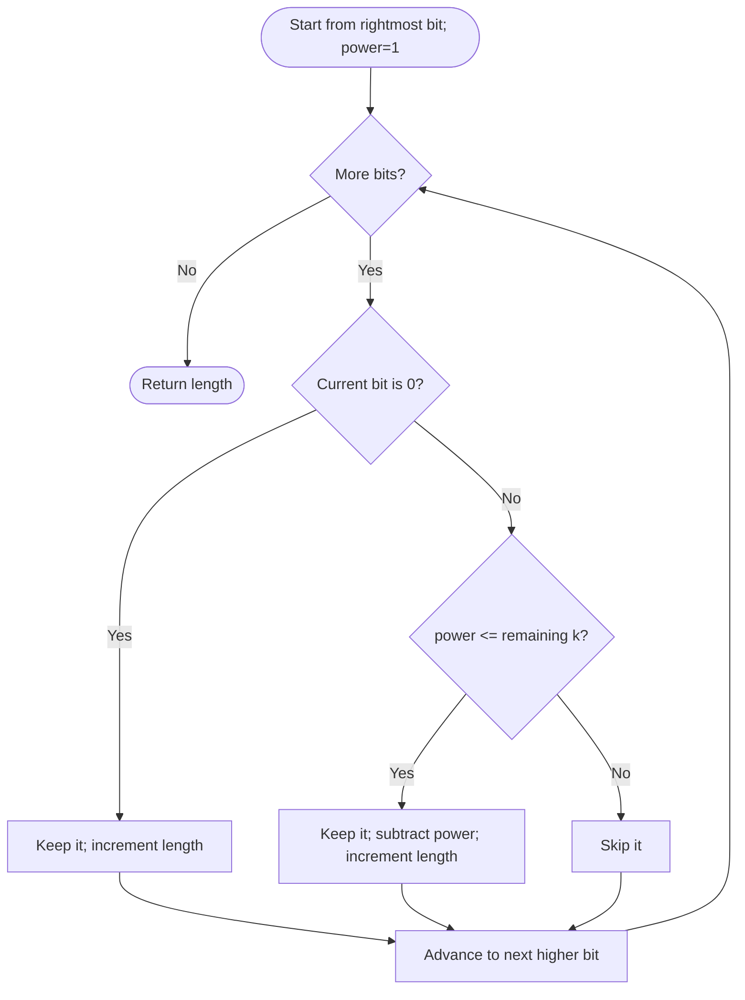

# Longest Binary Subsequence Less Than or Equal to K — LeetCode 2311

Source: `2311.cpp` contains a recursive take/skip method and `longestSubsequenceGreedy`, the linear-time greedy method.

## 1. Understanding — समजून घ्या

Delete any characters from a binary string, preserving order, so the resulting binary number is at most `k`; maximize its length. Leading zeroes are allowed and count toward length.

## 2. Worked examples and edge cases

> **मराठी:** प्रश्नात काय दिले आहे आणि नेमके काय शोधायचे आहे, हे आधी स्पष्ट करा.
> For `"1001010", k=5`, keep all useful zeroes and low-place ones while staying within 5. If `k=0`, every zero can be kept and every one must be skipped. All-zero strings are entirely valid.

## 3. Pattern identification + cheat sheet

> **मराठी:** या clues मुळे योग्य pattern ओळखता येतो; constraints आणि relations नीट तपासा.
> | Bit position | Greedy decision |
> |---|---|
> | Scan from right to left | Low bits first |
> | `0` contributes no value | Always keep |
> | `1` has current place value | Keep if it fits remaining `k` |
> Pattern: **greedy by positional weight**.

## 4. Approaches

> **मराठी:** सोप्या उपायापासून सुरुवात करा आणि constraints नुसार योग्य optimization निवडा.
> The source's recursive method explores take/skip choices and has exponential worst-case time without memoization. Greedy is optimal: every zero is free, while ones farther left are more expensive. A subsequence whose value is too large can discard high-order ones, but must preserve order.

## 5. Flowchart

> **मराठी:** Flowchart मधील decision, loop आणि termination condition क्रमाने समजून घ्या.

## 6. Algorithm and intuition

> **मराठी:** मुख्य observation समजल्यावर algorithm चे steps लक्षात ठेवणे सोपे होते.
> Scan from least significant end. Keep every zero because it adds length without increasing numeric value. Keep a one only if its place value fits in the remaining budget; subtract it when accepted. Double the place value as the scan moves left. Once a place exceeds the remaining budget, higher ones cannot fit.

## 7. Code explanation

> **मराठी:** Code मधील variable आणि condition यांचा algorithm मधील उद्देश समजून घ्या.
> `longestSubsequenceGreedy` tracks `length`, `powerValue`, and a shrinking `k`. `longestSubsequenceRecursive` uses take/skip recursion with fixed source-position weights; it is a reference implementation, but it does not memoize states and is much slower. The executable calls both on sample inputs.

## 8. Dry run

> **मराठी:** प्रत्येक महत्त्वाच्या step नंतर variable ची value trace करा.
> For `s="101", k=2`: scan right-to-left: `1` at power 1 fits → length 1, remaining 1; `0` kept → length 2; next `1` has power 2 > remaining 1, skip. Answer 2 (`"01"`).

## 9. Complexity

> **मराठी:** Input size आणि प्रत्येक operation कितीदा चालतो यावरून complexity ठरवा.
> Greedy: **O(n)** time, **O(1)** extra space. Recursive source: **O(2ⁿ)** worst-case time and **O(n)** recursion stack.

## 10. Correctness

> **मराठी:** Invariant किंवा तर्क वापरून algorithm योग्य उत्तर देतो हे समजून घ्या.
> Zeros never increase the represented value, so keeping them cannot hurt feasibility and maximizes length. For one bits, lower positions have lower cost; if a higher-position one is affordable, taking it gives one extra character, while taking it when unaffordable would violate the remaining value budget. Scanning low-to-high therefore makes the best feasible choices.

## 11. Mistakes and interview traps

> **मराठी:** Boundary, duplicate आणि off-by-one cases स्वतंत्रपणे तपासा.

- Scan from right to left; rightmost bits are cheapest.
- Keep zeros even when `k=0`.
- A one is tested against current remaining budget, then its weight is subtracted.
- Leading zeroes count toward subsequence length.
- Do not let `powerValue` grow without bound; the source only shifts while it is within budget.

## 12. Quick revision — झटपट उजळणी

> **मराठी सारांश:** उजवीकडून सुरुवात करा; zero ठेवा, परवडणारा one ठेवा.
> Right-to-left: keep every zero; keep a one if its place value fits; update budget and length.

## 13. Related problems and variations

> **मराठी:** प्रश्नात काय दिले आहे आणि नेमके काय शोधायचे आहे, हे आधी स्पष्ट करा.
> Longest subsequence under a numeric bound; binary knapsack with positional weights; minimum deletions to fit a number; greedy selection by increasing item cost.

## 14. Self-assessment

> **मराठी:** उत्तर न पाहता प्रश्न सोडवा आणि तुमच्या निवडीचे कारण सांगा.

1. Why can every zero be kept?
2. Why scan from the least significant bit?
3. What is the runtime issue with the recursive method?
