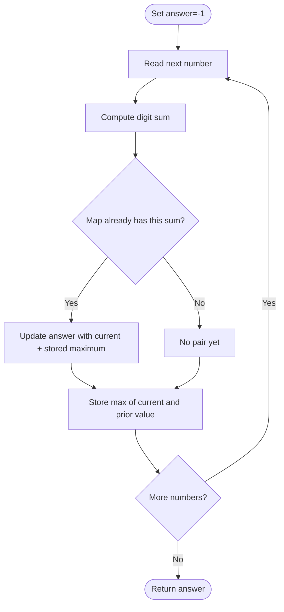

# Max Sum of a Pair With Equal Sum of Digits — LeetCode 2342

Source: `2342.cpp`; it maps each digit sum to the largest previously seen number with that sum.

## 1. Understanding — समजून घ्या

Choose two different array elements with equal digit sums and maximize their sum. Return `-1` if no valid pair exists.

## 2. Worked examples and edge cases

> **मराठी:** प्रश्नात काय दिले आहे आणि नेमके काय शोधायचे आहे, हे आधी स्पष्ट करा.
> For `[18,43,36,13,7]`, digit sum 9 occurs for 18 and 36, giving 54; digit sum 7 occurs for 43 and 7, giving 50. Answer is 54. A value cannot pair with itself; one occurrence in a digit-sum group is insufficient.

## 3. Pattern identification + cheat sheet

> **मराठी:** या clues मुळे योग्य pattern ओळखता येतो; constraints आणि relations नीट तपासा.
> | Clue | Pattern |
> |---|---|
> | Pair key is a derived property | Hash map by digit sum |
> | Need best pair sum | Keep largest prior value per key |
> | Process each value once | Streaming aggregation |

## 4. Approaches

> **मराठी:** सोप्या उपायापासून सुरुवात करा आणि constraints नुसार योग्य optimization निवडा.
> Brute force checks all pairs in O(n²). Grouping values by digit sum then sorting is valid but unnecessary. The streaming map is expected O(n): each new value pairs with the largest previous value sharing its digit sum.

## 5. Flowchart

> **मराठी:** Flowchart मधील decision, loop आणि termination condition क्रमाने समजून घ्या.

## 6. Algorithm and intuition

> **मराठी:** मुख्य observation समजल्यावर algorithm चे steps लक्षात ठेवणे सोपे होते.
> For each number, compute its digit sum. If a prior number with this sum exists, the best pair ending here uses the largest such prior number. Update the global maximum, then update the stored group maximum with the current number.

## 7. Code explanation

> **मराठी:** Code मधील variable आणि condition यांचा algorithm मधील उद्देश समजून घ्या.
> `SumOfDigit` repeatedly adds `i%10` and divides by 10. `maximumSum` uses `unordered_map<int,int> ump`; each entry stores the largest earlier number for that digit sum. `maxSum` starts at `-1`.

## 8. Dry run

> **मराठी:** प्रत्येक महत्त्वाच्या step नंतर variable ची value trace करा.
> Process 18 (sum 9): store 18. Process 36 (sum 9): candidate `36+18=54`, answer 54; map remains 36. A later sum-9 value pairs against 36, not a smaller earlier value.

## 9. Complexity

> **मराठी:** Input size आणि प्रत्येक operation कितीदा चालतो यावरून complexity ठरवा.
> For `n` numbers with at most `D` digits: expected **O(nD)** time and **O(u)** space for `u` distinct digit sums. If digit count is bounded, this is expected O(n).

## 10. Correctness

> **मराठी:** Invariant किंवा तर्क वापरून algorithm योग्य उत्तर देतो हे समजून घ्या.
> When processing a number `x`, only earlier elements can pair with it. Among earlier values with the same digit sum, the largest gives the largest possible pair sum, so the stored maximum is sufficient. Every valid pair is considered when its later element is processed; taking the global maximum finds the answer.

## 11. Mistakes and interview traps

> **मराठी:** Boundary, duplicate आणि off-by-one cases स्वतंत्रपणे तपासा.

- Compare digit sums, not the numbers themselves.
- Update the answer before replacing the stored maximum, so an element is not paired with itself.
- Initialize answer to `-1` for the no-pair case.
- Digit sum of zero is zero; problem inputs are positive.

## 12. Quick revision — झटपट उजळणी

> **मराठी सारांश:** समान digit-sum साठी आधीचा सर्वात मोठा अंक साठवा.
> For each `x`: `s=digitSum(x)`; if seen, update answer with `x+best[s]`; set `best[s]=max(best[s],x)`.

## 13. Related problems and variations

> **मराठी:** प्रश्नात काय दिले आहे आणि नेमके काय शोधायचे आहे, हे आधी स्पष्ट करा.
> Group by digit sum; maximum-sum pair by a computed key; group by character frequency or remainder; maintain top two values per bucket.

## 14. Self-assessment

> **मराठी:** उत्तर न पाहता प्रश्न सोडवा आणि तुमच्या निवडीचे कारण सांगा.

1. Why store only the largest previous number for each sum?
2. Why is the answer updated before the map maximum?
3. What value signals that no pair exists?
