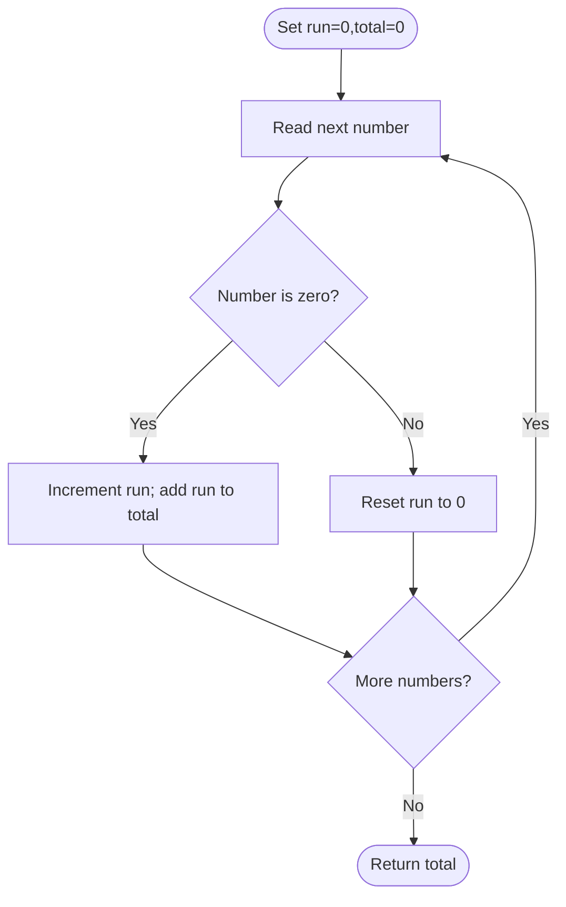

# Number of Zero-Filled Subarrays — LeetCode 2348

Source: `2348.cpp`; it counts zero-only subarrays ending at each position.

## 1. Understanding — समजून घ्या

Count all nonempty contiguous subarrays whose elements are all zero.

## 2. Worked examples and edge cases

> **मराठी:** प्रश्नात काय दिले आहे आणि नेमके काय शोधायचे आहे, हे आधी स्पष्ट करा.
> A run of three zeroes has `3+2+1=6` zero-filled subarrays. `[0,0,1,0]` has 3 from the first run and 1 from the last, total 4. No zeroes gives 0; a single zero gives 1.

## 3. Pattern identification + cheat sheet

> **मराठी:** या clues मुळे योग्य pattern ओळखता येतो; constraints आणि relations नीट तपासा.
> | Clue | Pattern |
> |---|---|
> | Contiguous all-zero ranges | Consecutive run |
> | Count subarrays ending at current index | Rolling DP |
> | Run length `r` | Add `r` new subarrays |

## 4. Approaches

> **मराठी:** सोप्या उपायापासून सुरुवात करा आणि constraints नुसार योग्य optimization निवडा.
> Enumerating all subarrays and checking elements can take O(n²). One can first find zero-run lengths and sum triangular numbers; the source does the same incrementally in O(n) time/O(1) space.

## 5. Flowchart

> **मराठी:** Flowchart मधील decision, loop आणि termination condition क्रमाने समजून घ्या.

## 6. Algorithm and intuition

> **मराठी:** मुख्य observation समजल्यावर algorithm चे steps लक्षात ठेवणे सोपे होते.
> Maintain the length `count` of the zero run ending at the current position. If the current value is zero, extend the run; each suffix of that run is a new valid subarray, so add `count`. A nonzero value ends the run.

## 7. Code explanation

> **मराठी:** Code मधील variable आणि condition यांचा algorithm मधील उद्देश समजून घ्या.
> `zeroFilledSubarray` stores `res` and `count` as `long long`. For a zero, `res += ++count`; otherwise it resets `count=0`. `main` exercises empty and several run patterns.

## 8. Dry run

> **मराठी:** प्रत्येक महत्त्वाच्या step नंतर variable ची value trace करा.
> For `[0,0,0]`: counts after each item are 1, 2, 3; additions are 1, 2, 3; total is 6.

## 9. Complexity

> **मराठी:** Input size आणि प्रत्येक operation कितीदा चालतो यावरून complexity ठरवा.
> **O(n)** time and **O(1)** extra space. `long long` is needed because the number of subarrays can be quadratic.

## 10. Correctness

> **मराठी:** Invariant किंवा तर्क वापरून algorithm योग्य उत्तर देतो हे समजून घ्या.
> At each zero, exactly `count` zero-only subarrays end there: one for each possible start within the current consecutive zero run. At a nonzero, no zero-only subarray can end there, and future runs start fresh. Summing contributions counts every valid subarray once by its endpoint.

## 11. Mistakes and interview traps

> **मराठी:** Boundary, duplicate आणि off-by-one cases स्वतंत्रपणे तपासा.

- Add the current run length, not just one per zero.
- Reset run length at every nonzero.
- Count contiguous subarrays, not subsequences.
- Use 64-bit total for long runs.

## 12. Quick revision — झटपट उजळणी

> **मराठी सारांश:** zero आल्यावर run वाढवा आणि ती लांबी उत्तरात जोडा.
> On zero: `run++`, `answer += run`; otherwise `run=0`.

## 13. Related problems and variations

> **मराठी:** प्रश्नात काय दिले आहे आणि नेमके काय शोधायचे आहे, हे आधी स्पष्ट करा.
> Count all-one subarrays; count subarrays with a target property; sum triangular numbers for runs; count substrings ending at each position.

## 14. Self-assessment

> **मराठी:** उत्तर न पाहता प्रश्न सोडवा आणि तुमच्या निवडीचे कारण सांगा.

1. Why does a run of length `r` contribute `r` at its final element?
2. When is the run counter reset?
3. Why can the result exceed a 32-bit integer?
