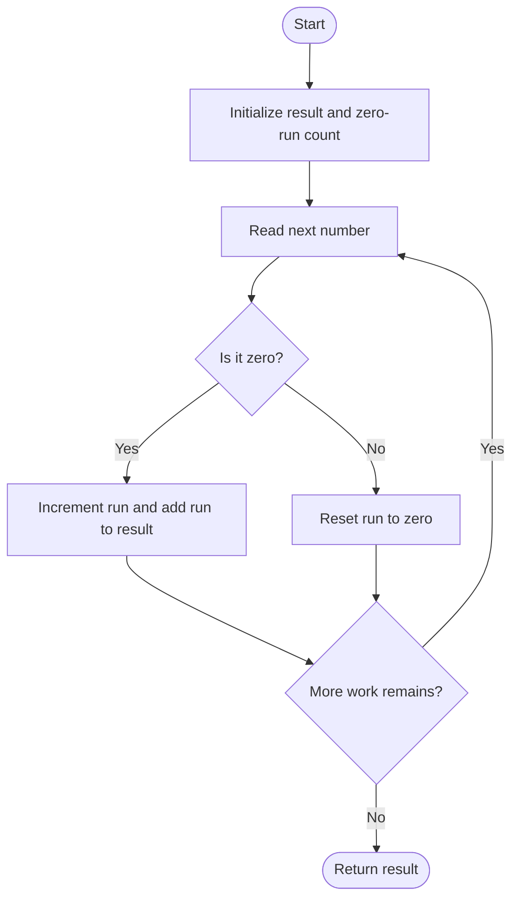
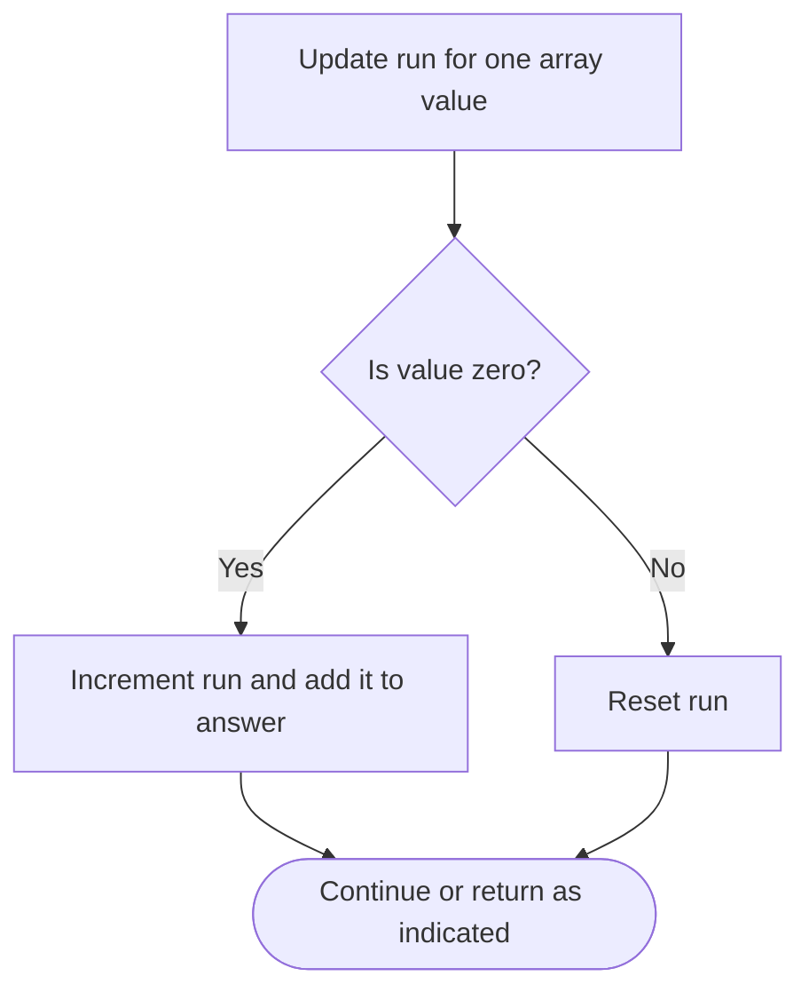

# Number of Zero-Filled Subarrays — LeetCode 2348

## Problem and judge interface

long long zeroFilledSubarray(vector<int>& nums); count contiguous nonempty all-zero subarrays.

## Identification evidence

The method adds the current zero-run length per zero and resets on nonzero, uniquely matching problem 2348.

## Main flow



## Important branch / loop



## Core logic and invariants

A zero extending a run to length r creates r subarrays ending at that index. Summing these contributions counts each zero-filled subarray once; long long holds the answer.

## Complexity

O(n) time and O(1) auxiliary space.

## Comparison and optimization

Run accumulation counts each maximal run as 1+2+...+r without enumerating subarrays.

## Compile and run

The `.cpp` is the original standalone source, including its local `main()` demonstration where present. Compile and run from the repository root with a C++17 compiler:

```text
g++ -std=c++17 LeetCode\2348\2348.cpp -o solution.exe
.\solution.exe
```

For LeetCode, adapt the implementation to the required class/method signature and omit the local `main()` and demonstration helpers; use the judge-provided node types. Notes above identify method-name or behavior differences. The moved source bytes have not been edited.
