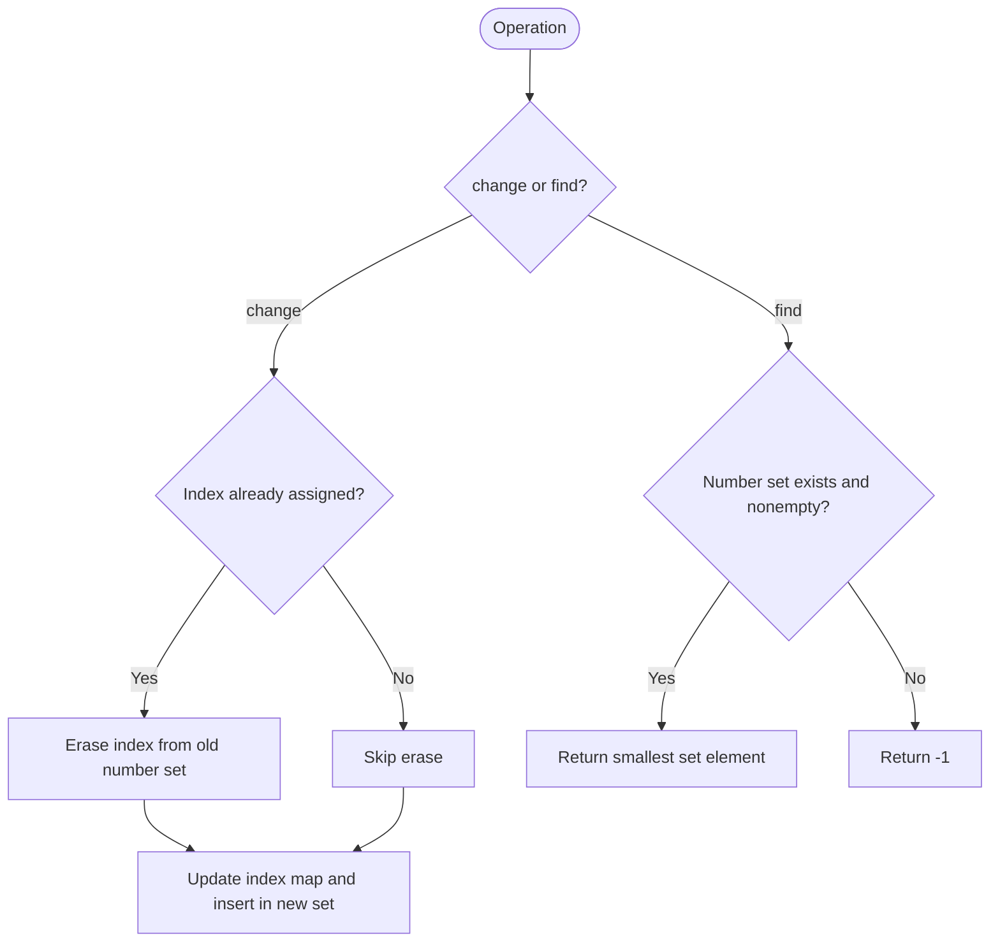

# Design a Number Container System — LeetCode 2349

Source: `2349.cpp`; it stores index-to-number mappings and an ordered set of indices for each number.

## 1. Understanding — समजून घ्या

Support `change(index,number)` and `find(number)`. A change overwrites any existing number at that index. Find returns the smallest index currently storing the requested number, or `-1`.

## 2. Worked examples and edge cases

> **मराठी:** प्रश्नात काय दिले आहे आणि नेमके काय शोधायचे आहे, हे आधी स्पष्ट करा.
> After `change(2,10)`, `change(1,10)`, `find(10)` returns 1. Then `change(1,20)` removes index 1 from number 10's set, so `find(10)` returns 2. Finding a number never assigned returns `-1`.

## 3. Pattern identification + cheat sheet

> **मराठी:** या clues मुळे योग्य pattern ओळखता येतो; constraints आणि relations नीट तपासा.
> | Operation | Data structure |
> |---|---|
> | Overwrite by index | Index → current value map |
> | Find smallest index for value | Value → ordered set of indices |
> | Remove stale association | Update both directions |

## 4. Approaches

> **मराठी:** सोप्या उपायापासून सुरुवात करा आणि constraints नुसार योग्य optimization निवडा.
> Scanning every index on each `find` is O(n) per query. A number-to-min-heap with lazy deletion can also work, but needs stale-entry cleanup. The source uses ordered sets, giving direct access to the smallest current index; remember to erase the old mapping on change.

## 5. Flowchart

> **मराठी:** Flowchart मधील decision, loop आणि termination condition क्रमाने समजून घ्या.

## 6. Algorithm and intuition

> **मराठी:** मुख्य observation समजल्यावर algorithm चे steps लक्षात ठेवणे सोपे होते.
> Maintain two synchronized views: `indexToNumber` tells what an index currently stores; `numberToIndices` lists all indices currently storing each number in sorted order. A change removes the old association before inserting the new one. The set's first element is the smallest index.

## 7. Code explanation

> **मराठी:** Code मधील variable आणि condition यांचा algorithm मधील उद्देश समजून घ्या.
> The source uses `map<int,int>` for index assignments and `unordered_map<int,set<int>>` for number buckets. `change` is a no-op if the same value is assigned again. `find` returns `*begin()` only when the bucket exists and is nonempty.

## 8. Dry run

> **मराठी:** प्रत्येक महत्त्वाच्या step नंतर variable ची value trace करा.
> `change(2,10)` → set 10 is `{2}`. `change(1,10)` → `{1,2}`. `find(10)` → 1. `change(1,20)` → remove 1 from 10, add to 20; `find(10)` → 2.

## 9. Complexity

> **मराठी:** Input size आणि प्रत्येक operation कितीदा चालतो यावरून complexity ठरवा.
> `change`: **O(log n)** due to `map` update and ordered-set insert/erase; hash bucket lookup is expected O(1). `find`: **O(1)** to access the set's first element on average, plus expected hash lookup. Space is **O(n)** stored assignments.

## 10. Correctness

> **मराठी:** Invariant किंवा तर्क वापरून algorithm योग्य उत्तर देतो हे समजून घ्या.
> After every change, the index map records the latest value and each value's set contains exactly the indices currently assigned to it: old membership is erased, new membership inserted. Since each set is ordered, its first element is exactly the smallest matching index; empty/missing sets correctly return `-1`.

## 11. Mistakes and interview traps

> **मराठी:** Boundary, duplicate आणि off-by-one cases स्वतंत्रपणे तपासा.

- Remove an index from its old value's set before inserting its new value.
- Do not duplicate an index on repeated same-value changes.
- Empty sets may remain in the hash map; `find` must check emptiness.
- Returning any matching index is insufficient—the smallest is required.
- Keep both mappings consistent across overwrites.

## 12. Quick revision — झटपट उजळणी

> **मराठी सारांश:** जुनी नोंद काढा, नवीन जोडा; set मधील पहिला index सर्वात लहान.
> Two-way state: index→number, number→ordered indices. Change erases old and inserts new; find returns set minimum.

## 13. Related problems and variations

> **मराठी:** प्रश्नात काय दिले आहे आणि नेमके काय शोधायचे आहे, हे आधी स्पष्ट करा.
> Design indexed maps; maintain minimum key per category; lazy-deletion heaps; add `remove(index)` or return all indices for a number.

## 14. Self-assessment

> **मराठी:** उत्तर न पाहता प्रश्न सोडवा आणि तुमच्या निवडीचे कारण सांगा.

1. Why are two mappings needed?
2. What must `change` do when an index is reassigned?
3. How does the set ensure `find` returns the minimum index?
