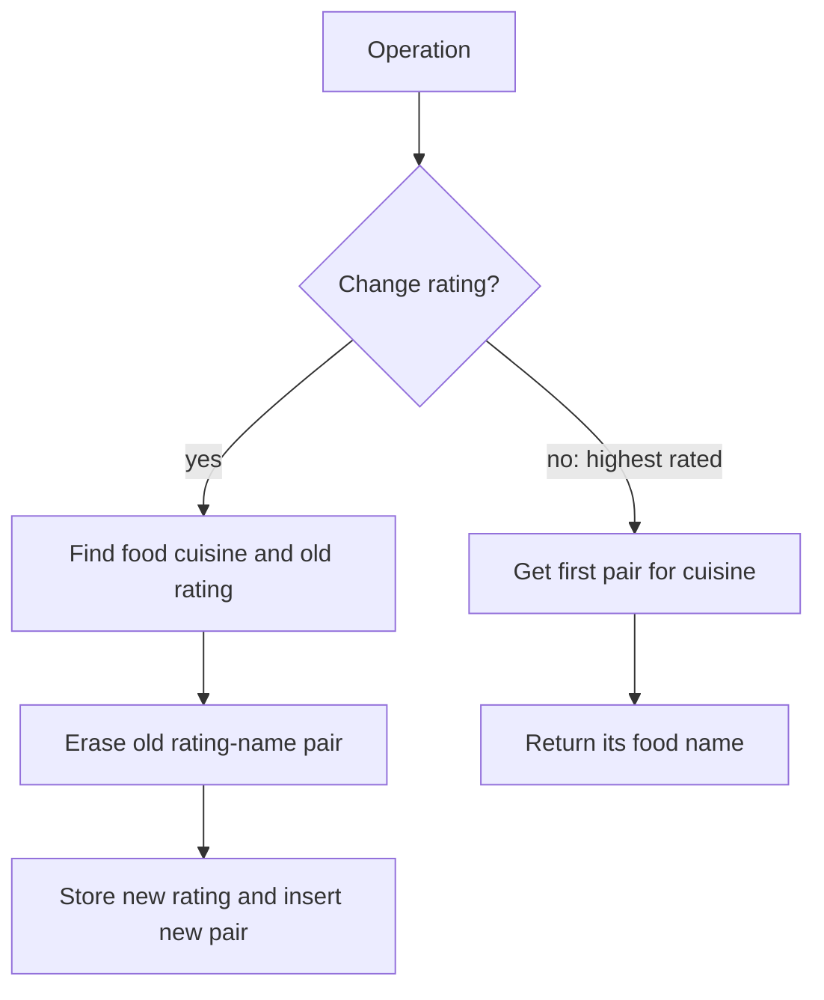

# 2353 — Design a Food Rating System

## 1. Understanding

या प्रश्नाचा गाभा म्हणजे cuisine नुसार सर्वोच्च rating असलेले food शोधणे.

> **मराठी:** प्रश्नात काय दिले आहे आणि नेमके काय शोधायचे आहे, हे आधी स्पष्ट करा.
> Store each food's cuisine and rating. `changeRating(food,newRating)` updates it; `highestRated(cuisine)` returns that cuisine's highest-rated food, breaking ties by lexicographically smaller name. The source uses three ordered maps and a set per cuisine.

## 2. Worked examples and edge cases

उदाहरणे आणि सीमाप्रकरणांत cuisine नुसार सर्वोच्च rating असलेले food शोधणे कशी लागू होते ते पाहा.

> **मराठी:** उदाहरणातील input पासून output पर्यंत प्रत्येक बदल समजून घ्या.
> If cuisine `Japanese` has `Sushi:4` and `Ramen:4`, highest is `Ramen` because the names tie-break alphabetically. After changing Sushi to 6, Sushi wins. A cuisine's set must contain one current `(rating, food)` entry per food.

## 3. Pattern identification + cheat sheet

येथे मुख्य pattern म्हणजे rating आणि नावावर क्रमबद्ध set ठेवणे; वरील तुलना लक्षात घ्या.

> **मराठी:** या clues मुळे योग्य pattern ओळखता येतो; constraints आणि relations नीट तपासा.
> This is an **ordered ranking / mutable key** design problem. Ratings change, but a top-item query must remain fast.
> | Requirement | Representation |
> |---|---|
> | Food's current rating | `foodrate` map |
> | Food's cuisine | `foodcui` map |
> | Cuisine ranking | set of `(-rating, food)` pairs |

## 4. Approaches

पद्धतींची तुलना करताना rating आणि नावावर क्रमबद्ध set ठेवणे याचा वेळ आणि जागेवरील परिणाम पाहा.

> **मराठी:** सोप्या उपायापासून सुरुवात करा आणि constraints नुसार योग्य optimization निवडा.

- Scan all foods on every query: brute force, `O(F)` per query.
- Sort once: incorrect after ratings change unless resorted.
- Update a cuisine's ordered set on every rating change: appropriate efficient design used here.

## 5. Flowchart

आकृतीमध्ये rating आणि नावावर क्रमबद्ध set ठेवणे ही प्रक्रिया क्रमाने दाखवली आहे.

> **मराठी:** Flowchart मध्ये प्रत्येक decision, loop आणि loop कधी थांबतो ते पाहा.

Negative ratings sort from highest actual score to lowest; pair ordering then sorts equal ratings by food name.

## 6. Algorithm and intuition

मूळ कल्पना: rating आणि नावावर क्रमबद्ध set ठेवणे.

> **मराठी:** मुख्य observation समजल्यावर algorithm चे steps लक्षात ठेवणे सोपे होते.
> The set stores `(-rating, food)`. Since sets sort ascending, the most negative rating (highest score) comes first. If scores tie, the second pair member gives the lexicographically smallest name. On update, erase the old pair before inserting the new one.

## 7. Code explanation

Code मधील state आणि updates हे rating आणि नावावर क्रमबद्ध set ठेवणे या कल्पनेशी जोडून वाचा.

> **मराठी:** Code मधील variable आणि condition यांचा algorithm मधील उद्देश समजून घ्या.
> The constructor fills both food lookups and each cuisine set. `changeRating` uses food-to-cuisine and food-to-rating maps to find and erase the exact old pair, then updates and reinserts. `highestRated` returns `begin()->second`. This standalone file includes `main`; judge submissions generally require the class only.

## 8. Dry run

Dry run मध्ये rating आणि नावावर क्रमबद्ध set ठेवणे कसे घडते ते प्रत्येक टप्प्यावर तपासा.

> **मराठी:** प्रत्येक महत्त्वाच्या step नंतर variable ची value trace करा.
> | State/operation | Japanese set (ordered) | Answer |
> |---|---|---|
> | Initialize Sushi 4, Ramen 4 | `{(-4,Ramen),(-4,Sushi)}` | — |
> | `highestRated("Japanese")` | same | `Ramen` |
> | `changeRating("Sushi",6)` | `{(-6,Sushi),(-4,Ramen)}` | — |
> | `highestRated("Japanese")` | same | `Sushi` |

## 9. Complexity

rating आणि नावावर क्रमबद्ध set ठेवणे यासाठी लागणारा वेळ आणि अतिरिक्त जागा वरील bounds मध्ये दिली आहेत.

> **मराठी:** Input size आणि प्रत्येक operation कितीदा चालतो यावरून complexity ठरवा.
> Let `F` be food count. Ordered-map lookups and set erase/insert are `O(log F)`; `highestRated` is `O(log C)` to access the cuisine map plus `O(1)` for its first set element. Space is `O(F)`.

## 10. Correctness

योग्यतेचा युक्तिवाद rating आणि नावावर क्रमबद्ध set ठेवणे यावर आधारित आहे; वरील अटी तपासा.

> **मराठी:** Invariant किंवा तर्क वापरून algorithm योग्य उत्तर देतो हे समजून घ्या.
> Initially each food appears once with its current rating in its cuisine set. For an update, removing the exact old pair and inserting the replacement restores that invariant. The first pair minimizes `(-rating, name)`, exactly maximizing rating and then minimizing name.

## 11. Mistakes and interview traps

लक्षात ठेवा: rating समान असल्यास lexicographically लहान नाव निवडायचे.

> **मराठी:** Boundary, duplicate आणि off-by-one cases स्वतंत्रपणे तपासा.

- Storing positive ratings in an ascending set would put the lowest first.
- Updating the rating map without removing the old set pair leaves stale ranking data.
- The name tie-break is handled automatically by `pair` ordering.
- The source uses `map` rather than hash maps, so lookups are logarithmic.

## 12. Quick revision

थोडक्यात, rating आणि नावावर क्रमबद्ध set ठेवणे. rating समान असल्यास lexicographically लहान नाव निवडायचे.

> **मराठी:** दोन मिनिटांच्या revision साठी pattern, मुख्य कल्पना आणि complexity आठवा.
> For sortable rank descending by rating and ascending by name, store `(-rating,name)` in each cuisine's ordered set. Replace old pair on every update.

## 13. Related problems and variations

संबंधित प्रश्नांत cuisine नुसार सर्वोच्च rating असलेले food शोधणे यासारखी अट बदलल्यास योग्य पद्धतही तपासा.

> **मराठी:** Related problem मध्ये constraints बदलल्यास approach कसा बदलेल ते विचारा.
> LeetCode 2349 (mutable minimum lookup); 2034 (stock price fluctuations); variations: top-k foods or ranking by a compound score.

## 14. Self-assessment

वरील प्रश्न स्वतः सोडवून cuisine नुसार सर्वोच्च rating असलेले food शोधणे याची उजळणी करा.

> **मराठी:** उत्तर न पाहता प्रश्न सोडवा आणि तुमच्या निवडीचे कारण सांगा.

1. Why is the rating negated?
2. Which pair field resolves equal-rating ties?
3. Why must the old entry be removed before inserting the new rating?
