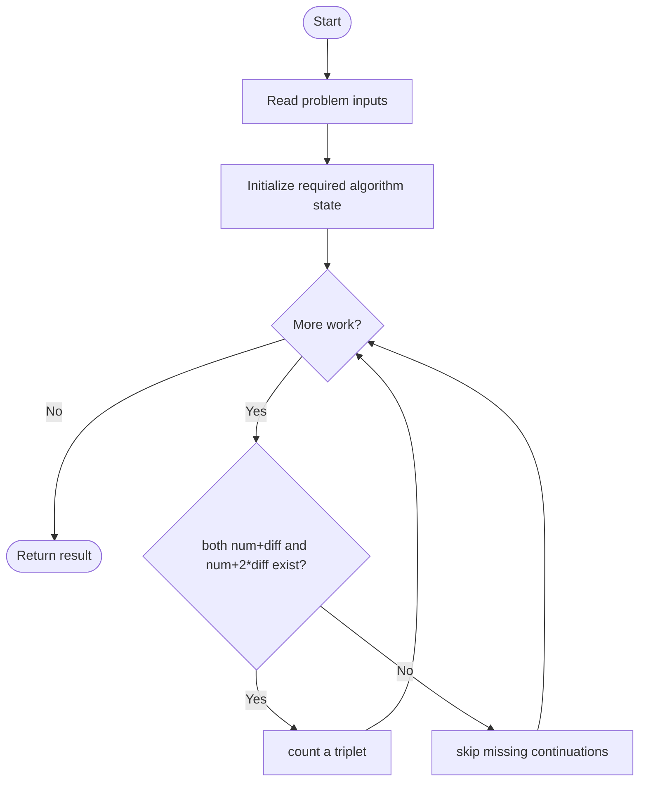
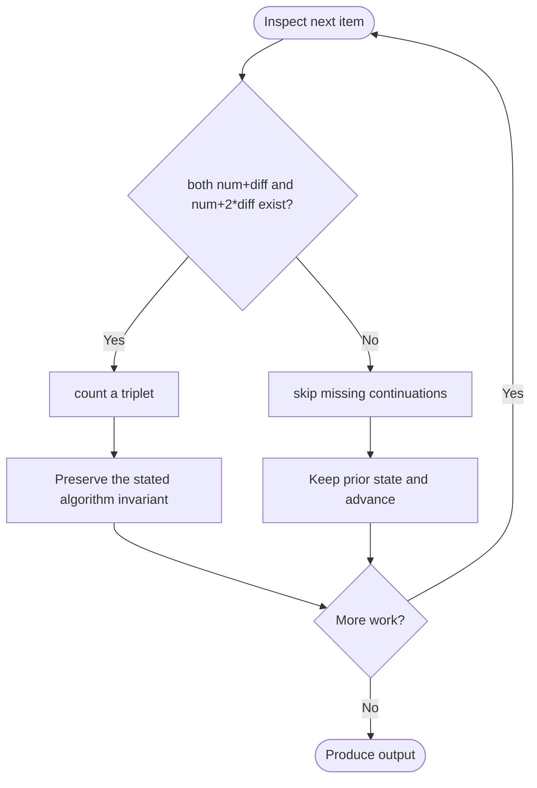

# Number of Arithmetic Triplets

**LeetCode ID:** 2367

**Source file(s):** `2367.cpp` (originally `arithmeticTriplets.cpp`)

**Identification evidence:** The original filename, declared signature, and distinctive behavior described below uniquely identify this problem; no number was inferred from a filename alone.

## Expected input/output or judge interface

arithmeticTripletsBruteForce / arithmeticTripletsOptimized(nums,diff). Inputs follow the problem constraints; the output is the documented scalar, sequence, or design-object behavior. The description below reflects the implementation actually present in the source.

## Main flow



## Important branch and loop flow



## Core logic and invariant

Counts increasing triples with consecutive differences diff; includes cubic index enumeration and hash-set checks for num+diff and num+2*diff.

The key branch/loop rule above is applied once per relevant item; the algorithm relies on that rule to preserve its state and produce the required result.

## Optimization / comparison

The set replaces nested index searches with two expected O(1) membership checks.

## Complexity

Brute force O(n^3); optimized expected O(n) time and O(n) set space.

## Compile and run

The repository file includes a standalone demonstration `main()`; it is not a raw LeetCode submission unit. From the repository root, with a C++17 compiler:

```powershell
g++ -std=c++17 LeetCode\2367\2367.cpp -o solution.exe
.\solution.exe
```

For LeetCode's class-method judge, copy the relevant class/method or design-class API and omit the demo `main()` and local harness. Adapt free-function implementations to the requested `Solution` class signature where necessary. See the source caveat above for any compile blocker.
