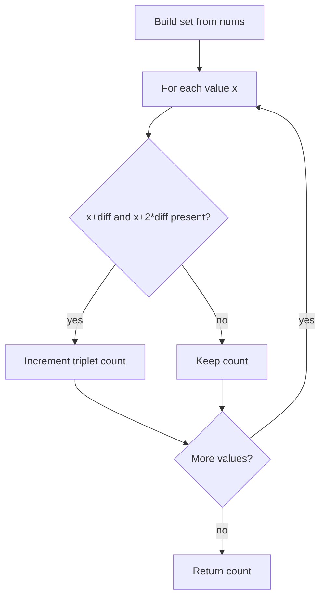

# 2367 — Number of Arithmetic Triplets

## 1. Understanding

या प्रश्नाचा गाभा म्हणजे समान फरक असलेल्या arithmetic triples ची मोजणी.

> **मराठी:** प्रश्नात काय दिले आहे आणि नेमके काय शोधायचे आहे, हे आधी स्पष्ट करा.
> Count triples of indices `i < j < k` such that `nums[j]-nums[i] == diff` and `nums[k]-nums[j] == diff`. The source includes cubic and hash-set implementations.

## 2. Worked examples and edge cases

उदाहरणे आणि सीमाप्रकरणांत समान फरक असलेल्या arithmetic triples ची मोजणी कशी लागू होते ते पाहा.

> **मराठी:** उदाहरणातील input पासून output पर्यंत प्रत्येक बदल समजून घ्या.
> For `[0,1,4,6,7,10]`, `diff=3`, the triplet `[1,4,7]` qualifies; `[0,3,6]` would qualify only if 3 were present. If `diff=0`, distinct increasing indices can still form a valid triple only when all three values are equal (the problem's input is strictly increasing, so none).

## 3. Pattern identification + cheat sheet

येथे मुख्य pattern म्हणजे पहिल्या मूल्यावरून उर्वरित दोन मूल्ये शोधणे; वरील तुलना लक्षात घ्या.

> **मराठी:** या clues मुळे योग्य pattern ओळखता येतो; constraints आणि relations नीट तपासा.
> Look for a **fixed-difference subsequence** in a sorted/unique array. Membership queries are a good fit for a hash set.
> | Approach | Work | Use |
> |---|---:|---|
> | Three nested index loops | `O(n^3)` | Direct reference/brute force |
> | Hash set + two expected `O(1)` lookups | `O(n)` expected | Source's optimized method |

## 4. Approaches

पद्धतींची तुलना करताना पहिल्या मूल्यावरून उर्वरित दोन मूल्ये शोधणे याचा वेळ आणि जागेवरील परिणाम पाहा.

> **मराठी:** सोप्या उपायापासून सुरुवात करा आणि constraints नुसार योग्य optimization निवडा.
> The brute force checks every ordered triple and is correct but slow. The optimized approach treats each value as the first member and tests whether `x+diff` and `x+2*diff` exist. A set of only indices or a sorted two-pointer variant is also possible, but unnecessary under the strictly increasing constraints.

## 5. Flowchart

आकृतीमध्ये पहिल्या मूल्यावरून उर्वरित दोन मूल्ये शोधणे ही प्रक्रिया क्रमाने दाखवली आहे.

> **मराठी:** Flowchart मध्ये प्रत्येक decision, loop आणि loop कधी थांबतो ते पाहा.

Each possible first value has at most one matching pair of values because the input values are unique.

## 6. Algorithm and intuition

मूळ कल्पना: पहिल्या मूल्यावरून उर्वरित दोन मूल्ये शोधणे.

> **मराठी:** मुख्य observation समजल्यावर algorithm चे steps लक्षात ठेवणे सोपे होते.
> Arithmetic progression values are determined by the start `x` and common difference: `x`, `x+d`, `x+2d`. Preload all values, then use membership tests instead of enumerating `j` and `k`.

## 7. Code explanation

Code मधील state आणि updates हे पहिल्या मूल्यावरून उर्वरित दोन मूल्ये शोधणे या कल्पनेशी जोडून वाचा.

> **मराठी:** Code मधील variable आणि condition यांचा algorithm मधील उद्देश समजून घ्या.
> `arithmeticTripletsBruteForce` uses increasing indices and checks both differences. `arithmeticTripletsOptimized` constructs `unordered_set<int>` and checks the two derived values for each `num`. `main` compares both versions on test cases.

## 8. Dry run

Dry run मध्ये पहिल्या मूल्यावरून उर्वरित दोन मूल्ये शोधणे कसे घडते ते प्रत्येक टप्प्यावर तपासा.

> **मराठी:** प्रत्येक महत्त्वाच्या step नंतर variable ची value trace करा.
> | `x` | `x+3` exists? | `x+6` exists? | Count |
> |---:|---|---|---:|
> | 0 | 3: no | — | 0 |
> | 1 | 4: yes | 7: yes | 1 |
> | 4 | 7: yes | 10: yes | 2 |

## 9. Complexity

पहिल्या मूल्यावरून उर्वरित दोन मूल्ये शोधणे यासाठी लागणारा वेळ आणि अतिरिक्त जागा वरील bounds मध्ये दिली आहेत.

> **मराठी:** Input size आणि प्रत्येक operation कितीदा चालतो यावरून complexity ठरवा.
> Brute force: `O(n^3)` time, `O(1)` extra space. Optimized: `O(n)` expected time and `O(n)` space; hash operations can degrade in pathological cases.

## 10. Correctness

योग्यतेचा युक्तिवाद पहिल्या मूल्यावरून उर्वरित दोन मूल्ये शोधणे यावर आधारित आहे; वरील अटी तपासा.

> **मराठी:** Invariant किंवा तर्क वापरून algorithm योग्य उत्तर देतो हे समजून घ्या.
> For every array value `x`, the set checks exactly the necessary second and third values. Since the input is strictly increasing, any present `x < x+diff < x+2diff` occurs at increasing indices. Thus each qualifying triplet is counted once, and no invalid triplet is counted.

## 11. Mistakes and interview traps

लक्षात ठेवा: मूळ अटीतील indices चा क्रम लक्षात ठेवायचा.

> **मराठी:** Boundary, duplicate आणि off-by-one cases स्वतंत्रपणे तपासा.

- Check both offsets from the same start, not only one difference.
- Do not count triples more than once by iterating over all three values.
- This set-based value reasoning relies on uniqueness/strict ordering from the problem.
- The brute-force name is useful in tests, but submit the required judge method name/signature.

## 12. Quick revision

थोडक्यात, पहिल्या मूल्यावरून उर्वरित दोन मूल्ये शोधणे. मूळ अटीतील indices चा क्रम लक्षात ठेवायचा.

> **मराठी:** दोन मिनिटांच्या revision साठी pattern, मुख्य कल्पना आणि complexity आठवा.
> For each `x`, count it when `x+d` and `x+2d` are both in the set. Expected `O(n)`.

## 13. Related problems and variations

संबंधित प्रश्नांत समान फरक असलेल्या arithmetic triples ची मोजणी यासारखी अट बदलल्यास योग्य पद्धतही तपासा.

> **मराठी:** Related problem मध्ये constraints बदलल्यास approach कसा बदलेल ते विचारा.
> LeetCode 1 (pair sum); 1218 (longest arithmetic subsequence of fixed difference); variations: count length-`m` progressions or use a frequency map when duplicates are allowed.

## 14. Self-assessment

वरील प्रश्न स्वतः सोडवून समान फरक असलेल्या arithmetic triples ची मोजणी याची उजळणी करा.

> **मराठी:** उत्तर न पाहता प्रश्न सोडवा आणि तुमच्या निवडीचे कारण सांगा.

1. Why does the set-based solution not need to store indices?
2. How does the input's strictly increasing property help?
3. What changes if duplicate values are allowed?
