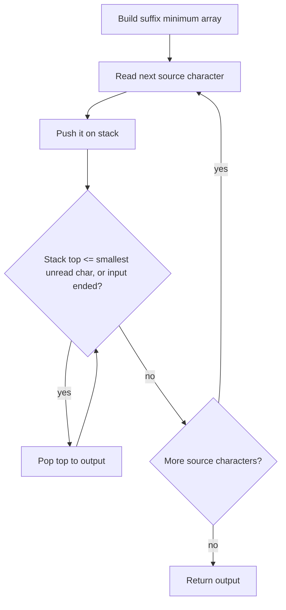

# 2434 — Using a Robot to Print the Lexicographically Smallest String

## 1. Understanding

या प्रश्नाचा गाभा म्हणजे robot च्या stack मधून सर्वात लहान lexicographic output.

> **मराठी:** प्रश्नात काय दिले आहे आणि नेमके काय शोधायचे आहे, हे आधी स्पष्ट करा.
> Characters arrive from `s` into a stack; at any point, the robot may pop the stack top into the output. Choose pushes and pops to make the output lexicographically smallest.

## 2. Worked examples and edge cases

उदाहरणे आणि सीमाप्रकरणांत robot च्या stack मधून सर्वात लहान lexicographic output कशी लागू होते ते पाहा.

> **मराठी:** उदाहरणातील input पासून output पर्यंत प्रत्येक बदल समजून घ्या.
> For `"zza"`, keep the `z`s while waiting for `a`; pop `a` first, then the `z`s, giving `"azz"`. For `"abc"`, each character can be emitted as soon as possible. A one-character string returns itself.

## 3. Pattern identification + cheat sheet

येथे मुख्य pattern म्हणजे उर्वरित suffix मधील किमान अक्षराशी stack top ची तुलना करणे; वरील तुलना लक्षात घ्या.

> **मराठी:** या clues मुळे योग्य pattern ओळखता येतो; constraints आणि relations नीट तपासा.
> This is **greedy + stack + suffix minimum**. A stack constrains output order; future minimum character determines whether waiting can improve the next output.
> | Question | Data |
> |---|---|
> | Smallest character still to come | `minChar[i]` suffix array |
> | Character that must come out last-in-first-out | stack |
> | Safe pop condition | stack top `<=` minimum remaining suffix char |

## 4. Approaches

पद्धतींची तुलना करताना उर्वरित suffix मधील किमान अक्षराशी stack top ची तुलना करणे याचा वेळ आणि जागेवरील परिणाम पाहा.

> **मराठी:** सोप्या उपायापासून सुरुवात करा आणि constraints नुसार योग्य optimization निवडा.
> Trying every push/pop sequence is exponential. Greedily popping every character is incorrect (e.g. `"zza"`). The suffix-minimum rule is optimal because it delays a larger top only while a smaller character can still arrive.

## 5. Flowchart

आकृतीमध्ये उर्वरित suffix मधील किमान अक्षराशी stack top ची तुलना करणे ही प्रक्रिया क्रमाने दाखवली आहे.

> **मराठी:** Flowchart मध्ये प्रत्येक decision, loop आणि loop कधी थांबतो ते पाहा.

The repeated pop check matters: after one pop, the next stack top may also be safe.

## 6. Algorithm and intuition

मूळ कल्पना: उर्वरित suffix मधील किमान अक्षराशी stack top ची तुलना करणे.

> **मराठी:** मुख्य observation समजल्यावर algorithm चे steps लक्षात ठेवणे सोपे होते.
> Precompute the minimum character in every suffix. After pushing `s[i]`, emit stack characters while the top is no larger than the minimum character still unread (`minChar[i+1]`). If the top is larger, keep it under the stack until the smaller future character has been processed. At end, flush the stack.

## 7. Code explanation

Code मधील state आणि updates हे उर्वरित suffix मधील किमान अक्षराशी stack top ची तुलना करणे या कल्पनेशी जोडून वाचा.

> **मराठी:** Code मधील variable आणि condition यांचा algorithm मधील उद्देश समजून घ्या.
> `minChar[n-1]` starts as the last source character; a backward pass fills the suffix minima. The main loop pushes each character, then pops while `top <= minChar[i+1]`; at the final index the code allows all remaining characters to pop. Empty input is not supported safely by this exact implementation because it indexes `minChar[n-1]`; LeetCode constraints provide nonempty `s`.

## 8. Dry run

Dry run मध्ये उर्वरित suffix मधील किमान अक्षराशी stack top ची तुलना करणे कसे घडते ते प्रत्येक टप्प्यावर तपासा.

> **मराठी:** प्रत्येक महत्त्वाच्या step नंतर variable ची value trace करा.
> For `"zza"`:
> | Read | Stack after push | Remaining minimum | Output action |
> |---|---|---|---|
> | z | `z` | a | wait |
> | z | `zz` | a | wait |
> | a | `zza` | end | pop `a,z,z` |
> Final output: `azz`.

## 9. Complexity

उर्वरित suffix मधील किमान अक्षराशी stack top ची तुलना करणे यासाठी लागणारा वेळ आणि अतिरिक्त जागा वरील bounds मध्ये दिली आहेत.

> **मराठी:** Input size आणि प्रत्येक operation कितीदा चालतो यावरून complexity ठरवा.
> Suffix preprocessing `O(n)`, each character pushed/popped once: total `O(n)` time. `O(n)` space for suffix array, stack, and output.

## 10. Correctness

योग्यतेचा युक्तिवाद उर्वरित suffix मधील किमान अक्षराशी stack top ची तुलना करणे यावर आधारित आहे; वरील अटी तपासा.

> **मराठी:** Invariant किंवा तर्क वापरून algorithm योग्य उत्तर देतो हे समजून घ्या.
> When stack top is no greater than every unread character, popping it now cannot make the output worse than waiting for any future character. If it is greater than the minimum unread character, delaying it allows that smaller character to be emitted first. Repeating this safe choice yields the lexicographically smallest feasible output.

## 11. Mistakes and interview traps

लक्षात ठेवा: उर्वरित लहान अक्षर आधी येऊ शकत असल्यास घाईने pop करू नये.

> **मराठी:** Boundary, duplicate आणि off-by-one cases स्वतंत्रपणे तपासा.

- Compare against the minimum of the _unread suffix_, not just the next character.
- Use `<=`, not `<`; equal characters can be emitted now.
- Continue popping after each pop.
- The supplied implementation assumes nonempty input at suffix initialization.

## 12. Quick revision

थोडक्यात, उर्वरित suffix मधील किमान अक्षराशी stack top ची तुलना करणे. उर्वरित लहान अक्षर आधी येऊ शकत असल्यास घाईने pop करू नये.

> **मराठी:** दोन मिनिटांच्या revision साठी pattern, मुख्य कल्पना आणि complexity आठवा.
> Suffix minima + stack. Push next char; pop while stack top is `<=` smallest unread char; flush at end.

## 13. Related problems and variations

संबंधित प्रश्नांत robot च्या stack मधून सर्वात लहान lexicographic output यासारखी अट बदलल्यास योग्य पद्धतही तपासा.

> **मराठी:** Related problem मध्ये constraints बदलल्यास approach कसा बदलेल ते विचारा.
> LeetCode 402 (remove K digits); 316 (remove duplicate letters); variations: lexicographically smallest stack permutation or different source/output alphabets.

## 14. Self-assessment

वरील प्रश्न स्वतः सोडवून robot च्या stack मधून सर्वात लहान lexicographic output याची उजळणी करा.

> **मराठी:** उत्तर न पाहता प्रश्न सोडवा आणि तुमच्या निवडीचे कारण सांगा.

1. Why can a larger stack top need to wait?
2. Why is the suffix minimum sufficient instead of the full suffix?
3. Why should the pop condition use `<=`?
