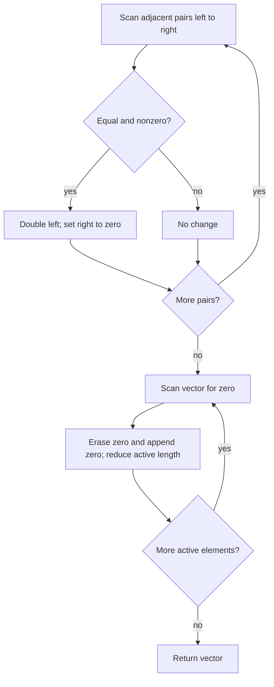

# 2460 — Apply Operations to an Array

## 1. Understanding

या प्रश्नाचा गाभा म्हणजे समान शेजारी मूल्ये merge करून शून्ये शेवटी नेणे.

> **मराठी:** प्रश्नात काय दिले आहे आणि नेमके काय शोधायचे आहे, हे आधी स्पष्ट करा.
> Walk left to right. When adjacent values are equal and nonzero, double the left one and set the right one to zero. After all merges, move every zero to the end while preserving nonzero order.

## 2. Worked examples and edge cases

उदाहरणे आणि सीमाप्रकरणांत समान शेजारी मूल्ये merge करून शून्ये शेवटी नेणे कशी लागू होते ते पाहा.

> **मराठी:** उदाहरणातील input पासून output पर्यंत प्रत्येक बदल समजून घ्या.
> `[2,2,0,4,4,8]` becomes `[4,0,8,8,0,0]` after merging, then `[4,8,8,0,0,0]`. A zero pair never merges. Newly doubled values are not revisited as a pair with the element before them; traversal always advances.

## 3. Pattern identification + cheat sheet

येथे मुख्य pattern म्हणजे डावीकडून merge pass आणि नंतर zero हलवणे; वरील तुलना लक्षात घ्या.

> **मराठी:** या clues मुळे योग्य pattern ओळखता येतो; constraints आणि relations नीट तपासा.
> This is a **simulation with ordered phases**: first apply local rules in original traversal order, then compact the result.
> | Phase | Invariant |
> |---|---|
> | Merge scan | Each adjacent pair is considered once, left to right |
> | Zero handling | Nonzero values retain their relative order |

## 4. Approaches

पद्धतींची तुलना करताना डावीकडून merge pass आणि नंतर zero हलवणे याचा वेळ आणि जागेवरील परिणाम पाहा.

> **मराठी:** सोप्या उपायापासून सुरुवात करा आणि constraints नुसार योग्य optimization निवडा.

- Directly simulate merges, then repeatedly erase zero elements: correct and simple, but vector erases make the source implementation `O(n²)` worst case.
- Stable compaction with a write pointer followed by zero fill: optimal `O(n)` time.
- Moving zeros before merging is incorrect because it changes adjacency.

## 5. Flowchart

आकृतीमध्ये डावीकडून merge pass आणि नंतर zero हलवणे ही प्रक्रिया क्रमाने दाखवली आहे.

> **मराठी:** Flowchart मध्ये प्रत्येक decision, loop आणि loop कधी थांबतो ते पाहा.

The second scan must happen only after all merge rules have been evaluated.

## 6. Algorithm and intuition

मूळ कल्पना: डावीकडून merge pass आणि नंतर zero हलवणे.

> **मराठी:** मुख्य observation समजल्यावर algorithm चे steps लक्षात ठेवणे सोपे होते.
> The class method and free-function version both make one merge pass, then repeatedly erase a zero and append one at the end. Erasing shifts later elements left, so the active length is reduced and the current position is checked again.

## 7. Code explanation

Code मधील state आणि updates हे डावीकडून merge pass आणि नंतर zero हलवणे या कल्पनेशी जोडून वाचा.

> **मराठी:** Code मधील variable आणि condition यांचा algorithm मधील उद्देश समजून घ्या.
> `Solution::applyOperations` is the class API; `applyOperationsFunction` duplicates it for demonstration. `PushZero`/`pushZero` use `vector::erase`, which preserves order but shifts elements. Both modify and return the input vector.

## 8. Dry run

Dry run मध्ये डावीकडून merge pass आणि नंतर zero हलवणे कसे घडते ते प्रत्येक टप्प्यावर तपासा.

> **मराठी:** प्रत्येक महत्त्वाच्या step नंतर variable ची value trace करा.
> | Stage | Array |
> |---|---|
> | Start | `[2,2,0,4,4,8]` |
> | Merge 2s and 4s | `[4,0,8,8,0,0]` |
> | Move zeros | `[4,8,8,0,0,0]` |

## 9. Complexity

डावीकडून merge pass आणि नंतर zero हलवणे यासाठी लागणारा वेळ आणि अतिरिक्त जागा वरील bounds मध्ये दिली आहेत.

> **मराठी:** Input size आणि प्रत्येक operation कितीदा चालतो यावरून complexity ठरवा.
> Merge scan is `O(n)`. Repeated `erase` shifts a suffix; zero-heavy input gives `O(n²)` time overall. Extra auxiliary space is `O(1)` beyond the modified vector; vector operations can still move elements.

## 10. Correctness

योग्यतेचा युक्तिवाद डावीकडून merge pass आणि नंतर zero हलवणे यावर आधारित आहे; वरील अटी तपासा.

> **मराठी:** Invariant किंवा तर्क वापरून algorithm योग्य उत्तर देतो हे समजून घ्या.
> The first pass performs exactly the specified operation at each adjacent index in left-to-right order, with zeros excluded. The second pass removes only zeros and appends the same count, so nonzero values and their relative order do not change. The final vector therefore has the required merges and zero placement.

## 11. Mistakes and interview traps

लक्षात ठेवा: पुढील तुलना अद्ययावत array वर करायची.

> **मराठी:** Boundary, duplicate आणि off-by-one cases स्वतंत्रपणे तपासा.

- Do not merge zeroes.
- Do not compact before completing the merge pass.
- After erasing at index `i`, do not increment `i`: the next element shifted into that position.
- For production constraints, replace repeated erases with one stable write-pointer compaction.

## 12. Quick revision

थोडक्यात, डावीकडून merge pass आणि नंतर zero हलवणे. पुढील तुलना अद्ययावत array वर करायची.

> **मराठी:** दोन मिनिटांच्या revision साठी pattern, मुख्य कल्पना आणि complexity आठवा.
> Merge adjacent equal nonzero values left-to-right; only then stable-move zeros to the end. Source uses repeated erase, so its zero phase is quadratic.

## 13. Related problems and variations

संबंधित प्रश्नांत समान शेजारी मूल्ये merge करून शून्ये शेवटी नेणे यासारखी अट बदलल्यास योग्य पद्धतही तपासा.

> **मराठी:** Related problem मध्ये constraints बदलल्यास approach कसा बदलेल ते विचारा.
> LeetCode 283 (Move Zeroes); 27 (Remove Element); variations: perform stable in-place compaction with read/write pointers or merge only once per adjacent pair.

## 14. Self-assessment

वरील प्रश्न स्वतः सोडवून समान शेजारी मूल्ये merge करून शून्ये शेवटी नेणे याची उजळणी करा.

> **मराठी:** उत्तर न पाहता प्रश्न सोडवा आणि तुमच्या निवडीचे कारण सांगा.

1. Why are the two operations separate passes?
2. Why should the index stay fixed after erasing a zero?
3. How would a write pointer improve the second phase?
