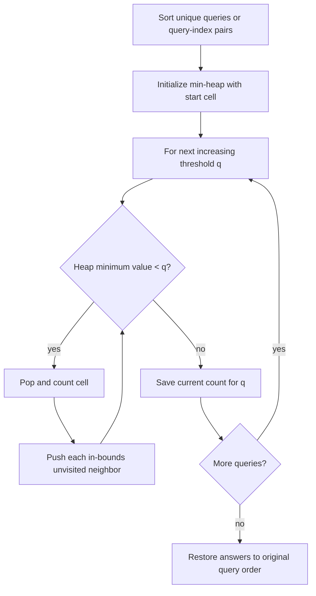

# 2503 — Maximum Number of Points From Grid Queries

## 1. Understanding

या प्रश्नाचा गाभा म्हणजे query पेक्षा कमी मूल्यांच्या पोहोचण्याजोग्या cells ची मोजणी.

> **मराठी:** प्रश्नात काय दिले आहे आणि नेमके काय शोधायचे आहे, हे आधी स्पष्ट करा.
> Starting at `(0,0)`, count cells reachable by moving up/down/left/right while each visited cell's value is **strictly less** than the query. Answer each query independently. The source provides two sorted-query/min-heap solutions.

## 2. Worked examples and edge cases

उदाहरणे आणि सीमाप्रकरणांत query पेक्षा कमी मूल्यांच्या पोहोचण्याजोग्या cells ची मोजणी कशी लागू होते ते पाहा.

> **मराठी:** उदाहरणातील input पासून output पर्यंत प्रत्येक बदल समजून घ्या.
> For `grid=[[5,2,1],[1,1,2]]`, query `3` cannot enter the start cell because `5 < 3` is false, so answer is 0. Equality is a barrier: a cell valued exactly `q` is not counted. Repeated queries must produce repeated answers in original query order.

## 3. Pattern identification + cheat sheet

येथे मुख्य pattern म्हणजे sorted queries साठी min-heap मधून frontier वाढवणे; वरील तुलना लक्षात घ्या.

> **मराठी:** या clues मुळे योग्य pattern ओळखता येतो; constraints आणि relations नीट तपासा.
> This is **offline queries + flood fill + minimum frontier**.
> | Signal | Technique |
> |---|---|
> | Queries differ only by a threshold | Sort queries |
> | Reachability expands from one start | BFS / graph traversal |
> | Lowest-valued unvisited frontier is next useful | Min-heap |
> | Return answers in input order | Save indices or map each threshold |

## 4. Approaches

पद्धतींची तुलना करताना sorted queries साठी min-heap मधून frontier वाढवणे याचा वेळ आणि जागेवरील परिणाम पाहा.

> **मराठी:** सोप्या उपायापासून सुरुवात करा आणि constraints नुसार योग्य optimization निवडा.

- Flood-fill from the start separately for every query: correct, but can cost `O(QMN)`.
- Sort queries and continue one traversal as thresholds increase: optimal. Both `Solution1` and `Solution2` implement this.
- A normal FIFO BFS alone is insufficient for processing multiple thresholds because it does not expose the smallest blocked frontier first.

## 5. Flowchart

आकृतीमध्ये sorted queries साठी min-heap मधून frontier वाढवणे ही प्रक्रिया क्रमाने दाखवली आहे.

> **मराठी:** Flowchart मध्ये प्रत्येक decision, loop आणि loop कधी थांबतो ते पाहा.

Only the currently reachable frontier is expanded; cells at or above the threshold wait in the heap.

## 6. Algorithm and intuition

मूळ कल्पना: sorted queries साठी min-heap मधून frontier वाढवणे.

> **मराठी:** मुख्य observation समजल्यावर algorithm चे steps लक्षात ठेवणे सोपे होते.
> Process thresholds in ascending order. Maintain a min-heap of frontier cells and a cumulative count. For each query, pop all frontier values `< q`, count them, and add their unvisited neighbors. Since thresholds only increase, cells already counted remain valid for every later query.

## 7. Code explanation

Code मधील state आणि updates हे sorted queries साठी min-heap मधून frontier वाढवणे या कल्पनेशी जोडून वाचा.

> **मराठी:** Code मधील variable आणि condition यांचा algorithm मधील उद्देश समजून घ्या.
> `Solution1` sorts `(query,index)` pairs, uses a min-heap frontier plus a queue for cells newly eligible at the current threshold, and marks visited cells by writing zero into the grid (safe under the problem's positive values). This **mutates the grid**. `Solution2` uses a visited matrix and processes unique sorted thresholds, storing counts in a hash map before restoring query order; it leaves the grid unchanged. Both methods have `maxPoints`.

## 8. Dry run

Dry run मध्ये sorted queries साठी min-heap मधून frontier वाढवणे कसे घडते ते प्रत्येक टप्प्यावर तपासा.

> **मराठी:** प्रत्येक महत्त्वाच्या step नंतर variable ची value trace करा.
> | Threshold | Newly processed frontier values | Cumulative points |
> |---:|---|---:|
> | 5 | `1,2,2,3,3` | 5 |
> | 6 | `5,5,1` | 8 |
> For `[[1,2,3],[2,5,7],[3,5,1]]`, the two cells valued 5 are excluded at query 5 (strict comparison), then become reachable at query 6.

## 9. Complexity

sorted queries साठी min-heap मधून frontier वाढवणे यासाठी लागणारा वेळ आणि अतिरिक्त जागा वरील bounds मध्ये दिली आहेत.

> **मराठी:** Input size आणि प्रत्येक operation कितीदा चालतो यावरून complexity ठरवा.
> For `R=M*N` cells and `Q` queries, sorting and heap operations take `O((R+Q) log(R+Q))` time; space is `O(R+Q)`. With heap insertions bounded by cells, this is commonly written `O(R log R + Q log Q)`.

## 10. Correctness

योग्यतेचा युक्तिवाद sorted queries साठी min-heap मधून frontier वाढवणे यावर आधारित आहे; वरील अटी तपासा.

> **मराठी:** Invariant किंवा तर्क वापरून algorithm योग्य उत्तर देतो हे समजून घ्या.
> At a threshold `q`, every cell already popped has value `<q` and is reachable through previously popped cells. Any reachable eligible cell not yet counted must be on the frontier. The min-heap exposes the smallest such frontier value; if its minimum is `>=q`, no frontier cell is eligible. Thus the cumulative count is exactly the reachable-cell count for each threshold.

## 11. Mistakes and interview traps

लक्षात ठेवा: तुलना strictly less आहे; समान मूल्य स्वीकारू नये.

> **मराठी:** Boundary, duplicate आणि off-by-one cases स्वतंत्रपणे तपासा.

- The comparison is strictly `< query`, not `<=`.
- Do not restart the traversal after sorting queries.
- Mark visited at insertion time to prevent duplicate heap entries.
- `Solution1` modifies its grid; use a copy if callers need the original.
- Sort/restore query positions; sorted-order answers are not the requested order.

## 12. Quick revision

थोडक्यात, sorted queries साठी min-heap मधून frontier वाढवणे. तुलना strictly less आहे; समान मूल्य स्वीकारू नये.

> **मराठी:** दोन मिनिटांच्या revision साठी pattern, मुख्य कल्पना आणि complexity आठवा.
> Ascending thresholds + min-heap boundary + cumulative flood fill. Pop while top `< q`; count and add neighbors; map answer back.

## 13. Related problems and variations

संबंधित प्रश्नांत query पेक्षा कमी मूल्यांच्या पोहोचण्याजोग्या cells ची मोजणी यासारखी अट बदलल्यास योग्य पद्धतही तपासा.

> **मराठी:** Related problem मध्ये constraints बदलल्यास approach कसा बदलेल ते विचारा.
> LeetCode 778 (Swim in Rising Water); 1631 (Path With Minimum Effort); variations: answer threshold connectivity with DSU or process cells in ascending value.

## 14. Self-assessment

वरील प्रश्न स्वतः सोडवून query पेक्षा कमी मूल्यांच्या पोहोचण्याजोग्या cells ची मोजणी याची उजळणी करा.

> **मराठी:** उत्तर न पाहता प्रश्न सोडवा आणि तुमच्या निवडीचे कारण सांगा.

1. Why does sorting queries let the visited set be reused?
2. Why does a min-heap belong on the frontier?
3. Which of the two source approaches changes the input grid?
