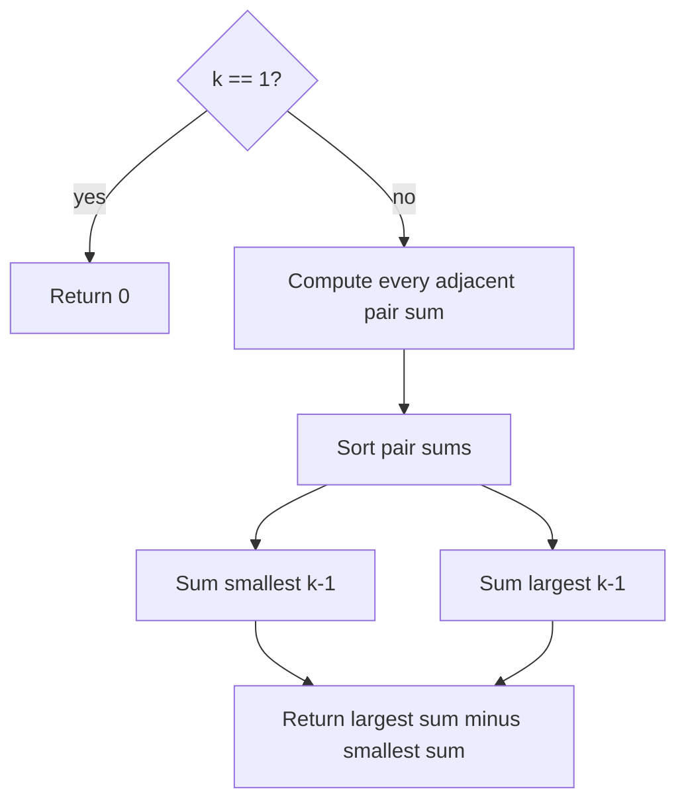

# 2551 — Put Marbles in Bags

## 1. Understanding

या प्रश्नाचा गाभा म्हणजे bags मधील गुणांच्या कमाल आणि किमान फरकाची मोजणी.

> **मराठी:** प्रश्नात काय दिले आहे आणि नेमके काय शोधायचे आहे, हे आधी स्पष्ट करा.
> Split `weights` into exactly `k` nonempty contiguous bags. Each bag's score is its first plus last weight. Return the largest possible total score minus the smallest possible total score.

## 2. Worked examples and edge cases

उदाहरणे आणि सीमाप्रकरणांत bags मधील गुणांच्या कमाल आणि किमान फरकाची मोजणी कशी लागू होते ते पाहा.

> **मराठी:** उदाहरणातील input पासून output पर्यंत प्रत्येक बदल समजून घ्या.
> For `[1,3,5,1]`, adjacent sums are `[4,8,6]`. With `k=2`, choose one of two cuts: the variable cut contribution can be 4, 6, or 8 across partitions; the difference between largest and smallest is `8-4=4`. For `k=1`, there is only one bag, so difference is 0.

## 3. Pattern identification + cheat sheet

येथे मुख्य pattern म्हणजे cut जवळील दोन वजनांच्या बेरीजांची क्रमवारी लावणे; वरील तुलना लक्षात घ्या.

> **मराठी:** या clues मुळे योग्य pattern ओळखता येतो; constraints आणि relations नीट तपासा.
> This is a **partition boundary contribution** problem. Fixed endpoints cancel when comparing partitions.
> | Observation | Result |
> |---|---|
> | Cut between `i` and `i+1` contributes to two bag endpoints | Contribution is `weights[i]+weights[i+1]` |
> | Exactly `k` bags | Choose exactly `k-1` cuts |
> | Max minus min score | Sum largest `k-1` cut values minus smallest `k-1` |

## 4. Approaches

पद्धतींची तुलना करताना cut जवळील दोन वजनांच्या बेरीजांची क्रमवारी लावणे याचा वेळ आणि जागेवरील परिणाम पाहा.

> **मराठी:** सोप्या उपायापासून सुरुवात करा आणि constraints नुसार योग्य optimization निवडा.

- Enumerate all choices of `k-1` cuts: correct but combinatorial.
- Dynamic programming can find extrema, but is unnecessary.
- Sort adjacent pair sums and take the extreme `k-1`: optimal for these constraints.

## 5. Flowchart

आकृतीमध्ये cut जवळील दोन वजनांच्या बेरीजांची क्रमवारी लावणे ही प्रक्रिया क्रमाने दाखवली आहे.

> **मराठी:** Flowchart मध्ये प्रत्येक decision, loop आणि loop कधी थांबतो ते पाहा.

Every valid partition selects a set of `k-1` boundaries, so only boundary values matter.

## 6. Algorithm and intuition

मूळ कल्पना: cut जवळील दोन वजनांच्या बेरीजांची क्रमवारी लावणे.

> **मराठी:** मुख्य observation समजल्यावर algorithm चे steps लक्षात ठेवणे सोपे होते.
> For any partition, the first array value and last array value occur in every total. Each cut adds the right endpoint of one bag and the left endpoint of the next, together `w[i]+w[i+1]`. Thus maximizing/minimizing partition score reduces to selecting the largest/smallest `k-1` adjacent sums.

## 7. Code explanation

Code मधील state आणि updates हे cut जवळील दोन वजनांच्या बेरीजांची क्रमवारी लावणे या कल्पनेशी जोडून वाचा.

> **मराठी:** Code मधील variable आणि condition यांचा algorithm मधील उद्देश समजून घ्या.
> `putMarbles` returns early for `k==1`, builds `subArr`, sorts it, then uses `accumulate(...,0LL)` for the low and high groups so their totals are `long long`. `main` contains sample runs.

## 8. Dry run

Dry run मध्ये cut जवळील दोन वजनांच्या बेरीजांची क्रमवारी लावणे कसे घडते ते प्रत्येक टप्प्यावर तपासा.

> **मराठी:** प्रत्येक महत्त्वाच्या step नंतर variable ची value trace करा.
> | Adjacent sum | Sorted |
> |---|---|
> | `1+3=4` | 4 |
> | `3+5=8` | 6 |
> | `5+1=6` | 8 |
> For `k=2`, use one value from each end: high `8`, low `4`, answer `4`.

## 9. Complexity

cut जवळील दोन वजनांच्या बेरीजांची क्रमवारी लावणे यासाठी लागणारा वेळ आणि अतिरिक्त जागा वरील bounds मध्ये दिली आहेत.

> **मराठी:** Input size आणि प्रत्येक operation कितीदा चालतो यावरून complexity ठरवा.
> `O(n log n)` time to sort `n-1` boundaries; `O(n)` extra space for `subArr`.

## 10. Correctness

योग्यतेचा युक्तिवाद cut जवळील दोन वजनांच्या बेरीजांची क्रमवारी लावणे यावर आधारित आहे; वरील अटी तपासा.

> **मराठी:** Invariant किंवा तर्क वापरून algorithm योग्य उत्तर देतो हे समजून घ्या.
> Every partition corresponds to exactly `k-1` internal cuts, and its score equals the fixed two endpoints plus the sum of those cuts' adjacent sums. Among all size-`k-1` selections, the maximum sum uses the largest values and the minimum uses the smallest. Their difference is therefore the desired max-minus-min score.

## 11. Mistakes and interview traps

लक्षात ठेवा: k bags साठी k-1 cuts लागतात.

> **मराठी:** Boundary, duplicate आणि off-by-one cases स्वतंत्रपणे तपासा.

- Choose `k-1` cuts, not `k`.
- Include only adjacent sums; endpoints are common and cancel.
- Use `0LL` in accumulation to avoid summing into `int`.
- `k=1` has no boundaries, so answer is zero.

## 12. Quick revision

थोडक्यात, cut जवळील दोन वजनांच्या बेरीजांची क्रमवारी लावणे. k bags साठी k-1 cuts लागतात.

> **मराठी:** दोन मिनिटांच्या revision साठी pattern, मुख्य कल्पना आणि complexity आठवा.
> Build `w[i]+w[i+1]`; sort; answer = sum largest `k-1` minus sum smallest `k-1`.

## 13. Related problems and variations

संबंधित प्रश्नांत bags मधील गुणांच्या कमाल आणि किमान फरकाची मोजणी यासारखी अट बदलल्यास योग्य पद्धतही तपासा.

> **मराठी:** Related problem मध्ये constraints बदलल्यास approach कसा बदलेल ते विचारा.
> LeetCode 410 (Split Array Largest Sum); \_partition DP tasks; variations: weighted boundary costs or directly compute top/bottom values with heaps.

## 14. Self-assessment

वरील प्रश्न स्वतः सोडवून bags मधील गुणांच्या कमाल आणि किमान फरकाची मोजणी याची उजळणी करा.

> **मराठी:** उत्तर न पाहता प्रश्न सोडवा आणि तुमच्या निवडीचे कारण सांगा.

1. Why do the first and last weights cancel?
2. Why are there `k-1` adjacent sums in a partition score?
3. What is the result when `k=1`?
