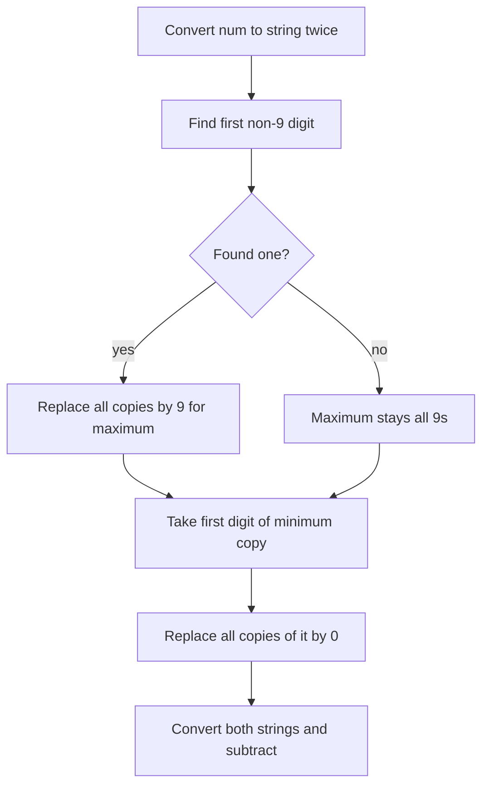

# 2566 — Maximum Difference by Remapping a Digit

## 1. Understanding

या प्रश्नाचा गाभा म्हणजे digit remapping ने कमाल आणि किमान संख्यांतील फरक.

> **मराठी:** प्रश्नात काय दिले आहे आणि नेमके काय शोधायचे आहे, हे आधी स्पष्ट करा.
> Choose a digit in `num` and replace every occurrence of it with another digit to create a maximum value; do this independently to create a minimum value. Return maximum minus minimum.

## 2. Worked examples and edge cases

उदाहरणे आणि सीमाप्रकरणांत digit remapping ने कमाल आणि किमान संख्यांतील फरक कशी लागू होते ते पाहा.

> **मराठी:** उदाहरणातील input पासून output पर्यंत प्रत्येक बदल समजून घ्या.
> For `9288`, maximum: replace first non-9 digit `2` with `9` -> `9988`; minimum: replace the first digit `9` with `0` -> `0288` (=288). Difference is 9700. If every digit is `9`, maximum remains unchanged. In a one-digit input, the same procedure still applies.

## 3. Pattern identification + cheat sheet

येथे मुख्य pattern म्हणजे स्थानमूल्य पाहून निवडलेल्या अंकाच्या सर्व occurrences बदलणे; वरील तुलना लक्षात घ्या.

> **मराठी:** या clues मुळे योग्य pattern ओळखता येतो; constraints आणि relations नीट तपासा.
> This is a **greedy digit transformation**: positional place value means the first eligible digit has the largest effect.
> | Goal | Digit to locate | Replacement |
> |---|---|---|
> | Maximize | First digit not `9` | Replace all its copies with `9` |
> | Minimize | First (leading) digit | Replace all copies with `0` |

## 4. Approaches

पद्धतींची तुलना करताना स्थानमूल्य पाहून निवडलेल्या अंकाच्या सर्व occurrences बदलणे याचा वेळ आणि जागेवरील परिणाम पाहा.

> **मराठी:** सोप्या उपायापासून सुरुवात करा आणि constraints नुसार योग्य optimization निवडा.
> Trying every possible source digit and replacement is brute-force but still small (`10×10×digits`). The greedy construction is direct and optimal. Replacing only one occurrence is incorrect: all occurrences of the chosen digit must change.

## 5. Flowchart

आकृतीमध्ये स्थानमूल्य पाहून निवडलेल्या अंकाच्या सर्व occurrences बदलणे ही प्रक्रिया क्रमाने दाखवली आहे.

> **मराठी:** Flowchart मध्ये प्रत्येक decision, loop आणि loop कधी थांबतो ते पाहा.

The selected digit is replaced everywhere, not just at its first position.

## 6. Algorithm and intuition

मूळ कल्पना: स्थानमूल्य पाहून निवडलेल्या अंकाच्या सर्व occurrences बदलणे.

> **मराठी:** मुख्य observation समजल्यावर algorithm चे steps लक्षात ठेवणे सोपे होते.
> The highest place where a digit can improve a number dominates changes in later positions. Thus replace the leftmost non-9 digit for the maximum. For the minimum, changing the first digit to zero gives the largest possible reduction; every occurrence of it is also replaced.

## 7. Code explanation

Code मधील state आणि updates हे स्थानमूल्य पाहून निवडलेल्या अंकाच्या सर्व occurrences बदलणे या कल्पनेशी जोडून वाचा.

> **मराठी:** Code मधील variable आणि condition यांचा algorithm मधील उद्देश समजून घ्या.
> The code creates `MaxString` and `MinString`. `find_first_not_of('9')` selects the maximizing digit and `replace` changes its occurrences. It then replaces every occurrence of the first minimum digit with `'0'`, parses both via `stoi`, and subtracts.

## 8. Dry run

Dry run मध्ये स्थानमूल्य पाहून निवडलेल्या अंकाच्या सर्व occurrences बदलणे कसे घडते ते प्रत्येक टप्प्यावर तपासा.

> **मराठी:** प्रत्येक महत्त्वाच्या step नंतर variable ची value trace करा.
> | Copy | Selected digit | Result |
> |---|---|---|
> | max `"9288"` | first non-9 = `2` | `"9988"` |
> | min `"9288"` | first digit = `9` | `"0288"` |
> | numeric difference | — | `9988-288=9700` |

## 9. Complexity

स्थानमूल्य पाहून निवडलेल्या अंकाच्या सर्व occurrences बदलणे यासाठी लागणारा वेळ आणि अतिरिक्त जागा वरील bounds मध्ये दिली आहेत.

> **मराठी:** Input size आणि प्रत्येक operation कितीदा चालतो यावरून complexity ठरवा.
> `O(d)` time and `O(d)` space for `d` decimal digits; each string is scanned/replaced a constant number of times.

## 10. Correctness

योग्यतेचा युक्तिवाद स्थानमूल्य पाहून निवडलेल्या अंकाच्या सर्व occurrences बदलणे यावर आधारित आहे; वरील अटी तपासा.

> **मराठी:** Invariant किंवा तर्क वापरून algorithm योग्य उत्तर देतो हे समजून घ्या.
> Replacing a digit in a more significant position affects at least as much value as changing only later positions. For a maximum, the earliest digit that can rise is the first non-9, and setting it to 9 is optimal. For a minimum, the leading digit is the most significant and setting its copies to 0 minimizes the result under the problem's allowed remapping. The two constructions are independent, so their difference is maximal.

## 11. Mistakes and interview traps

लक्षात ठेवा: निवडलेल्या अंकाच्या सर्व occurrences बदलायच्या.

> **मराठी:** Boundary, duplicate आणि off-by-one cases स्वतंत्रपणे तपासा.

- Replace all copies of the chosen digit.
- The maximum's target digit is always 9, but source digit is the first non-9.
- Use separate copies: maximum/minimum remappings are independent.
- `"0288"` parses as 288; leading zero is allowed for the constructed number.
- Source assumes positive input (so `MinString[0]` exists).

## 12. Quick revision

थोडक्यात, स्थानमूल्य पाहून निवडलेल्या अंकाच्या सर्व occurrences बदलणे. निवडलेल्या अंकाच्या सर्व occurrences बदलायच्या.

> **मराठी:** दोन मिनिटांच्या revision साठी pattern, मुख्य कल्पना आणि complexity आठवा.
> Stringify twice; max = replace all first non-9 with 9; min = replace all leading digit with 0; subtract.

## 13. Related problems and variations

संबंधित प्रश्नांत digit remapping ने कमाल आणि किमान संख्यांतील फरक यासारखी अट बदलल्यास योग्य पद्धतही तपासा.

> **मराठी:** Related problem मध्ये constraints बदलल्यास approach कसा बदलेल ते विचारा.
> LeetCode 1432 (Max Difference You Can Get From Changing an Integer); 1323 (Maximum 69 Number); variations: restrict replacement digits or preserve leading digit.

## 14. Self-assessment

वरील प्रश्न स्वतः सोडवून digit remapping ने कमाल आणि किमान संख्यांतील फरक याची उजळणी करा.

> **मराठी:** उत्तर न पाहता प्रश्न सोडवा आणि तुमच्या निवडीचे कारण सांगा.

1. Why is the first non-9 digit the best digit to change for maximum?
2. Why replace all occurrences rather than only one?
3. What happens when the maximum string contains only 9s?
