# 2570 — Merge Two 2D Arrays by Summing Values

## 1. Understanding

या प्रश्नाचा गाभा म्हणजे ID नुसार दोन arrays मधील मूल्यांचे एकत्रीकरण.

> **मराठी:** प्रश्नात काय दिले आहे आणि नेमके काय शोधायचे आहे, हे आधी स्पष्ट करा.
> Each input is sorted by unique ID and stores `[id,value]`. Merge both lists by ID, summing values for IDs present in both; output IDs in ascending order.

## 2. Worked examples and edge cases

उदाहरणे आणि सीमाप्रकरणांत ID नुसार दोन arrays मधील मूल्यांचे एकत्रीकरण कशी लागू होते ते पाहा.

> **मराठी:** उदाहरणातील input पासून output पर्यंत प्रत्येक बदल समजून घ्या.
> `[[1,2],[2,4]]` plus `[[2,3],[3,1]]` becomes `[[1,2],[2,7],[3,1]]`. An ID appearing in only one list keeps its original value. Empty input on one side returns the other list represented as the merged result.

## 3. Pattern identification + cheat sheet

येथे मुख्य pattern म्हणजे समान ID ची मूल्ये जमा करून क्रमाने निकाल देणे; वरील तुलना लक्षात घ्या.

> **मराठी:** या clues मुळे योग्य pattern ओळखता येतो; constraints आणि relations नीट तपासा.
> This is a **merge by key / aggregation** task.
> | Method | When useful |
> |---|---|
> | Ordered map accumulation | Simple; automatically sorts IDs (source method) |
> | Two pointers | Optimal linear merge when both inputs are sorted |
> | Nested scans | Correct but unnecessarily quadratic |

## 4. Approaches

पद्धतींची तुलना करताना समान ID ची मूल्ये जमा करून क्रमाने निकाल देणे याचा वेळ आणि जागेवरील परिणाम पाहा.

> **मराठी:** सोप्या उपायापासून सुरुवात करा आणि constraints नुसार योग्य optimization निवडा.
> The source inserts every pair into `map<int,int>` and adds duplicate IDs. This is clear, `O((n+m)log(n+m))`. Since inputs are already sorted, two pointers can do `O(n+m)` and avoid a map. Do not concatenate without summing matching IDs.

## 5. Flowchart

आकृतीमध्ये समान ID ची मूल्ये जमा करून क्रमाने निकाल देणे ही प्रक्रिया क्रमाने दाखवली आहे.

> **मराठी:** Flowchart मध्ये प्रत्येक decision, loop आणि loop कधी थांबतो ते पाहा.

```mermaid
flowchart TD
    A[Create ordered map] --> B[Add each pair from first array]
    B --> C[Add each pair from second array]
    C --> D[Traverse map in key order]
    D --> E[Append id and summed value]
    E --> F[Return result]
```

Map ordering supplies the required ascending ID order without a separate sort.

## 6. Algorithm and intuition

मूळ कल्पना: समान ID ची मूल्ये जमा करून क्रमाने निकाल देणे.

> **मराठी:** मुख्य observation समजल्यावर algorithm चे steps लक्षात ठेवणे सोपे होते.
> Treat each ID as a key and its value as an accumulated total. Adding both arrays automatically merges shared keys; iterating an ordered map emits unique IDs in ascending order.

## 7. Code explanation

Code मधील state आणि updates हे समान ID ची मूल्ये जमा करून क्रमाने निकाल देणे या कल्पनेशी जोडून वाचा.

> **मराठी:** Code मधील variable आणि condition यांचा algorithm मधील उद्देश समजून घ्या.
> `mergeArrays` updates `m[pair[0]] += pair[1]` for each input pair, reserves output capacity equal to map size, then emits `{id,total}` entries. It does not modify either input.

## 8. Dry run

Dry run मध्ये समान ID ची मूल्ये जमा करून क्रमाने निकाल देणे कसे घडते ते प्रत्येक टप्प्यावर तपासा.

> **मराठी:** प्रत्येक महत्त्वाच्या step नंतर variable ची value trace करा.
> | ID | First contribution | Second contribution | Map total |
> |---:|---:|---:|---:|
> | 1 | 2 | — | 2 |
> | 2 | 4 | 3 | 7 |
> | 3 | — | 1 | 1 |
> Output: `[[1,2],[2,7],[3,1]]`.

## 9. Complexity

समान ID ची मूल्ये जमा करून क्रमाने निकाल देणे यासाठी लागणारा वेळ आणि अतिरिक्त जागा वरील bounds मध्ये दिली आहेत.

> **मराठी:** Input size आणि प्रत्येक operation कितीदा चालतो यावरून complexity ठरवा.
> For `n` and `m` pairs and `u` unique IDs: `O((n+m)log u)` time and `O(u)` extra space.

## 10. Correctness

योग्यतेचा युक्तिवाद समान ID ची मूल्ये जमा करून क्रमाने निकाल देणे यावर आधारित आहे; वरील अटी तपासा.

> **मराठी:** Invariant किंवा तर्क वापरून algorithm योग्य उत्तर देतो हे समजून घ्या.
> Every input pair adds its value to exactly the map entry for its ID. Therefore each map value is the sum of all contributions for that ID. Map traversal is ascending and emits each key once, so the result has exactly the required sorted unique IDs and sums.

## 11. Mistakes and interview traps

लक्षात ठेवा: एका यादीतच असलेले ID सुद्धा निकालात ठेवायचे.

> **मराठी:** Boundary, duplicate आणि off-by-one cases स्वतंत्रपणे तपासा.

- Sum values for duplicate IDs across the two arrays.
- Do not sort by value; output order is by ID.
- Inputs are sorted, so a two-pointer merge can improve asymptotic time.
- Reserve output by number of unique IDs, not total pair count (source does this).

## 12. Quick revision

थोडक्यात, समान ID ची मूल्ये जमा करून क्रमाने निकाल देणे. एका यादीतच असलेले ID सुद्धा निकालात ठेवायचे.

> **मराठी:** दोन मिनिटांच्या revision साठी pattern, मुख्य कल्पना आणि complexity आठवा.
> Aggregate values by ID; emit IDs ascending. Source: ordered map. Alternative: two pointers.

## 13. Related problems and variations

संबंधित प्रश्नांत ID नुसार दोन arrays मधील मूल्यांचे एकत्रीकरण यासारखी अट बदलल्यास योग्य पद्धतही तपासा.

> **मराठी:** Related problem मध्ये constraints बदलल्यास approach कसा बदलेल ते विचारा.
> LeetCode 88 (Merge Sorted Array); 350 (Intersection of Two Arrays II); variations: merge three sorted key-value streams or combine with max/min instead of sum.

## 14. Self-assessment

वरील प्रश्न स्वतः सोडवून ID नुसार दोन arrays मधील मूल्यांचे एकत्रीकरण याची उजळणी करा.

> **मराठी:** उत्तर न पाहता प्रश्न सोडवा आणि तुमच्या निवडीचे कारण सांगा.

1. Why does the source's map guarantee sorted output?
2. How can two pointers reduce the time?
3. What should happen when an ID exists in only one input?
