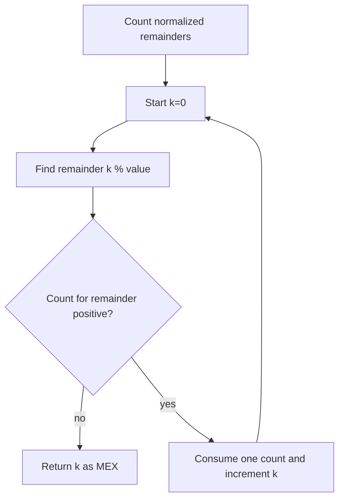

# 2598 — Smallest Missing Non-negative Integer After Operations

## 1. Understanding

या प्रश्नाचा गाभा म्हणजे निश्चित पावलांनी संख्या बदलून मिळणारा कमाल MEX.

> **मराठी:** प्रश्नात काय दिले आहे आणि नेमके काय शोधायचे आहे, हे आधी स्पष्ट करा.
> Any number may be increased or decreased by `value` repeatedly. Find the maximum possible MEX (smallest missing nonnegative integer). An operation preserves a number's remainder modulo `value`.

## 2. Worked examples and edge cases

उदाहरणे आणि सीमाप्रकरणांत निश्चित पावलांनी संख्या बदलून मिळणारा कमाल MEX कशी लागू होते ते पाहा.

> **मराठी:** उदाहरणातील input पासून output पर्यंत प्रत्येक बदल समजून घ्या.
> With `value=3`, one number of remainder 0 can supply 0, another can supply 3, and one with remainder 1 can supply 1. The source consumes a remainder bucket for each `k=0,1,2,...`; the first empty bucket gives the answer. Negative numbers must be normalized to a nonnegative remainder.

## 3. Pattern identification + cheat sheet

येथे मुख्य pattern म्हणजे समान remainder असलेल्या उपलब्ध संख्यांची मोजणी करणे; वरील तुलना लक्षात घ्या.

> **मराठी:** या clues मुळे योग्य pattern ओळखता येतो; constraints आणि relations नीट तपासा.
> This is **modulo equivalence classes + greedy MEX construction**.
> | Concept | Meaning |
> |---|---|
> | `num mod value` | Invariant under ±`value` operations |
> | Remainder count | How many targets in that class can be filled |
> | Consume classes in order | Construct values `0,1,2,...` greedily |

## 4. Approaches

पद्धतींची तुलना करताना समान remainder असलेल्या उपलब्ध संख्यांची मोजणी करणे याचा वेळ आणि जागेवरील परिणाम पाहा.

> **मराठी:** सोप्या उपायापासून सुरुवात करा आणि constraints नुसार योग्य optimization निवडा.
> Trying sequences of operations is unnecessary and unbounded. Greedily test whether every integer from 0 upward can be represented by an available remainder class. A set of remainders alone is incorrect because multiplicities matter; use counts.

## 5. Flowchart

आकृतीमध्ये समान remainder असलेल्या उपलब्ध संख्यांची मोजणी करणे ही प्रक्रिया क्रमाने दाखवली आहे.

> **मराठी:** Flowchart मध्ये प्रत्येक decision, loop आणि loop कधी थांबतो ते पाहा.

The `k`th target needs one unused source with the same remainder class.

## 6. Algorithm and intuition

मूळ कल्पना: समान remainder असलेल्या उपलब्ध संख्यांची मोजणी करणे.

> **मराठी:** मुख्य observation समजल्यावर algorithm चे steps लक्षात ठेवणे सोपे होते.
> Normalize each remainder as `((num % value)+value)%value`. To create target `k`, choose an unused number congruent to `k`; add or subtract `value` to reach it. Consume one count from bucket `k%value`, then continue. First unavailable target is the maximum MEX.

## 7. Code explanation

Code मधील state आणि updates हे समान remainder असलेल्या उपलब्ध संख्यांची मोजणी करणे या कल्पनेशी जोडून वाचा.

> **मराठी:** Code मधील variable आणि condition यांचा algorithm मधील उद्देश समजून घ्या.
> The source stores counts in `unordered_map<int,int>`, loops `k` upward, returns if `count[k%value]==0`, otherwise decrements it. Under constraints, the MEX is at most `nums.size()`, so the loop terminates.

## 8. Dry run

Dry run मध्ये समान remainder असलेल्या उपलब्ध संख्यांची मोजणी करणे कसे घडते ते प्रत्येक टप्प्यावर तपासा.

> **मराठी:** प्रत्येक महत्त्वाच्या step नंतर variable ची value trace करा.
> `nums=[1,2,3,4,5]`, `value=3` has remainders: `1,2,0,1,2`.
> | Target `k` | Needed remainder | Remaining count before | Action |
> |---:|---:|---:|---|
> | 0 | 0 | 1 | consume |
> | 1 | 1 | 2 | consume |
> | 2 | 2 | 2 | consume |
> | 3 | 0 | 0 | stop; answer 3 |

## 9. Complexity

समान remainder असलेल्या उपलब्ध संख्यांची मोजणी करणे यासाठी लागणारा वेळ आणि अतिरिक्त जागा वरील bounds मध्ये दिली आहेत.

> **मराठी:** Input size आणि प्रत्येक operation कितीदा चालतो यावरून complexity ठरवा.
> Expected `O(n+mex)` time and `O(min(n,value))` stored remainder buckets; since `mex<=n`, expected total time is `O(n)`.

## 10. Correctness

योग्यतेचा युक्तिवाद समान remainder असलेल्या उपलब्ध संख्यांची मोजणी करणे यावर आधारित आहे; वरील अटी तपासा.

> **मराठी:** Invariant किंवा तर्क वापरून algorithm योग्य उत्तर देतो हे समजून घ्या.
> Every allowed operation preserves remainder modulo `value`, and any integer in a class can be shifted to any other integer in that class. Thus target `k` is constructible exactly when an unused source remains in bucket `k%value`. The greedy loop consumes one source for every consecutive nonnegative target; the first empty bucket is missing and cannot be bypassed to increase the MEX.

## 11. Mistakes and interview traps

लक्षात ठेवा: ऋण संख्यांचा remainder normalize करायचा.

> **मराठी:** Boundary, duplicate आणि off-by-one cases स्वतंत्रपणे तपासा.

- Normalize negative modulo; C++ `%` can be negative.
- Counts matter: several targets can share a remainder class.
- Do not return when a bucket empties permanently; later targets may use other buckets, but MEX is already the first missing `k`.
- `value` must be positive per problem constraints.

## 12. Quick revision

थोडक्यात, समान remainder असलेल्या उपलब्ध संख्यांची मोजणी करणे. ऋण संख्यांचा remainder normalize करायचा.

> **मराठी:** दोन मिनिटांच्या revision साठी pattern, मुख्य कल्पना आणि complexity आठवा.
> Count normalized remainders; for `k=0...`, consume bucket `k%value`; first empty bucket is MEX.

## 13. Related problems and variations

संबंधित प्रश्नांत निश्चित पावलांनी संख्या बदलून मिळणारा कमाल MEX यासारखी अट बदलल्यास योग्य पद्धतही तपासा.

> **मराठी:** Related problem मध्ये constraints बदलल्यास approach कसा बदलेल ते विचारा.
> LeetCode 41 (First Missing Positive); 128 (Longest Consecutive Sequence); variations: MEX with modulo classes or bounded shifts.

## 14. Self-assessment

वरील प्रश्न स्वतः सोडवून निश्चित पावलांनी संख्या बदलून मिळणारा कमाल MEX याची उजळणी करा.

> **मराठी:** उत्तर न पाहता प्रश्न सोडवा आणि तुमच्या निवडीचे कारण सांगा.

1. Why is remainder preserved by adding or subtracting `value`?
2. Why is a set insufficient?
3. Why must negative remainders be normalized?
