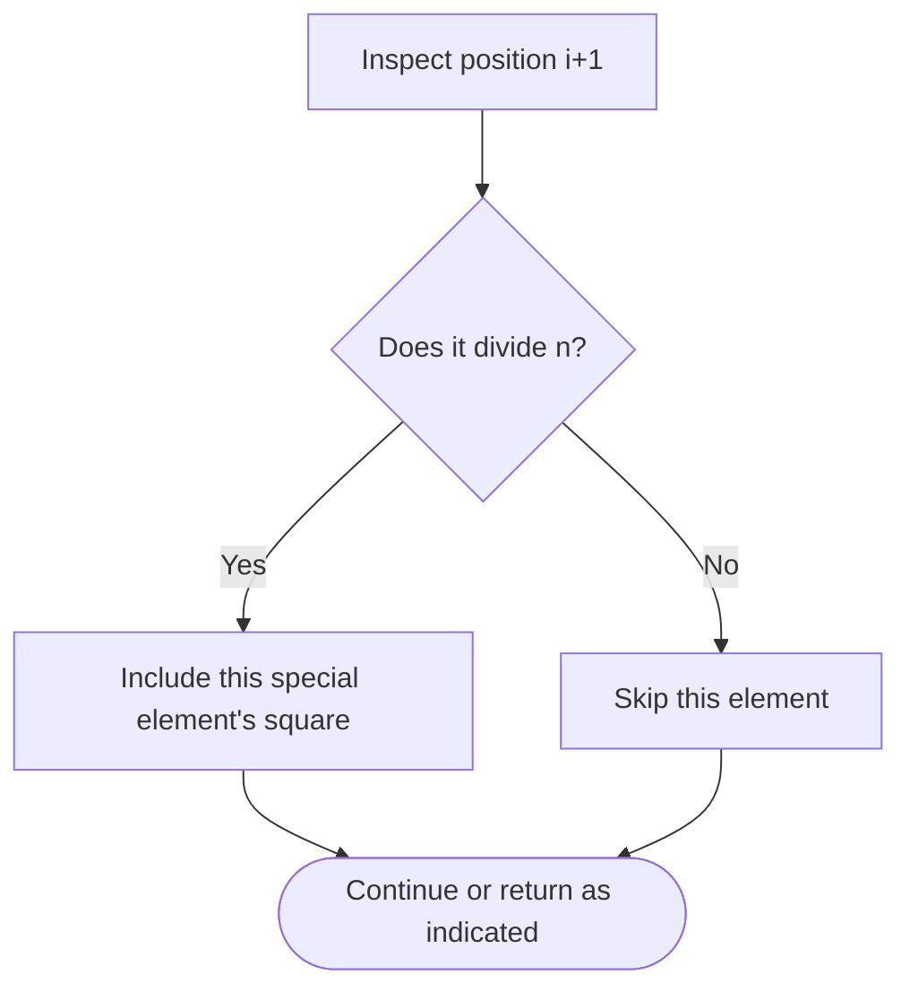

# Sum of Squares of Special Elements — LeetCode 2778

## Problem and judge interface

int sumOfSquares(vector<int>& nums); sum squares at 1-based positions dividing array length.

## Identification evidence

The loop tests n%(i+1)==0 and adds nums[i] squared, uniquely matching problem 2778.

## Main flow

```mermaid
flowchart TD
 A([Start]) --> B[Set result to zero and scan indices]
 B --> C[Check whether each 1-based position divides n]
 C --> D{Is n divisible by i+1?}
 D -- Yes --> E[Add nums[i] squared]
 D -- No --> F[Leave sum unchanged]
 E --> G{More work remains?}
 F --> G
 G -- Yes --> C
 G -- No --> H([Return result])
```

## Important branch / loop



## Core logic and invariants

Scan zero-based i; its one-based position i+1 is special when it divides n. Add that element's square.

## Complexity

O(n) time and O(1) auxiliary space.

## Comparison and optimization

A full scan is simple; enumerating divisor pairs could visit fewer positions but is not implemented.

## Compile and run

The `.cpp` is the original standalone source, including its local `main()` demonstration where present. Compile and run from the repository root with a C++17 compiler:

```text
g++ -std=c++17 LeetCode\2778\2778.cpp -o solution.exe
.\solution.exe
```

For LeetCode, adapt the implementation to the required class/method signature and omit the local `main()` and demonstration helpers; use the judge-provided node types. Notes above identify method-name or behavior differences. The moved source bytes have not been edited.
