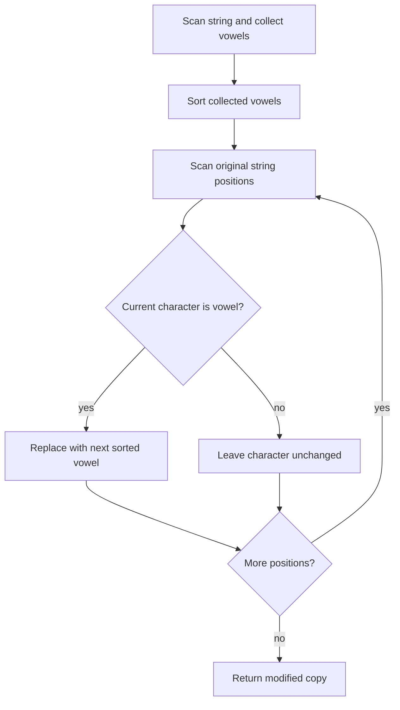

# 2785 — Sort Vowels in a String

## 1. Understanding

या प्रश्नाचा गाभा म्हणजे फक्त vowels क्रमाने लावून string पुन्हा तयार करणे.

> **मराठी:** प्रश्नात काय दिले आहे आणि नेमके काय शोधायचे आहे, हे आधी स्पष्ट करा.
> Sort only the vowels in a string into ascending character order, then put them back into the original vowel positions. Consonants and their positions must remain unchanged; vowels may include uppercase and lowercase.

## 2. Worked examples and edge cases

उदाहरणे आणि सीमाप्रकरणांत फक्त vowels क्रमाने लावून string पुन्हा तयार करणे कशी लागू होते ते पाहा.

> **मराठी:** उदाहरणातील input पासून output पर्यंत प्रत्येक बदल समजून घ्या.
> `"lEetcOde"` has vowels `E,e,O,e`; ASCII sorting gives `E,O,e,e`, placed into those same positions. With no vowels, return the string unchanged. With all vowels, sort the whole string.

## 3. Pattern identification + cheat sheet

येथे मुख्य pattern म्हणजे vowels वेगळे sort करून मूळ vowel स्थानांवर ठेवणे; वरील तुलना लक्षात घ्या.

> **मराठी:** या clues मुळे योग्य pattern ओळखता येतो; constraints आणि relations नीट तपासा.
> This is **extract-sort-reinsert** with a fixed set of eligible characters.
> | Step | Technique |
> |---|---|
> | Identify vowels | membership set / small list |
> | Reorder | `sort` extracted vowels |
> | Preserve layout | replace only vowel slots |

## 4. Approaches

पद्धतींची तुलना करताना vowels वेगळे sort करून मूळ vowel स्थानांवर ठेवणे याचा वेळ आणि जागेवरील परिणाम पाहा.

> **मराठी:** सोप्या उपायापासून सुरुवात करा आणि constraints नुसार योग्य optimization निवडा.
> The source includes `sortVowelsNaive` and `sortVowelsOptimized`. Both are correct. Naive performs repeated linear `find` in a five-vowel list (constant factor); optimized uses an `unordered_set` and edits the original string copy. Since the vowel alphabet is fixed, both are `O(n + v log v)`.

## 5. Flowchart

आकृतीमध्ये vowels वेगळे sort करून मूळ vowel स्थानांवर ठेवणे ही प्रक्रिया क्रमाने दाखवली आहे.

> **मराठी:** Flowchart मध्ये प्रत्येक decision, loop आणि loop कधी थांबतो ते पाहा.

Collecting first prevents overwritten characters from affecting later tests.

## 6. Algorithm and intuition

मूळ कल्पना: vowels वेगळे sort करून मूळ vowel स्थानांवर ठेवणे.

> **मराठी:** मुख्य observation समजल्यावर algorithm चे steps लक्षात ठेवणे सोपे होते.
> The set of vowel positions is fixed. Sorting only the extracted vowels and writing them back in order changes their arrangement without moving consonants or changing any non-vowel slot.

## 7. Code explanation

Code मधील state आणि updates हे vowels वेगळे sort करून मूळ vowel स्थानांवर ठेवणे या कल्पनेशी जोडून वाचा.

> **मराठी:** Code मधील variable आणि condition यांचा algorithm मधील उद्देश समजून घ्या.
> `sortVowelsNaive` checks membership with `find` and stores vowels and consonants separately, then rebuilds the string. `sortVowelsOptimized` uses a set containing both cases, collects vowels, sorts them, then replaces vowels in the string copy. `std::sort` uses character/ASCII order, so uppercase letters sort before lowercase letters.

## 8. Dry run

Dry run मध्ये vowels वेगळे sort करून मूळ vowel स्थानांवर ठेवणे कसे घडते ते प्रत्येक टप्प्यावर तपासा.

> **मराठी:** प्रत्येक महत्त्वाच्या step नंतर variable ची value trace करा.
> For `"lEetcOde"`:
> | Original vowel positions | Collected | Sorted | Result |
> |---|---|---|---|
> | 1, 2, 5, 7 | `E,e,O,e` | `E,O,e,e` | `lEOtcede` |

## 9. Complexity

vowels वेगळे sort करून मूळ vowel स्थानांवर ठेवणे यासाठी लागणारा वेळ आणि अतिरिक्त जागा वरील bounds मध्ये दिली आहेत.

> **मराठी:** Input size आणि प्रत्येक operation कितीदा चालतो यावरून complexity ठरवा.
> Let `n` be string length and `v` vowel count. Time `O(n + v log v)`; extra space `O(v)` plus the returned string copy (`O(n)`).

## 10. Correctness

योग्यतेचा युक्तिवाद vowels वेगळे sort करून मूळ vowel स्थानांवर ठेवणे यावर आधारित आहे; वरील अटी तपासा.

> **मराठी:** Invariant किंवा तर्क वापरून algorithm योग्य उत्तर देतो हे समजून घ्या.
> Every vowel is collected exactly once and sorted. The second pass replaces each original vowel slot with the next sorted vowel, preserving the number and positions of vowels. Non-vowel characters are never modified. Therefore only the vowel sequence changes, and it is sorted.

## 11. Mistakes and interview traps

लक्षात ठेवा: consonants ची स्थाने बदलू नयेत.

> **मराठी:** Boundary, duplicate आणि off-by-one cases स्वतंत्रपणे तपासा.

- Include uppercase vowels.
- Do not sort the entire string or move consonants.
- Clarify ordering: this code uses ASCII order, not case-insensitive alphabetical order.
- Naive rebuild relies on consonants remaining in their original order.

## 12. Quick revision

थोडक्यात, vowels वेगळे sort करून मूळ vowel स्थानांवर ठेवणे. consonants ची स्थाने बदलू नयेत.

> **मराठी:** दोन मिनिटांच्या revision साठी pattern, मुख्य कल्पना आणि complexity आठवा.
> Collect vowels, sort, then refill only vowel positions. Keep consonants exactly where they are.

## 13. Related problems and variations

संबंधित प्रश्नांत फक्त vowels क्रमाने लावून string पुन्हा तयार करणे यासारखी अट बदलल्यास योग्य पद्धतही तपासा.

> **मराठी:** Related problem मध्ये constraints बदलल्यास approach कसा बदलेल ते विचारा.
> LeetCode 451 (Sort Characters by Frequency); 791 (Custom Sort String); variations: case-insensitive sort or preserve vowel case at each position.

## 14. Self-assessment

वरील प्रश्न स्वतः सोडवून फक्त vowels क्रमाने लावून string पुन्हा तयार करणे याची उजळणी करा.

> **मराठी:** उत्तर न पाहता प्रश्न सोडवा आणि तुमच्या निवडीचे कारण सांगा.

1. Why are consonant positions unchanged?
2. What does ASCII sorting do with uppercase versus lowercase vowels?
3. Why is the vowel collection built before replacement?
