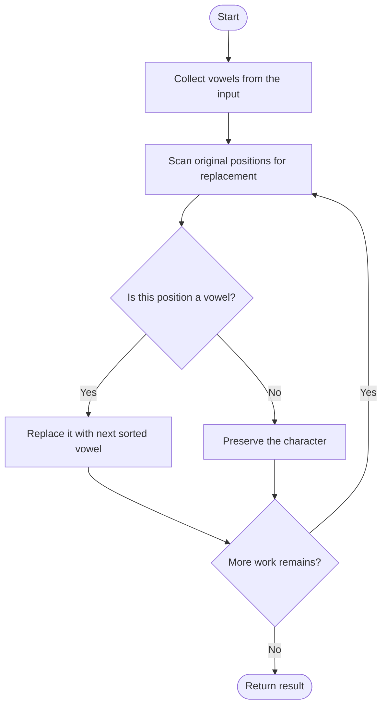
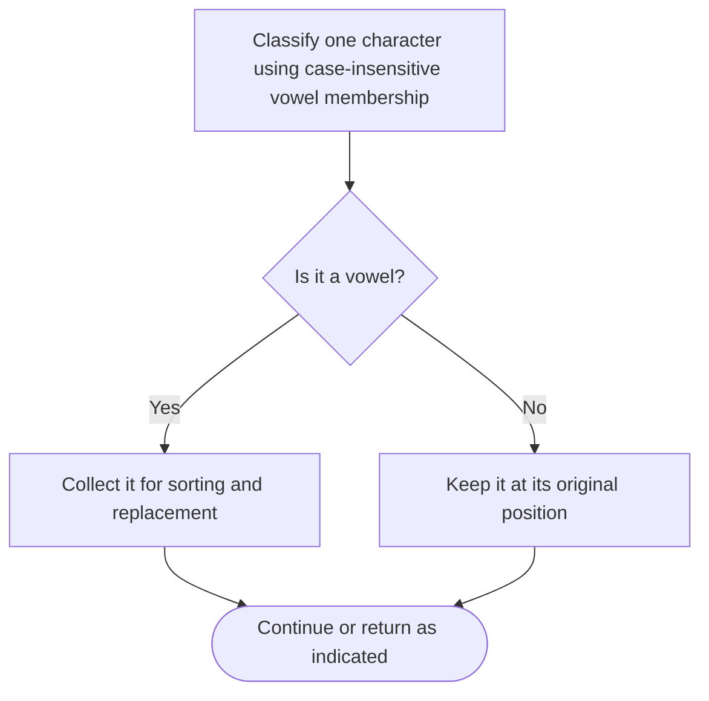

# Sort Vowels in a String — LeetCode 2785

## Problem and judge interface

string sortVowels(string s); sort vowel characters while preserving all consonant positions.

## Identification evidence

Both implementations extract/sort vowels and restore them; both uppercase and lowercase vowels are recognized, matching problem 2785.

## Main flow



## Important branch / loop



## Core logic and invariants

The naive method uses a five-vowel list, stores vowels and consonants, sorts vowels and rebuilds. The optimized method uses a set of both cases, then replaces vowel slots in the string copy.

## Complexity

For n characters and v vowels, O(n+v log v) time and O(n) auxiliary space.

## Comparison and optimization

The source methods are named `sortVowelsNaive` and `sortVowelsOptimized`; adapt the selected method to `sortVowels`. The set-based implementation avoids a separate consonant string. Both use character/ASCII order, where uppercase sorts before lowercase.

## Compile and run

The `.cpp` is the original standalone source, including its local `main()` demonstration where present. Compile and run from the repository root with a C++17 compiler:

```text
g++ -std=c++17 LeetCode\2785\2785.cpp -o solution.exe
.\solution.exe
```

For LeetCode, adapt the implementation to the required class/method signature and omit the local `main()` and demonstration helpers; use the judge-provided node types. Notes above identify method-name or behavior differences. The moved source bytes have not been edited.

