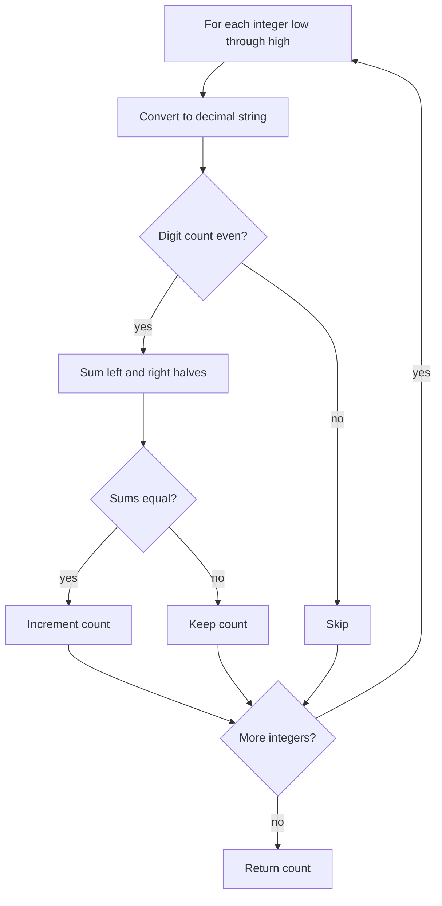

# 2843 — Count Symmetric Integers

## 1. Understanding

या प्रश्नाचा गाभा म्हणजे दोन्ही अर्ध्यांच्या अंकबेरजा समान असलेल्या संख्यांची मोजणी.

> **मराठी:** प्रश्नात काय दिले आहे आणि नेमके काय शोधायचे आहे, हे आधी स्पष्ट करा.
> Within inclusive range `[low,high]`, count numbers with an even number of digits whose first-half digit sum equals the second-half digit sum.

## 2. Worked examples and edge cases

उदाहरणे आणि सीमाप्रकरणांत दोन्ही अर्ध्यांच्या अंकबेरजा समान असलेल्या संख्यांची मोजणी कशी लागू होते ते पाहा.

> **मराठी:** उदाहरणातील input पासून output पर्यंत प्रत्येक बदल समजून घ्या.
> `1230` is symmetric because `1+2 = 3+0`. `1234` is not (`1+2 != 3+4`). Odd-digit numbers are never symmetric by definition. Single-digit inputs are skipped.

## 3. Pattern identification + cheat sheet

येथे मुख्य pattern म्हणजे सम अंकसंख्या असलेल्या प्रत्येक संख्येचे अर्धे तपासणे; वरील तुलना लक्षात घ्या.

> **मराठी:** या clues मुळे योग्य pattern ओळखता येतो; constraints आणि relations नीट तपासा.
> This is **bounded enumeration + digit property check**.
> | Check | Reason |
> |---|---|
> | Convert integer to string | Easy digit boundaries |
> | Even string length | Required by definition |
> | Sum each half | Compare digit totals |

## 4. Approaches

पद्धतींची तुलना करताना सम अंकसंख्या असलेल्या प्रत्येक संख्येचे अर्धे तपासणे याचा वेळ आणि जागेवरील परिणाम पाहा.

> **मराठी:** सोप्या उपायापासून सुरुवात करा आणि constraints नुसार योग्य optimization निवडा.
> Generate all numbers in the range and inspect digits: direct and suitable for the problem's small limits. A more optimized approach could derive digit-sum formulas by digit length, but is unnecessary and more complex.

## 5. Flowchart

आकृतीमध्ये सम अंकसंख्या असलेल्या प्रत्येक संख्येचे अर्धे तपासणे ही प्रक्रिया क्रमाने दाखवली आहे.

> **मराठी:** Flowchart मध्ये प्रत्येक decision, loop आणि loop कधी थांबतो ते पाहा.

Odd-length values can be rejected without computing digit sums.

## 6. Algorithm and intuition

मूळ कल्पना: सम अंकसंख्या असलेल्या प्रत्येक संख्येचे अर्धे तपासणे.

> **मराठी:** मुख्य observation समजल्यावर algorithm चे steps लक्षात ठेवणे सोपे होते.
> Loop through the range, stringify each integer, skip odd lengths, and use digit sums on the two equal-length halves. Count matches.

## 7. Code explanation

Code मधील state आणि updates हे सम अंकसंख्या असलेल्या प्रत्येक संख्येचे अर्धे तपासणे या कल्पनेशी जोडून वाचा.

> **मराठी:** Code मधील variable आणि condition यांचा algorithm मधील उद्देश समजून घ्या.
> `countSymmetricIntegers` uses a lambda with `accumulate` to sum character digits (`ch-'0'`). It checks `NoStr.size()%2==0` before comparing sums. Complexity depends on both range width and number of digits.

## 8. Dry run

Dry run मध्ये सम अंकसंख्या असलेल्या प्रत्येक संख्येचे अर्धे तपासणे कसे घडते ते प्रत्येक टप्प्यावर तपासा.

> **मराठी:** प्रत्येक महत्त्वाच्या step नंतर variable ची value trace करा.
> For `1230`:
> | Half | Digits | Sum |
> |---|---|---:|
> | Left | `1,2` | 3 |
> | Right | `3,0` | 3 |
> | Result | equal | counted |

## 9. Complexity

सम अंकसंख्या असलेल्या प्रत्येक संख्येचे अर्धे तपासणे यासाठी लागणारा वेळ आणि अतिरिक्त जागा वरील bounds मध्ये दिली आहेत.

> **मराठी:** Input size आणि प्रत्येक operation कितीदा चालतो यावरून complexity ठरवा.
> For `R=high-low+1` and at most `d` digits: `O(R*d)` time and `O(d)` temporary string space.

## 10. Correctness

योग्यतेचा युक्तिवाद सम अंकसंख्या असलेल्या प्रत्येक संख्येचे अर्धे तपासणे यावर आधारित आहे; वरील अटी तपासा.

> **मराठी:** Invariant किंवा तर्क वापरून algorithm योग्य उत्तर देतो हे समजून घ्या.
> Each integer in the inclusive interval is examined once. Odd-length numbers are excluded exactly as required. For each even-length number, the code sums precisely the left and right halves and increments iff they are equal. Therefore the counter equals the number of symmetric integers.

## 11. Mistakes and interview traps

लक्षात ठेवा: विषम अंकसंख्या असलेली संख्या वगळायची.

> **मराठी:** Boundary, duplicate आणि off-by-one cases स्वतंत्रपणे तपासा.

- Range endpoints are inclusive.
- Digit halves are based on string length, not numeric division.
- Leading zeros are not part of the integer's representation.
- `accumulate` sums digit values only after subtracting `'0'`.

## 12. Quick revision

थोडक्यात, सम अंकसंख्या असलेल्या प्रत्येक संख्येचे अर्धे तपासणे. विषम अंकसंख्या असलेली संख्या वगळायची.

> **मराठी:** दोन मिनिटांच्या revision साठी pattern, मुख्य कल्पना आणि complexity आठवा.
> Enumerate; convert to string; even length + equal half digit sums means symmetric.

## 13. Related problems and variations

संबंधित प्रश्नांत दोन्ही अर्ध्यांच्या अंकबेरजा समान असलेल्या संख्यांची मोजणी यासारखी अट बदलल्यास योग्य पद्धतही तपासा.

> **मराठी:** Related problem मध्ये constraints बदलल्यास approach कसा बदलेल ते विचारा.
> LeetCode 129 (Sum Root to Leaf Numbers); 2283 (Check if Number Has Equal Digit Count and Digit Value); variations: compare alternating digit sums or count by digit length.

## 14. Self-assessment

वरील प्रश्न स्वतः सोडवून दोन्ही अर्ध्यांच्या अंकबेरजा समान असलेल्या संख्यांची मोजणी याची उजळणी करा.

> **मराठी:** उत्तर न पाहता प्रश्न सोडवा आणि तुमच्या निवडीचे कारण सांगा.

1. Why are odd-length numbers skipped?
2. Does `1230` qualify, and why?
3. What are the time and extra-space costs?
