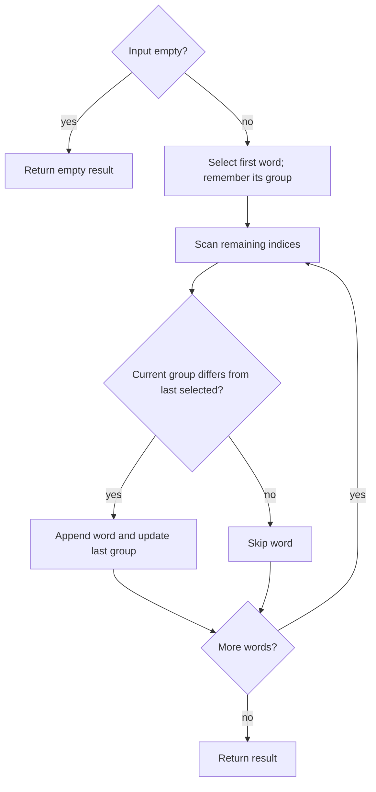

# 2900 — Longest Unequal Adjacent Groups Subsequence I

## 1. Understanding

या प्रश्नाचा गाभा म्हणजे शेजारी निवडलेल्या शब्दांचे group वेगळे असलेला मोठा subsequence.

> **मराठी:** प्रश्नात काय दिले आहे आणि नेमके काय शोधायचे आहे, हे आधी स्पष्ट करा.
> Choose a subsequence of words where every pair of consecutive selected words has different group labels. Return a longest such subsequence. The source selects actual words, preserving input order.

## 2. Worked examples and edge cases

उदाहरणे आणि सीमाप्रकरणांत शेजारी निवडलेल्या शब्दांचे group वेगळे असलेला मोठा subsequence कशी लागू होते ते पाहा.

> **मराठी:** उदाहरणातील input पासून output पर्यंत प्रत्येक बदल समजून घ्या.
> For groups `[1,1,2,2,3]`, select the first word, then one word whenever the group changes: selected groups `[1,2,3]`. For an empty input, return empty; one word returns that word. With alternating group labels, every word can be selected.

## 3. Pattern identification + cheat sheet

येथे मुख्य pattern म्हणजे group बदलल्यावर पुढचा शब्द निवडणे; वरील तुलना लक्षात घ्या.

> **मराठी:** या clues मुळे योग्य pattern ओळखता येतो; constraints आणि relations नीट तपासा.
> This is **greedy subsequence selection**. For binary groups (the problem constraints), every transition can be included.
> | Condition | Action |
> |---|---|
> | First position | Always take |
> | Group differs from last selected | Take word and update last group |
> | Same as last selected | Skip |

## 4. Approaches

पद्धतींची तुलना करताना group बदलल्यावर पुढचा शब्द निवडणे याचा वेळ आणि जागेवरील परिणाम पाहा.

> **मराठी:** सोप्या उपायापासून सुरुवात करा आणि constraints नुसार योग्य optimization निवडा.
> Enumerating subsequences is exponential. Standard DP can find the longest sequence for general labels, but under the problem's two-group condition, greedily take every group transition for an optimal answer. The source's greedy is the intended efficient approach.

## 5. Flowchart

आकृतीमध्ये group बदलल्यावर पुढचा शब्द निवडणे ही प्रक्रिया क्रमाने दाखवली आहे.

> **मराठी:** Flowchart मध्ये प्रत्येक decision, loop आणि loop कधी थांबतो ते पाहा.

Comparisons are against the last selected group, not necessarily the immediately previous input element.

## 6. Algorithm and intuition

मूळ कल्पना: group बदलल्यावर पुढचा शब्द निवडणे.

> **मराठी:** मुख्य observation समजल्यावर algorithm चे steps लक्षात ठेवणे सोपे होते.
> Take the first available word. Whenever the scan reaches a different group from the last selected, append it. Under two group labels, selecting every transition is longest: skipped same-group entries cannot add length without violating adjacency.

## 7. Code explanation

Code मधील state आणि updates हे group बदलल्यावर पुढचा शब्द निवडणे या कल्पनेशी जोडून वाचा.

> **मराठी:** Code मधील variable आणि condition यांचा algorithm मधील उद्देश समजून घ्या.
> `getLongestSubsequence` accepts const references, handles `n==0`, reserves result space, seeds the first word, then scans the rest. It appends a word and updates `lastGroup` only when the label changes.

## 8. Dry run

Dry run मध्ये group बदलल्यावर पुढचा शब्द निवडणे कसे घडते ते प्रत्येक टप्प्यावर तपासा.

> **मराठी:** प्रत्येक महत्त्वाच्या step नंतर variable ची value trace करा.
> Words `[a,b,c,d,e]`, groups `[1,1,2,2,3]`:
> | Word | Group | Selected? | Result |
> |---|---:|---|---|
> | a | 1 | yes, first | `[a]` |
> | b | 1 | no | `[a]` |
> | c | 2 | yes | `[a,c]` |
> | d | 2 | no | `[a,c]` |
> | e | 3 | yes | `[a,c,e]` |

## 9. Complexity

group बदलल्यावर पुढचा शब्द निवडणे यासाठी लागणारा वेळ आणि अतिरिक्त जागा वरील bounds मध्ये दिली आहेत.

> **मराठी:** Input size आणि प्रत्येक operation कितीदा चालतो यावरून complexity ठरवा.
> `O(n)` scan plus the cost of copying selected strings; in a character-count model, `O(total output characters)` additional copy work. Result storage is `O(n)` words worst case.

## 10. Correctness

योग्यतेचा युक्तिवाद group बदलल्यावर पुढचा शब्द निवडणे यावर आधारित आहे; वरील अटी तपासा.

> **मराठी:** Invariant किंवा तर्क वापरून algorithm योग्य उत्तर देतो हे समजून घ्या.
> The selected sequence starts with an input word and appends exactly when its group differs from the last selected group, so it is a valid subsequence. For binary labels, every change in the input group sequence contributes at most one item to any valid subsequence between consecutive runs; taking one from each run achieves that bound. The greedy therefore has maximum length.

## 11. Mistakes and interview traps

लक्षात ठेवा: निवडलेल्या शब्दांचा मूळ क्रम टिकवायचा.

> **मराठी:** Boundary, duplicate आणि off-by-one cases स्वतंत्रपणे तपासा.

- Preserve original order; this is a subsequence, not a reorder.
- Compare against the last selected group, not always `groups[i-1]`.
- On selection, update the remembered group.
- The greedy optimality relies on the given two-group constraints; arbitrary many labels may need different reasoning.

## 12. Quick revision

थोडक्यात, group बदलल्यावर पुढचा शब्द निवडणे. निवडलेल्या शब्दांचा मूळ क्रम टिकवायचा.

> **मराठी:** दोन मिनिटांच्या revision साठी pattern, मुख्य कल्पना आणि complexity आठवा.
> Take first word, then take a word whenever its group differs from the last selected. Preserve order.

## 13. Related problems and variations

संबंधित प्रश्नांत शेजारी निवडलेल्या शब्दांचे group वेगळे असलेला मोठा subsequence यासारखी अट बदलल्यास योग्य पद्धतही तपासा.

> **मराठी:** Related problem मध्ये constraints बदलल्यास approach कसा बदलेल ते विचारा.
> LeetCode 376 (Wiggle Subsequence); 300 (Longest Increasing Subsequence); variations: arbitrary group labels, weighted words, or maximize total word value.

## 14. Self-assessment

वरील प्रश्न स्वतः सोडवून शेजारी निवडलेल्या शब्दांचे group वेगळे असलेला मोठा subsequence याची उजळणी करा.

> **मराठी:** उत्तर न पाहता प्रश्न सोडवा आणि तुमच्या निवडीचे कारण सांगा.

1. Why is the first word always selected?
2. Which group is compared against at each position?
3. Why does alternating groups allow selecting every word?
