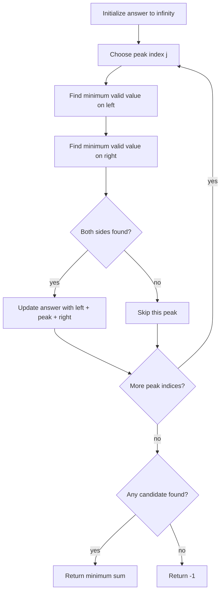

# 2908 — Minimum Sum of Mountain Triplets I

## 1. Understanding

या प्रश्नाचा गाभा म्हणजे मधला घटक मोठा असलेल्या triplet ची किमान बेरीज.

> **मराठी:** प्रश्नात काय दिले आहे आणि नेमके काय शोधायचे आहे, हे आधी स्पष्ट करा.
> Choose indices `i<j<k` such that `nums[i] < nums[j]` and `nums[k] < nums[j]`. Return the smallest possible sum of the three values, or `-1` if no mountain exists.

## 2. Worked examples and edge cases

उदाहरणे आणि सीमाप्रकरणांत मधला घटक मोठा असलेल्या triplet ची किमान बेरीज कशी लागू होते ते पाहा.

> **मराठी:** उदाहरणातील input पासून output पर्यंत प्रत्येक बदल समजून घ्या.
> For `[8,6,1,5,3]`, peak 5 has left candidate 1 and right candidate 3, sum 9. Strict inequalities matter: equal side and peak values do not qualify. A strictly increasing or decreasing array has no valid mountain.

## 3. Pattern identification + cheat sheet

येथे मुख्य pattern म्हणजे प्रत्येक मधल्या स्थानासाठी दोन्ही बाजूंची किमान पात्र मूल्ये शोधणे; वरील तुलना लक्षात घ्या.

> **मराठी:** या clues मुळे योग्य pattern ओळखता येतो; constraints आणि relations नीट तपासा.
> This is **fix the peak + best feasible side values**.
> | Fixed center `j` | Need |
> |---|---|
> | Left side | Minimum value before `j` that is `< nums[j]` |
> | Right side | Minimum value after `j` that is `< nums[j]` |
> | Candidate | `leftMin + nums[j] + rightMin` |

## 4. Approaches

पद्धतींची तुलना करताना प्रत्येक मधल्या स्थानासाठी दोन्ही बाजूंची किमान पात्र मूल्ये शोधणे याचा वेळ आणि जागेवरील परिणाम पाहा.

> **मराठी:** सोप्या उपायापासून सुरुवात करा आणि constraints नुसार योग्य optimization निवडा.
> The source includes brute force over all triples (`O(n³)`) and an improved scan of both sides for every peak (`O(n²)`). Prefix/suffix minima can reduce this further to `O(n)` by precomputing best valid side candidates.

## 5. Flowchart

आकृतीमध्ये प्रत्येक मधल्या स्थानासाठी दोन्ही बाजूंची किमान पात्र मूल्ये शोधणे ही प्रक्रिया क्रमाने दाखवली आहे.

> **मराठी:** Flowchart मध्ये प्रत्येक decision, loop आणि loop कधी थांबतो ते पाहा.

Only the best smaller value on each side is needed for a fixed peak because the peak value is fixed.

## 6. Algorithm and intuition

मूळ कल्पना: प्रत्येक मधल्या स्थानासाठी दोन्ही बाजूंची किमान पात्र मूल्ये शोधणे.

> **मराठी:** मुख्य observation समजल्यावर algorithm चे steps लक्षात ठेवणे सोपे होते.
> Enumerate the middle index. Find the smallest value to its left that is strictly below the peak and the smallest value to its right that is strictly below the peak. These minimize the sum for that peak. Keep the global minimum.

## 7. Code explanation

Code मधील state आणि updates हे प्रत्येक मधल्या स्थानासाठी दोन्ही बाजूंची किमान पात्र मूल्ये शोधणे या कल्पनेशी जोडून वाचा.

> **मराठी:** Code मधील variable आणि condition यांचा algorithm मधील उद्देश समजून घ्या.
> `minimumSumBruteForce` checks every `i<j<k`. `minimumSumOptimized` fixes `j`, scans left and right, applies strict `<` tests, and updates `result` when both candidates exist. Both return `-1` if the sentinel `INT_MAX` remains.

## 8. Dry run

Dry run मध्ये प्रत्येक मधल्या स्थानासाठी दोन्ही बाजूंची किमान पात्र मूल्ये शोधणे कसे घडते ते प्रत्येक टप्प्यावर तपासा.

> **मराठी:** प्रत्येक महत्त्वाच्या step नंतर variable ची value trace करा.
> For `[8,6,1,5,3]`, peak index 3 (value 5):
> | Side | Values inspected | Smallest value `<5` |
> |---|---|---:|
> | Left | 8, 6, 1 | 1 |
> | Right | 3 | 3 |
> | Candidate | `1+5+3` | 9 |

## 9. Complexity

प्रत्येक मधल्या स्थानासाठी दोन्ही बाजूंची किमान पात्र मूल्ये शोधणे यासाठी लागणारा वेळ आणि अतिरिक्त जागा वरील bounds मध्ये दिली आहेत.

> **मराठी:** Input size आणि प्रत्येक operation कितीदा चालतो यावरून complexity ठरवा.
> Brute force `O(n³)` time; optimized source `O(n²)` time. Both use `O(1)` extra space.

## 10. Correctness

योग्यतेचा युक्तिवाद प्रत्येक मधल्या स्थानासाठी दोन्ही बाजूंची किमान पात्र मूल्ये शोधणे यावर आधारित आहे; वरील अटी तपासा.

> **मराठी:** Invariant किंवा तर्क वापरून algorithm योग्य उत्तर देतो हे समजून घ्या.
> Every valid mountain has a unique middle index `j`, so it is considered by the optimized loop. For that peak, replacing either side element with a smaller qualifying value preserves index order and strict inequality while reducing sum. Thus the scans find the minimum candidate for that peak; taking the minimum over all peaks gives the global optimum. No candidate means no valid triplet.

## 11. Mistakes and interview traps

लक्षात ठेवा: दोन्ही बाजूंची मूल्ये मधल्या मूल्यापेक्षा काटेकोरपणे लहान असावीत.

> **मराठी:** Boundary, duplicate आणि off-by-one cases स्वतंत्रपणे तपासा.

- Require strict `<` on both sides.
- Keep index order: left index before peak, right index after.
- Use minimum qualifying values, not simply overall minimum if it is not below the peak.
- Distinguish source's `O(n²)` optimization from possible `O(n)` prefix/suffix improvement.

## 12. Quick revision

थोडक्यात, प्रत्येक मधल्या स्थानासाठी दोन्ही बाजूंची किमान पात्र मूल्ये शोधणे. दोन्ही बाजूंची मूल्ये मधल्या मूल्यापेक्षा काटेकोरपणे लहान असावीत.

> **मराठी:** दोन मिनिटांच्या revision साठी pattern, मुख्य कल्पना आणि complexity आठवा.
> Fix each peak; get smallest smaller value on each side; minimize sum; return `-1` if absent.

## 13. Related problems and variations

संबंधित प्रश्नांत मधला घटक मोठा असलेल्या triplet ची किमान बेरीज यासारखी अट बदलल्यास योग्य पद्धतही तपासा.

> **मराठी:** Related problem मध्ये constraints बदलल्यास approach कसा बदलेल ते विचारा.
> LeetCode 2874 (ordered triplet); 121 (prefix minimum); variations: maximum mountain sum, non-strict sides, or linear prefix/suffix minima.

## 14. Self-assessment

वरील प्रश्न स्वतः सोडवून मधला घटक मोठा असलेल्या triplet ची किमान बेरीज याची उजळणी करा.

> **मराठी:** उत्तर न पाहता प्रश्न सोडवा आणि तुमच्या निवडीचे कारण सांगा.

1. Why can each peak be solved independently?
2. Why must a side value be strictly smaller?
3. How could you reduce the source's `O(n²)` method to `O(n)`?
