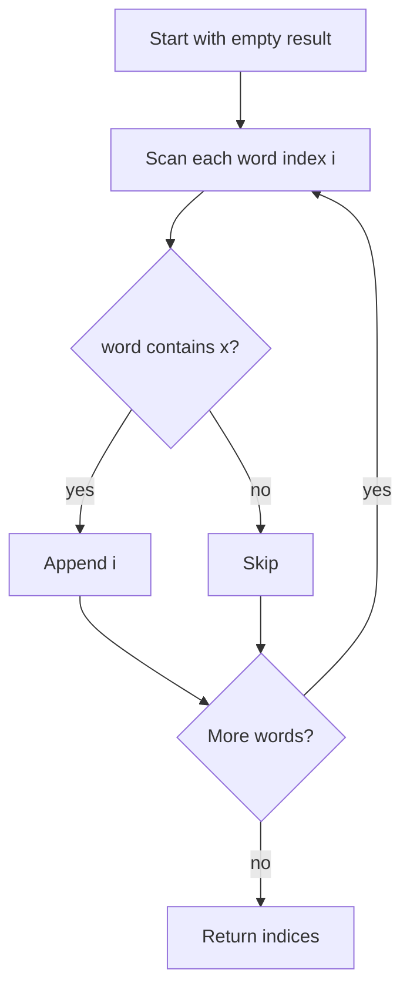

# 2942 — Find Words Containing Character

## 1. Understanding

या प्रश्नाचा गाभा म्हणजे दिलेला अक्षर असलेल्या शब्दांचे indices शोधणे.

> **मराठी:** प्रश्नात काय दिले आहे आणि नेमके काय शोधायचे आहे, हे आधी स्पष्ट करा.
> Given `words` and a character `x`, return indices of every word containing `x`. Each matching index appears once, in increasing input order.

## 2. Worked examples and edge cases

उदाहरणे आणि सीमाप्रकरणांत दिलेला अक्षर असलेल्या शब्दांचे indices शोधणे कशी लागू होते ते पाहा.

> **मराठी:** उदाहरणातील input पासून output पर्यंत प्रत्येक बदल समजून घ्या.
> For `["apple","banana","cherry"]` and `'a'`, return `[0,1]`. A word containing the character multiple times is still reported once. If no word contains it, return an empty vector.

## 3. Pattern identification + cheat sheet

येथे मुख्य pattern म्हणजे प्रत्येक शब्दात अक्षर शोधून पात्र index नोंदवणे; वरील तुलना लक्षात घ्या.

> **मराठी:** या clues मुळे योग्य pattern ओळखता येतो; constraints आणि relations नीट तपासा.
> This is a **linear scan + string membership test**.
> | Need | Operation |
> |---|---|
> | Preserve original order | Scan indices ascending |
> | Test whether character occurs | `string::find` |
> | Avoid duplicate indices | Append once per word |

## 4. Approaches

पद्धतींची तुलना करताना प्रत्येक शब्दात अक्षर शोधून पात्र index नोंदवणे याचा वेळ आणि जागेवरील परिणाम पाहा.

> **मराठी:** सोप्या उपायापासून सुरुवात करा आणि constraints नुसार योग्य optimization निवडा.
> Nested character loops are direct. The source uses `string::find`, which is concise and scans each word. Building an inverted index is unnecessary for a single query.

## 5. Flowchart

आकृतीमध्ये प्रत्येक शब्दात अक्षर शोधून पात्र index नोंदवणे ही प्रक्रिया क्रमाने दाखवली आहे.

> **मराठी:** Flowchart मध्ये प्रत्येक decision, loop आणि loop कधी थांबतो ते पाहा.

One membership test per word ensures repeated occurrences do not duplicate that word's index.

## 6. Algorithm and intuition

मूळ कल्पना: प्रत्येक शब्दात अक्षर शोधून पात्र index नोंदवणे.

> **मराठी:** मुख्य observation समजल्यावर algorithm चे steps लक्षात ठेवणे सोपे होते.
> Scan words from left to right. If `find(x)` succeeds, append the current index. This directly preserves the required order.

## 7. Code explanation

Code मधील state आणि updates हे प्रत्येक शब्दात अक्षर शोधून पात्र index नोंदवणे या कल्पनेशी जोडून वाचा.

> **मराठी:** Code मधील variable आणि condition यांचा algorithm मधील उद्देश समजून घ्या.
> `findWordsContaining` takes a const reference to the word list and a character. It compares `words[i].find(x)` with `string::npos`, appending `i` on a match. It does not modify inputs.

## 8. Dry run

Dry run मध्ये प्रत्येक शब्दात अक्षर शोधून पात्र index नोंदवणे कसे घडते ते प्रत्येक टप्प्यावर तपासा.

> **मराठी:** प्रत्येक महत्त्वाच्या step नंतर variable ची value trace करा.
> Words `["apple","banana","cherry"]`, `x='a'`:
> | Index | Word | Contains `a`? | Result |
> |---:|---|---|---|
> | 0 | apple | yes | `[0]` |
> | 1 | banana | yes | `[0,1]` |
> | 2 | cherry | no | `[0,1]` |

## 9. Complexity

प्रत्येक शब्दात अक्षर शोधून पात्र index नोंदवणे यासाठी लागणारा वेळ आणि अतिरिक्त जागा वरील bounds मध्ये दिली आहेत.

> **मराठी:** Input size आणि प्रत्येक operation कितीदा चालतो यावरून complexity ठरवा.
> If total input characters is `C`, time is `O(C)` in the worst case; extra result space is `O(n)` worst case.

## 10. Correctness

योग्यतेचा युक्तिवाद प्रत्येक शब्दात अक्षर शोधून पात्र index नोंदवणे यावर आधारित आहे; वरील अटी तपासा.

> **मराठी:** Invariant किंवा तर्क वापरून algorithm योग्य उत्तर देतो हे समजून घ्या.
> Every word is inspected once in ascending index order. `find` succeeds exactly when the word contains `x`; the algorithm appends that index once and only then. Therefore the output contains exactly all matching indices, without duplicates, in order.

## 11. Mistakes and interview traps

लक्षात ठेवा: एका शब्दात अक्षर अनेकदा असले तरी index एकदाच घ्यायचा.

> **मराठी:** Boundary, duplicate आणि off-by-one cases स्वतंत्रपणे तपासा.

- Compare against `string::npos`.
- Add the word index once even if the character appears many times.
- Return indices, not matching words.
- Preserve order; don't sort or use an unordered result.

## 12. Quick revision

थोडक्यात, प्रत्येक शब्दात अक्षर शोधून पात्र index नोंदवणे. एका शब्दात अक्षर अनेकदा असले तरी index एकदाच घ्यायचा.

> **मराठी:** दोन मिनिटांच्या revision साठी pattern, मुख्य कल्पना आणि complexity आठवा.
> For each index `i`, if `words[i].find(x) != npos`, append `i`.

## 13. Related problems and variations

संबंधित प्रश्नांत दिलेला अक्षर असलेल्या शब्दांचे indices शोधणे यासारखी अट बदलल्यास योग्य पद्धतही तपासा.

> **मराठी:** Related problem मध्ये constraints बदलल्यास approach कसा बदलेल ते विचारा.
> LeetCode 14 (Longest Common Prefix); 28 (Find the Index of the First Occurrence); variations: return words containing all query characters or collect matching positions within each word.

## 14. Self-assessment

वरील प्रश्न स्वतः सोडवून दिलेला अक्षर असलेल्या शब्दांचे indices शोधणे याची उजळणी करा.

> **मराठी:** उत्तर न पाहता प्रश्न सोडवा आणि तुमच्या निवडीचे कारण सांगा.

1. What does `string::npos` indicate?
2. Why is an index appended only once per word?
3. What is the worst-case time in terms of total character count?
