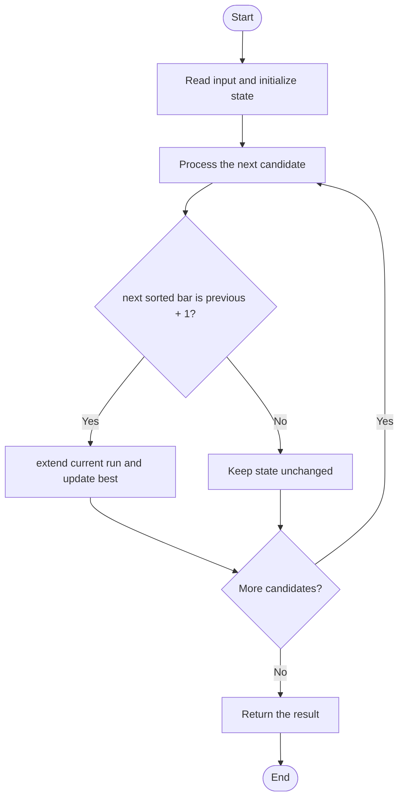

# 2943 — Maximize the Area of a Square Hole in a Grid

## 1. Problem understanding and constraints

Given removable horizontal and vertical bars, find the largest square opening. Consecutive removed bars extend an opening by one; the square side is one more than the shorter consecutive run. Inputs are valid bar indices within the grid dimensions. **थोडक्यात:** काय मोजायचे/निवडायचे ते आधी स्पष्ट करा; मगच code निवडा.

## 2. Stepwise example and edge cases

> **मराठी:** प्रश्नात काय दिले आहे आणि नेमके काय शोधायचे आहे, हे आधी स्पष्ट करा.
> `n=m=5, hBars=[2,3], vBars=[2,3]` gives runs 2 and 2, side 3, area 9. No consecutive pair gives side 2 when each direction has at least one removable bar. **Edge cases:** check smallest valid input, ties/boundaries, and empty/no-match outcomes where constraints allow them.

## 3. Pattern identification — clue table

Longest consecutive run in two independent dimensions; answer is `min(runH, runV)+1`, squared. हा मुख्य pattern आहे.
| Clue | What it suggests |
|---|---|
| Output depends on longest consecutive run in two independent dimensions | Keep only the relevant state; avoid unrelated recomputation |
| Need to preserve the stated condition | State an invariant before coding |
| Input scan/order matters | Update once per item and test boundaries |

## 4. Multiple approaches

`maximizeSquareHoleArea_sorting` sorts each list and scans runs: correct, `O(H log H+V log V)`. Set-based grouping is also correct but uses more memory. Boolean marking is useful only when dimensions are small; it scans dimension-sized arrays. **योग्य निवड:** source मध्ये असलेली method आणि तिच्या मर्यादा वेगळ्या ओळखा.

## 5. Flowchart

Flow समजताना decision condition आणि update invariant शी जुळतात का ते तपासा.

## 6. Selected algorithm and intuition

> **मराठी:** मुख्य observation समजल्यावर algorithm चे steps लक्षात ठेवणे सोपे होते.
> Sort removable bar numbers; a gap of exactly one continues the run, any larger gap starts a new run. Only the smaller opening can bound a square.

## 7. Code-specific explanation

> **मराठी:** Code मधील variable आणि condition यांचा algorithm मधील उद्देश समजून घ्या.
> `LeetCode\2943\2943.cpp` — The source provides sorting, set, and marking methods. The demo calls all three. Sorting parameters are passed by value, so the copied bar lists use linear extra memory; ignore `n,m` except for the marking variant.

## 8. Dry run

> **मराठी:** प्रत्येक महत्त्वाच्या step नंतर variable ची value trace करा.
> | Step | State / action |
> |---:|---|
> | 1 | `hBars=[2,3,5]`: scan 2→3 extends run to 2 |
> | 2 | 5 resets it to 1. `vBars=[1,2,3]` has run 3. Side=`min(2,3)+1=3`, area=9. |

## 9. Complexity

> **मराठी:** Input size आणि प्रत्येक operation कितीदा चालतो यावरून complexity ठरवा.
> Sorting method: `O(H log H+V log V)` time and `O(H+V)` extra space for pass-by-value copies (plus sorting stack). Set method: same asymptotic time, `O(H+V)` space. Marking method: `O(n+m+H+V)` time and `O(n+m)` space.

## 10. Correctness

> **मराठी:** Invariant किंवा तर्क वापरून algorithm योग्य उत्तर देतो हे समजून घ्या.
> A run of r consecutive removable bars creates exactly r+1 open grid units in that direction. Taking the longest run per dimension and then the smaller side gives the largest feasible square; squaring it returns its area.

## 11. Mistakes and interview traps

> **मराठी:** Boundary, duplicate आणि off-by-one cases स्वतंत्रपणे तपासा.

- Add 1 to the run length before squaring.
- Use the smaller of horizontal and vertical openings.
- Empty removable-bar lists need a baseline run of zero; the sorting variant initializes to one and relies on the stated input constraints.

## 12. Quick revision

**झटपट:** Sort removable bar numbers; a gap of exactly one continues the run, any larger gap starts a new run. Only the smaller opening can bound a square. Pattern ओळखा, condition तपासा, आणि answer एकदाच योग्य पद्धतीने update करा.

## 13. Related patterns and variations

> **मराठी:** या clues मुळे योग्य pattern ओळखता येतो; constraints आणि relations नीट तपासा.
> Longest consecutive sequence; histogram/coordinate scans; grid geometry.

## 14. Self-assessment

> **मराठी:** उत्तर न पाहता प्रश्न सोडवा आणि तुमच्या निवडीचे कारण सांगा.

1. Why is the side one larger than the removed-bar run?
2. Why does the smaller dimension limit the square?
3. Which implementation is unsuitable for very large dimensions?
