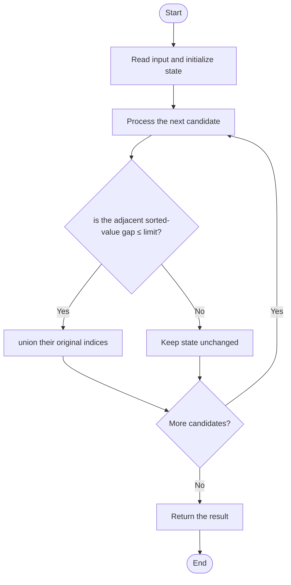

# 2948 — Make Lexicographically Smallest Array by Swapping Elements

## 1. Problem understanding and constraints

You may swap values when their difference is at most `limit`; swaps can chain through other values. Return the lexicographically smallest reachable arrangement. Array values can be negative, so compare adjacent sorted values carefully. **थोडक्यात:** काय मोजायचे/निवडायचे ते आधी स्पष्ट करा; मगच code निवडा.

## 2. Stepwise example and edge cases

> **मराठी:** प्रश्नात काय दिले आहे आणि नेमके काय शोधायचे आहे, हे आधी स्पष्ट करा.
> `nums=[1,4,3,9], limit=1`: sorted gaps greater than 1 split the values into `{1}`, `{3,4}`, `{9}`. Values 3 and 4 can swap within their original component indices. **Edge cases:** check smallest valid input, ties/boundaries, and empty/no-match outcomes where constraints allow them.

## 3. Pattern identification — clue table

Sort values to discover connected components; DSU represents transitive swap reachability. हा मुख्य pattern आहे.
| Clue | What it suggests |
|---|---|
| Output depends on sort values to discover connected components | Keep only the relevant state; avoid unrelated recomputation |
| Need to preserve the stated condition | State an invariant before coding |
| Input scan/order matters | Update once per item and test boundaries |

## 4. Multiple approaches

Brute-force swapping one pair repeatedly is correct but can be very slow and awkward to terminate. The source sorts `(value,index)` pairs, unions adjacent values within `limit`, then sorts indices and values per component; correct, `O(n log n)`. Unioning all eligible pairs is unnecessary. **योग्य निवड:** source मध्ये असलेली method आणि तिच्या मर्यादा वेगळ्या ओळखा.

## 5. Flowchart

Flow समजताना decision condition आणि update invariant शी जुळतात का ते तपासा.

## 6. Selected algorithm and intuition

> **मराठी:** मुख्य observation समजल्यावर algorithm चे steps लक्षात ठेवणे सोपे होते.
> In sorted order, a gap greater than `limit` is an uncrossable boundary. Within a component, chained legal swaps allow any permutation, so assign its smallest values to its smallest indices.

## 7. Code-specific explanation

> **मराठी:** Code मधील variable आणि condition यांचा algorithm मधील उद्देश समजून घ्या.
> `LeetCode\2948\2948.cpp` — `lexicographicallySmallestArray` uses path compression in `find`, unions adjacent sorted pairs, groups values and original indices by root, then writes sorted values back. It mutates and returns `nums`.

## 8. Dry run

> **मराठी:** प्रत्येक महत्त्वाच्या step नंतर variable ची value trace करा.
> | Step | State / action |
> |---:|---|
> | 1 | Sorted pairs: `(1,1),(3,2),(4,0),(9,3)`. Only 3–4 is an edge. Their component has indices `[0,2]` and values `[3,4]`, assigned in that order. |

## 9. Complexity

> **मराठी:** Input size आणि प्रत्येक operation कितीदा चालतो यावरून complexity ठरवा.
> `O(n log n+n α(n))` time, dominated by sorting; `O(n)` auxiliary space for pairs, DSU, and groups.

## 10. Correctness

> **मराठी:** Invariant किंवा तर्क वापरून algorithm योग्य उत्तर देतो हे समजून घ्या.
> Every permitted swap links two values whose difference is within the limit. In sorted order, adjacent eligible edges generate exactly the transitive components; a larger gap separates components. Any permutation within one component is reachable, and ascending values assigned to ascending indices are lexicographically minimal.

## 11. Mistakes and interview traps

> **मराठी:** Boundary, duplicate आणि off-by-one cases स्वतंत्रपणे तपासा.

- Connectivity is transitive: endpoints can differ by more than `limit` and still belong together.
- A gap greater than the limit splits components.
- Group indices and values independently before assigning; unordered-map iteration order is irrelevant.

## 12. Quick revision

**झटपट:** In sorted order, a gap greater than `limit` is an uncrossable boundary. Within a component, chained legal swaps allow any permutation, so assign its smallest values to its smallest indices. Pattern ओळखा, condition तपासा, आणि answer एकदाच योग्य पद्धतीने update करा.

## 13. Related patterns and variations

> **मराठी:** या clues मुळे योग्य pattern ओळखता येतो; constraints आणि relations नीट तपासा.
> Union-Find connected components; sorting + grouping; lexicographic greedy assignment.

## 14. Self-assessment

> **मराठी:** उत्तर न पाहता प्रश्न सोडवा आणि तुमच्या निवडीचे कारण सांगा.

1. Why are only adjacent sorted values checked?
2. Can two values more than `limit` apart still be swappable indirectly?
3. Why assign sorted values to sorted indices?
