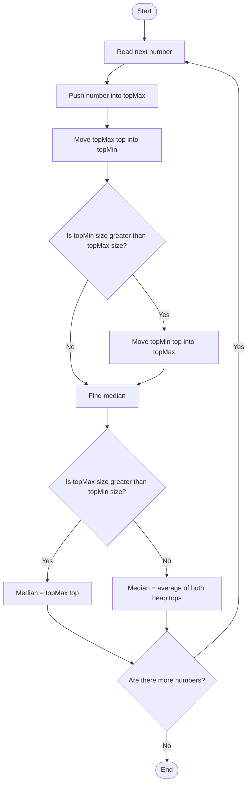

# 295. Find Median from Data Stream

## 1. Problem Understanding

या problem मध्ये numbers एकेक करून stream मधून येतात. प्रत्येक नवीन number नंतर आतापर्यंत आलेल्या सर्व numbers चा **median** शोधायचा आहे.

- `addNum(num)`: stream मध्ये नवीन number जोडा.
- `findMedian()`: आतापर्यंतच्या numbers चा median परत करा.
  Numbers चा क्रम बदलत नाही; प्रत्येक वेळी नवीन number जोडला जातो. Median म्हणजे sorted क्रमातील मधला number. Numbers ची संख्या even असेल, तर मधल्या दोन numbers ची average median असते.
  उदाहरणार्थ, `[2, 5, 8]` चा median `5` आहे. `[2, 5, 8, 10]` चा median `(5 + 8) / 2 = 6.5` आहे.
  **महत्त्वाचे:** दिलेला C++ program प्रत्येक insertion नंतर median काढतो आणि brute-force व two-heaps approaches यांची तुलना करतो. LeetCode वरील API मध्ये `addNum` आणि `findMedian` methods अपेक्षित असतात.

## 2. Example Understanding

### Example A: Odd count

Stream: `[5, 2, 8]`
| Insert केलेला number | Sorted numbers | Median |
|---:|---|---:|
| 5 | `[5]` | 5 |
| 2 | `[2, 5]` | 3.5 |
| 8 | `[2, 5, 8]` | 5 |
तीन numbers असताना एकच middle number असतो.

### Example B: Even count

Stream: `[5, 2, 8, 10]`
| Insert केलेला number | Sorted numbers | Median |
|---:|---|---:|
| 5 | `[5]` | 5 |
| 2 | `[2, 5]` | 3.5 |
| 8 | `[2, 5, 8]` | 5 |
| 10 | `[2, 5, 8, 10]` | 6.5 |
चार numbers असताना मधले दोन `5` आणि `8` आहेत; त्यांची average `6.5` आहे.

### Edge cases

- एकच number: median तोच number.
- दोन numbers: दोन्हींची average.
- Duplicate values: duplicates स्वतंत्र stream entries म्हणून मोजले जातात.
- Negative values: heaps आणि median ची ही पद्धत negative numbers साठीही चालते.

## 3. Problem Identification

### Pattern Recognition Cheat Sheet

| Clue in Question                                           | Possible Pattern        | Why?                                                                      |
| ---------------------------------------------------------- | ----------------------- | ------------------------------------------------------------------------- |
| Numbers सतत येतात आणि प्रत्येक insertion नंतर median हवा   | Two heaps               | Sorted list पुन्हा पुन्हा बनवण्याऐवजी lower/upper halves सांभाळता येतात   |
| वारंवार middle किंवा extreme value विचारली जाते            | Heap / order-statistics | Heap मधून संबंधित boundary value पटकन मिळते                               |
| Data insert होत असताना प्रश्नाचे उत्तरही update करायचे आहे | Online algorithm        | सर्व input येईपर्यंत थांबता येत नाही; प्रत्येक step ला state राखावी लागते |

स्वतःला विचारा:

1. Median साठी sorted order मध्ये कोणते element(s) आवश्यक आहेत?
2. पूर्ण array प्रत्येक वेळी sort करणे आवश्यक आहे का, की फक्त middle जवळचे elements पुरेसे आहेत?
3. दोन भाग केले, तर त्यांच्या मधल्या boundary वर कोणती values ठेवणे उपयोगी ठरेल?
   **अनुभवी problem solver ची observation:** median साठी पूर्ण क्रमाची गरज नाही. Lower half मधला सर्वात मोठा आणि upper half मधला सर्वात लहान element मिळाला, तर median काढता येतो.

## 4. Different Approaches

### Approach 1: प्रत्येक वेळी sort करणे (Brute force)

**Intuition:** सर्व numbers vector मध्ये साठवा. Median विचारल्यावर vector ची copy sort करा आणि मधले element(s) घ्या. हे तुमच्या `addNumBrute` आणि `findMedianBrute` methods मध्ये आहे.
**Steps:**

1. नवीन number vector मध्ये जोडा.
2. Median मागितल्यावर vector ची copy तयार करा.
3. Copy sort करा.
4. Odd count असेल तर middle element; even count असेल तर मधल्या दोनची average द्या.
   **का योग्य आहे?** प्रत्येक query वेळी संपूर्ण data sort केल्यामुळे answer बरोबर मिळतो. कमी operations किंवा लहान input साठी समजायला सोपा पर्याय आहे.
   **का पुरेसा वेगवान नसेल?** प्रत्येक median query ला पुन्हा sorting होते. मोठ्या stream मध्ये हा खर्च वाढतो.

- फायदे: implementation सोपी, प्रत्येक वेळी values चा sorted क्रम उपलब्ध.
- तोटे: वारंवार sort करावे लागते; query महाग.
- कधी वापरावे: input लहान असेल, किंवा correctness तपासण्यासाठी reference implementation म्हणून.

### Approach 2: दोन heaps (Optimized)

**Intuition:** Numbers दोन भागांत ठेवा:

- `topMax`: lower half साठी max-heap; lower half मधील सर्वात मोठा number वर असतो.
- `topMin`: upper half साठी min-heap; upper half मधील सर्वात लहान number वर असतो.
  यामुळे दोन्ही halves च्या मधल्या boundary वरील values लगेच मिळतात. तुमच्या code मध्ये heaps `topMax` आणि `topMin` नावाने आहेत.
  **Heap invariants:**

1. `topMax` मधील प्रत्येक value `topMin` मधील प्रत्येक value पेक्षा लहान किंवा समान असते.
2. `topMax` चा size `topMin` च्या size इतका किंवा त्यापेक्षा फक्त एकाने मोठा असतो.
   **एका number ची भर:**
3. Number `topMax` मध्ये push करा.
4. `topMax` चा सर्वात मोठा number `topMin` मध्ये हलवा. त्यामुळे halves मधील ordering योग्य राहते.
5. `topMin` मोठा झाला, तर त्याचा सर्वात लहान number परत `topMax` मध्ये हलवा. त्यामुळे size balance राखला जातो.
   **Median:**

- `topMax` मध्ये एक extra element असल्यास, `topMax.top()` median.
- Sizes समान असल्यास, `(topMax.top() + topMin.top()) / 2.0`.
  **का योग्य आहे?** Heaps चे invariant प्रत्येक insertion नंतर दोन्ही halves चा क्रम आणि आकार सांभाळतात. त्यामुळे middle value(s) नेहमी heap tops वर असतात.
  **मर्यादा:** पूर्ण sorted sequence तयार होत नाही; फक्त median साठी लागणाऱ्या boundary values सहज मिळतात. या problem साठी ते पुरेसे आहे.
  | Approach | Add | Median query | Extra space | Pros | Cons |
  |---|---:|---:|---:|---|---|
  | Vector + sort-on-query | `O(1)` amortized | `O(n log n)` | `O(n)` | सोपा; समजायला आणि validate करायला उपयुक्त | प्रत्येक query ला sort |
  | Two heaps | `O(log n)` | `O(1)` | `O(n)` | Online median; query जलद | दोन heaps आणि balancing logic समजणे आवश्यक |
  `n` म्हणजे त्या वेळेपर्यंत stream मध्ये आलेल्या numbers ची संख्या. Vector approach मध्ये query करताना copy साठी `O(n)` अतिरिक्त memory देखील लागते.

## 5. Flowchart Using Mermaid

**Flow समजून घ्या:** प्रत्येक number आधी lower-half max-heap मध्ये जातो. मग boundary element upper-half min-heap मध्ये हलवून क्रम राखला जातो. Size imbalance असेल, तर एक element परत हलवतो. Median query आल्यावर heap sizes तपासून एक top value किंवा दोन्ही tops ची average घेतो. Stream संपल्यावर प्रक्रिया थांबते.

## 6. Algorithm / Intuition

Final optimized approach म्हणजे two heaps. याची मुख्य कल्पना अशी: sorted array मधील फक्त middle point आवश्यक आहे; lower half चा maximum आणि upper half चा minimum पुरेसा आहे.

1. `topMax` मध्ये lower half ठेवा.
2. `topMin` मध्ये upper half ठेवा.
3. प्रत्येक insertion नंतर values ची ordering योग्य ठेवण्यासाठी `topMax` चा top `topMin` मध्ये हलवा.
4. दोन्ही heaps चे sizes balance करा.
5. Median मागितल्यावर size आणि heap tops वापरून उत्तर द्या.
   `topMax` आणि `topMin` हे दोन्ही heaps एकत्रितपणे सर्व inserted numbers ठेवतात; data discard होत नाही.

## 7. Code Explanation

### Brute-force methods

- `arr`: stream मधील सर्व values साठवतो.
- `addNumBrute(int num)`: value शेवटी जोडतो.
- `findMedianBrute()`: `arr` ची copy sort करतो. Odd size मध्ये `temp[n / 2]`; even size मध्ये middle दोन values ची floating-point average देतो.

### Two-heaps methods

- `topMax`: max-heap; lower half मधील सर्वात मोठी value `top()` वर.
- `topMin`: min-heap; upper half मधील सर्वात लहान value `top()` वर.
- `addNumHeap(int num)`: value insert करतो, heaps मधील boundary value हलवतो आणि sizes संतुलित करतो.
- `findMedianHeap()`: heap sizes वरून middle value किंवा middle दोन values ची average देतो.

### `main()`

`main()` fast I/O सुरू करतो, hardcoded test cases घेतो, आणि प्रत्येक test case साठी नवीन `Solution` object वापरतो. प्रत्येक inserted number नंतर दोन्ही implementations चे median छापतो. त्यामुळे समान input वर दोन्ही answers ची तुलना होते.

### Code-review notes

- दिलेल्या test cases मध्ये प्रत्येक `findMedian...()` call च्या आधी किमान एक number insert केला आहे. Empty stream वर median विचारल्यास हे methods valid answer देत नाहीत; API वापरताना आधी `addNum` call करणे अपेक्षित आहे.
- `findMedianHeap()` मध्ये even count साठी दोन `int` values add करण्याआधी `double` cast केला आहे. यामुळे integer addition overflow होण्याचा धोका टाळला जातो.
- LeetCode submission साठी साधारणपणे demo `main()` ऐवजी platform ने मागितलेली `MedianFinder` class आणि `addNum`/`findMedian` method signatures वापरावी लागतील. इथला code comparison/demo स्वरूपात आहे.

## 8. Dry Run

Stream: `[5, 2, 8, 10]`
| Step | Insert | `topMax` (lower half) | `topMin` (upper half) | Condition / action | Median |
|---:|---:|---|---|---|---:|
| 1 | 5 | `[5]` | `[]` | Size balance योग्य | 5 |
| 2 | 2 | `[2]` | `[5]` | `topMax` मधून `5` हलवले; sizes समान असल्याने आणखी rebalance नाही | 3.5 |
| 3 | 8 | `[5, 2]` | `[8]` | `8` upper half मध्ये; `topMax` एकाने मोठा | 5 |
| 4 | 10 | `[5, 2]` | `[8, 10]` | Halves समान आकाराचे | 6.5 |
`topMax`/`topMin` मधील bracket मधील क्रम heap चा internal storage क्रम दर्शवतो; महत्त्वाची values अनुक्रमे `top()` आहेत: `topMax.top()` आणि `topMin.top()`.

## 9. Complexity Analysis

### Brute force

- Add: `O(1)` amortized, vector च्या शेवटी append.
- Median query: `O(n log n)`, कारण `n` values sort होतात.
- Query-time extra space: `O(n)`, कारण vector ची copy तयार होते.
- Stored space: `O(n)`.

### Two heaps

- Add: `O(log n)`. Constant number of heap push/pop operations होतात; प्रत्येक `O(log n)`.
- Median query: `O(1)`. फक्त heap sizes आणि top values वापरतो.
- Stored space: `O(n)`, कारण सर्व values दोन्ही heaps मध्ये ठेवले जातात.
  Stream मध्ये अनेक median queries असतील, तर two heaps चा query फायदा महत्त्वाचा ठरतो. दोन्ही approaches सर्व values साठवत असल्यामुळे space `O(n)` आहे.

## 10. Why This Solution Works

Two heaps चे दोन invariants कायम आहेत:

1. **Ordering:** lower half मधील values upper half पेक्षा मोठ्या नसतात. Insertion नंतर `topMax` मधील सर्वात मोठी value `topMin` मध्ये हलवल्याने boundary योग्य राहते.
2. **Balance:** `topMax` मध्ये `topMin` एवढे किंवा एकाने अधिक elements असतात. `topMin` मोठा झाल्यावर त्याचा top परत हलवल्याने balance restore होतो.
   म्हणून:

- Odd count मध्ये lower half मध्ये एक extra value असते; तिचा maximum म्हणजे संपूर्ण sorted क्रमातील middle value.
- Even count मध्ये halves समान आकाराचे असतात; lower maximum आणि upper minimum हे दोन middle values असतात.
  प्रत्येक insertion मध्ये मर्यादित heap operations होतात, त्यामुळे algorithm संपतो. प्रत्येक value heap मध्ये योग्य भागात राहते आणि median साठी आवश्यक boundary हरवत नाही.

## 11. Common Mistakes & Interview Traps

- Heap sizes मध्ये फरक एकापेक्षा जास्त होऊ देणे.
- `topMax.top() <= topMin.top()` अशी boundary ordering न राखणे.
- Even count साठी integer division करणे; `/ 2.0` वापरा.
- Empty stream वर `top()` वाचणे.
- Duplicate values वेगवेगळे stream entries आहेत हे विसरणे.
- Brute-force sorting ची query complexity `O(n log n)` आहे हे नोंदवायला विसरणे.
- LeetCode API signatures आणि या file मधील demo method names गोंधळणे.
  **Interview follow-ups:**
- Median शोधताना काही values काढून टाकायच्या असतील तर heaps कसे update कराल?
- Sliding window median साठी outgoing elements कसे हाताळाल?
- Data memory मध्ये ठेवता येत नसेल तर काय अडचणी येतील?
- प्रत्येक insertion ऐवजी फक्त ठरावीक वेळी query असेल, तर कोणते पर्याय योग्य ठरतील?

## 12. Revision Notes (Quick Recall)

- **Pattern:** Online median / two heaps.
- **Clues:** Numbers stream स्वरूपात येतात; प्रत्येक insertion नंतर median हवा.
- **Core intuition:** Lower half चा maximum आणि upper half चा minimum सांभाळा.
- **Invariants:** Lower half `topMax` मध्ये; upper half `topMin` मध्ये; `topMax` चा size समान किंवा एकाने मोठा.
- **Median:** `topMax` मोठा असल्यास त्याचा top; sizes समान असल्यास दोन्ही tops ची average.
- **Complexity:** Insert `O(log n)`, median `O(1)`, space `O(n)`.
- **Mistakes:** Balancing/order विसरणे, integer division, empty heaps वर `top()`.
- **One-line takeaway:** पूर्ण stream sort न करता दोन heaps च्या tops मधून median मिळवा.

## 13. Similar Problem Recognition

हीच दोन-heaps कल्पना **running median**, **sliding window median**, आणि stream मधील lower/upper quantile सारख्या प्रश्नांसाठी उपयोगी पडते.

- Sliding window मध्ये नवीन value insert करण्याबरोबर window मधून बाहेर पडलेली value remove करावी लागते; साधे heaps deletion साठी थेट पुरेसे नाहीत. Lazy deletion किंवा दुसरी योग्य ordered data structure आवश्यक होऊ शकते.
- फक्त `k`-th smallest/largest हवा असल्यास, सर्व values दोन भागांत विभागण्याऐवजी `k` boundary राखणारा heap उपयोगी ठरू शकतो.
- फक्त एकदाच median काढायचा असेल, तर sorting किंवा selection algorithm पुरेसा असू शकतो; streaming updates असतील तेव्हा दोन heaps अधिक योग्य pattern आहे.
  Similar problems पाहताना आधी विचारा: **डेटा online येतो का? प्रत्येक update नंतर middle/order statistic हवा का?** उत्तर हो असेल तर दोन heaps विचारात घ्या.

## 14. Final Self-Assessment

1. दोन heaps मध्ये values ठेवण्यामागची मुख्य observation काय आहे?
2. `topMax` मध्ये नेहमी किती elements असू शकतात, `topMin` च्या तुलनेत?
3. Even number of values असताना median कोणत्या दोन heap values वरून मिळतो?
4. `n` insertions नंतर एकूण `n` median queries केल्यास brute-force sorting आणि two-heaps यांचे काम कसे वेगळे आहे?
5. या code मध्ये stream रिकामा असताना `findMedianHeap()` का call करू नये?
