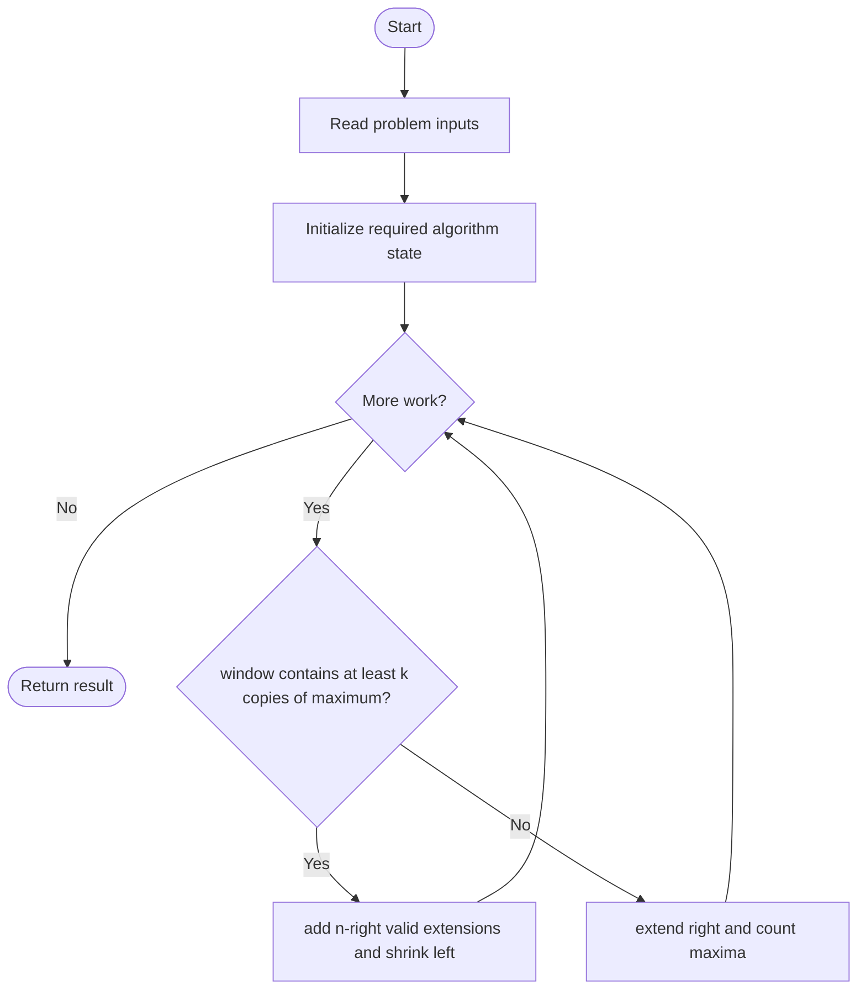
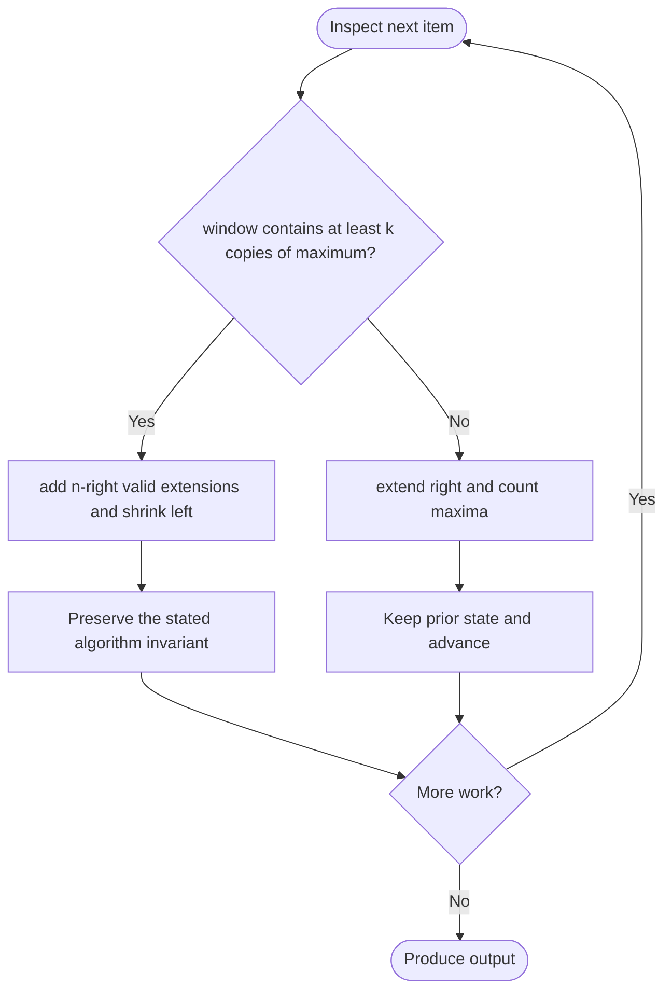

# Count Subarrays Where Max Element Appears at Least K Times

**LeetCode ID:** 2962

**Source file(s):** `2962.cpp` (originally `countSubarrays2962.cpp`)

**Identification evidence:** The original filename, declared signature, and distinctive behavior described below uniquely identify this problem; no number was inferred from a filename alone.

## Expected input/output or judge interface

countSubarraysBruteForce/Optimized(vector<int>& nums,int k). Inputs follow the problem constraints; the output is the documented scalar, sequence, or design-object behavior. The description below reflects the implementation actually present in the source.

## Main flow



## Important branch and loop flow



## Core logic and invariant

Finds the global maximum and counts subarrays containing it at least k times; the sliding window adds all valid endings.

The key branch/loop rule above is applied once per relevant item; the algorithm relies on that rule to preserve its state and produce the required result.

## Optimization / comparison

Once a window has k maxima, every rightward extension remains valid; shrink until invalid.

## Complexity

Brute force O(n^2); sliding window O(n); O(1) auxiliary space.

## Compile and run

The repository file includes a standalone demonstration `main()`; it is not a raw LeetCode submission unit. From the repository root, with a C++17 compiler:

```powershell
g++ -std=c++17 LeetCode\2962\2962.cpp -o solution.exe
.\solution.exe
```

For LeetCode's class-method judge, copy the relevant class/method or design-class API and omit the demo `main()` and local harness. Adapt free-function implementations to the requested `Solution` class signature where necessary. See the source caveat above for any compile blocker.
