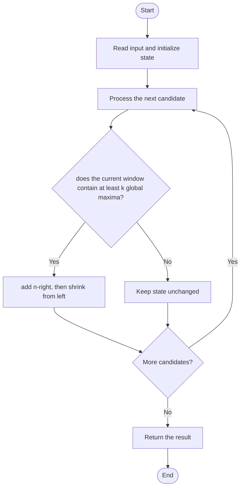

# 2962 — Count Subarrays Where Max Element Appears at Least K Times

## 1. Problem understanding and constraints

Count subarrays containing the array's global maximum at least `k` times. Values below the global maximum do not affect validity; the answer can exceed 32-bit range, so use `long long`. **थोडक्यात:** काय मोजायचे/निवडायचे ते आधी स्पष्ट करा; मगच code निवडा.

## 2. Stepwise example and edge cases

> **मराठी:** प्रश्नात काय दिले आहे आणि नेमके काय शोधायचे आहे, हे आधी स्पष्ट करा.
> `nums=[1,3,2,3,3], k=2` returns 6. Once a window has two 3s, every extension to the right remains valid. **Edge cases:** check smallest valid input, ties/boundaries, and empty/no-match outcomes where constraints allow them.

## 3. Pattern identification — clue table

Sliding window / two pointers; count valid suffix extensions. हा मुख्य pattern आहे.
| Clue | What it suggests |
|---|---|
| Output depends on sliding window / two pointers | Keep only the relevant state; avoid unrelated recomputation |
| Need to preserve the stated condition | State an invariant before coding |
| Input scan/order matters | Update once per item and test boundaries |

## 4. Multiple approaches

The source brute-force method examines each start and stops at its kth maximum: correct but `O(n²)` worst case. The optimized window is correct and linear. Do not count only windows of exact length—the condition is “at least k.” **योग्य निवड:** source मध्ये असलेली method आणि तिच्या मर्यादा वेगळ्या ओळखा.

## 5. Flowchart

Flow समजताना decision condition आणि update invariant शी जुळतात का ते तपासा.

## 6. Selected algorithm and intuition

> **मराठी:** मुख्य observation समजल्यावर algorithm चे steps लक्षात ठेवणे सोपे होते.
> For each right endpoint, while the window has k maxima, every subarray beginning at `left` or later through the current left boundary is valid; add `n-right`, then shrink.

## 7. Code-specific explanation

> **मराठी:** Code मधील variable आणि condition यांचा algorithm मधील उद्देश समजून घ्या.
> `LeetCode\2962\2962.cpp` — `countSubarraysOptimized` computes the global max, tracks its count in `[left,right]`, and repeatedly adds `n-right` before removing the left item. Both methods return `long long`.

## 8. Dry run

> **मराठी:** प्रत्येक महत्त्वाच्या step नंतर variable ची value trace करा.
> | Step | State / action |
> |---:|---|
> | 1 | For `[1,3,2,3,3], k=2`: at right=3 the window has two 3s, add 2 endings |
> | 2 | shrink. At right=4, add 2 then 1 as the left edge advances. Total 6. |

## 9. Complexity

> **मराठी:** Input size आणि प्रत्येक operation कितीदा चालतो यावरून complexity ठरवा.
> Optimized: `O(n)` time, `O(1)` auxiliary space. Brute force: `O(n²)` worst-case time, `O(1)` space. Each window boundary advances at most n times.

## 10. Correctness

> **मराठी:** Invariant किंवा तर्क वापरून algorithm योग्य उत्तर देतो हे समजून घ्या.
> For a fixed right endpoint with at least k maxima, every starting index from the current `left` through the earliest valid boundary yields a valid subarray; adding `n-right` counts all right extensions. Shrinking removes starts until the window becomes invalid, so no valid start is skipped or counted twice.

## 11. Mistakes and interview traps

> **मराठी:** Boundary, duplicate आणि off-by-one cases स्वतंत्रपणे तपासा.

- Find the global maximum first; a local maximum is not enough.
- Add `n-right`, not one, when a valid window is found.
- Keep the result 64-bit, including the brute-force version.

## 12. Quick revision

**झटपट:** For each right endpoint, while the window has k maxima, every subarray beginning at `left` or later through the current left boundary is valid; add `n-right`, then shrink. Pattern ओळखा, condition तपासा, आणि answer एकदाच योग्य पद्धतीने update करा.

## 13. Related patterns and variations

> **मराठी:** या clues मुळे योग्य pattern ओळखता येतो; constraints आणि relations नीट तपासा.
> At-least-K sliding windows; count subarrays by contribution; two pointers.

## 14. Self-assessment

> **मराठी:** उत्तर न पाहता प्रश्न सोडवा आणि तुमच्या निवडीचे कारण सांगा.

1. Why does a valid window contribute `n-right`?
2. Why can left only move forward?
3. What is the worst-case count magnitude?
