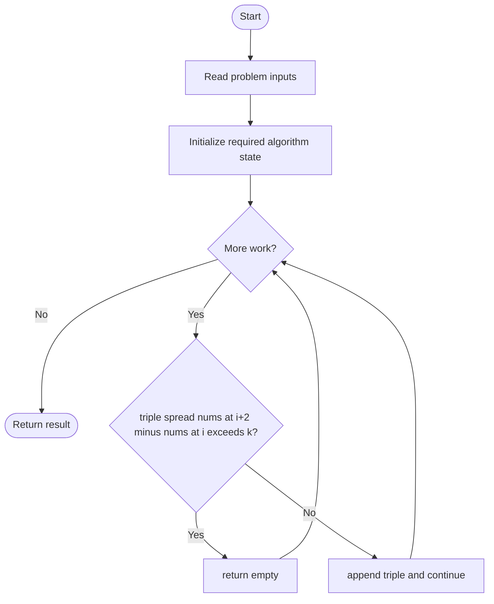
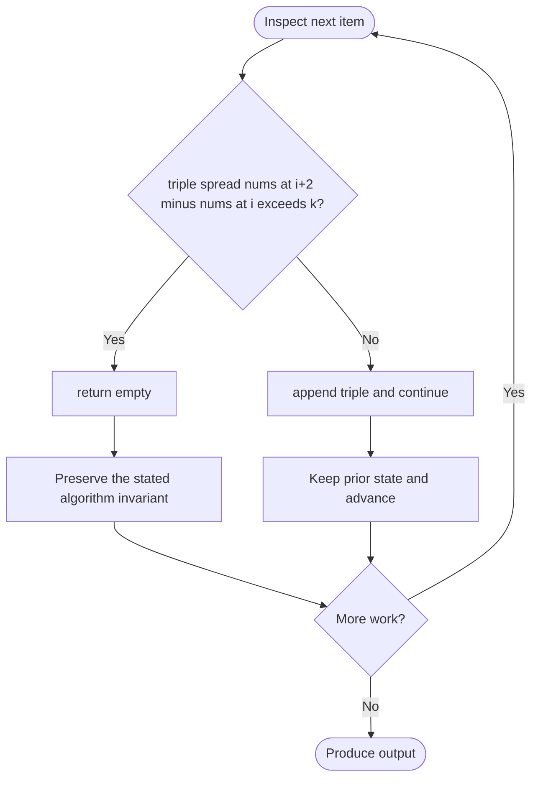

# Divide Array Into Arrays With Max Difference

**LeetCode ID:** 2966

**Source file(s):** `2966.cpp` (originally `divideArray.cpp`)

**Identification evidence:** The original filename, declared signature, and distinctive behavior described below uniquely identify this problem; no number was inferred from a filename alone.

## Expected input/output or judge interface

divideArrayApproach1/2(vector<int>& nums,int k). Inputs follow the problem constraints; the output is the documented scalar, sequence, or design-object behavior. The description below reflects the implementation actually present in the source.

## Main flow



## Important branch and loop flow



## Core logic and invariant

Sorts values and groups consecutive triples; accepts each only if max-min<=k and otherwise returns empty.

The key branch/loop rule above is applied once per relevant item; the algorithm relies on that rule to preserve its state and produce the required result.

## Optimization / comparison

Consecutive sorted triples minimize each group's range. The first variant has malformed iterator-list construction that can prevent compilation.

## Complexity

O(n log n) time and O(n) output.

## Compile and run

The repository file includes a standalone demonstration `main()`; it is not a raw LeetCode submission unit. **The current file may not compile as a whole:** `divideArrayApproach1` initializes a vector from two iterators with a brace-enclosed initializer, which is not the iterator-range constructor. The source is preserved unchanged; use the valid `divideArrayApproach2` implementation when extracting a judge solution. From the repository root, with a C++17 compiler:

```powershell
g++ -std=c++17 LeetCode\2966\2966.cpp -o solution.exe
.\solution.exe
```

For LeetCode's class-method judge, copy the relevant class/method or design-class API and omit the demo `main()` and local harness. Adapt free-function implementations to the requested `Solution` class signature where necessary. See the source caveat above for any compile blocker.
