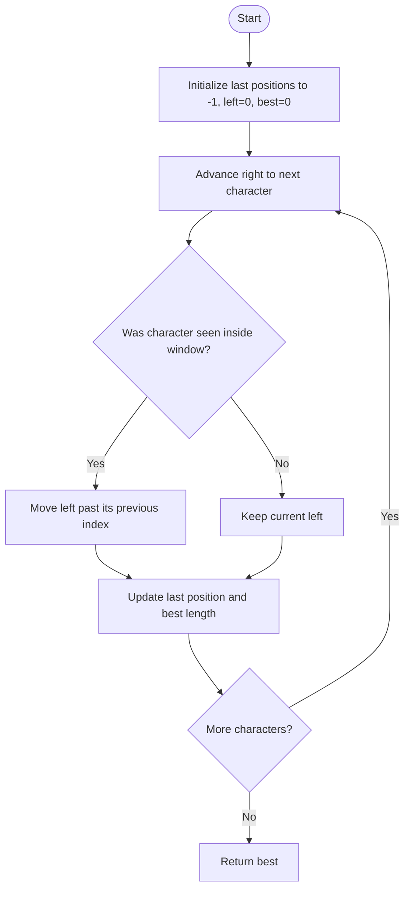

# Longest Substring Without Repeating Characters — LeetCode 3

## 1. Understanding

String मधील duplicate नसलेला सर्वात लांब contiguous substring ची length शोधा. Source मध्ये last-occurrence sliding window, string-window आणि brute-force set methods आहेत.

## 2. Worked examples and edges

- `"abcabcbb"` → `3` (`"abc"`).
- `"pwwkew"` → `3` (`"wke"`); substring contiguous असतो.
- `""` → 0; `"bbbbb"` → 1; `"dvdf"` → 3.
- Source ची array implementation `last(256)` वापरते; bytes/ASCII input अपेक्षित.

## 3. Pattern identification + cheat sheet

| Clue                           | Pattern         | कारण                                 |
| ------------------------------ | --------------- | ------------------------------------ |
| Contiguous substring + longest | Sliding window  | Valid interval वाढवत/हलवत राहतो      |
| Uniqueness constraint          | Last-seen index | Duplicate आल्यावर left boundary jump |
| All substrings test            | Brute force     | Valid baseline, quadratic            |

## 4. Approaches

- Brute-force set: start бүрून extend until repeat — O(n²) expected, O(min(n,alphabet)) space.
- `SlidingWindowString`: `find` आणि `substr` वापरते — worst-case O(n²), string-copy O(n) शक्य.
- `SlidingWindowArray`: last occurrence index राखते — O(n), fixed 256-entry auxiliary array.
- चुकीचा update: duplicate सापडल्यावर `left = last[c] + 1`; `left` मागे नेऊ नका.

## 5. Flowchart

Window मधील uniqueness invariant राखण्यासाठी `left` फक्त पुढे सरकतो.

## 6. Algorithm / intuition

`last[c]` मध्ये शेवटचा index ठेवा. `right` पुढे नेताना repeated char सध्याच्या window मध्ये असेल तर त्याच्या नंतर `left` ठेवा; मग length आणि best update करा.

## 7. Code explanation

`lengthOfLongestSubstring_SlidingWindowArray` हा optimal source method. `SlidingWindowString` जुना window string शोधून trim करतो. `BruteForce` प्रत्येक start साठी set बनवतो. Source चे `main()` तिन्हींची तुलना करतो.

## 8. Dry run

> **मराठी:** प्रत्येक महत्त्वाच्या step नंतर variable ची value trace करा.
> `"abba"`:
> | right | char | previous | left | current length | best |
> |---:|:---:|---:|---:|---:|---:|
> | 0 | a | -1 | 0 | 1 | 1 |
> | 1 | b | -1 | 0 | 2 | 2 |
> | 2 | b | 1 | 2 | 1 | 2 |
> | 3 | a | 0 (<left) | 2 | 2 | 2 |

## 9. Complexity

> **मराठी:** Input size आणि प्रत्येक operation कितीदा चालतो यावरून complexity ठरवा.
> Array sliding window: O(n) time, O(256)=O(1) space. String window and brute-force: O(n²) worst-case time, O(n) auxiliary space.

## 10. Correctness

प्रत्येक step नंतर `[left,right]` मध्ये duplicates नाहीत: duplicate सध्याच्या window मध्ये आल्यास `left` त्याच्या मागील occurrence च्या पुढे जातो. प्रत्येक right endpoint साठी मिळालेली window ही त्या endpoint ला संपणारी maximal valid substring असल्याने max length उत्तर आहे.

## 11. Mistakes and interview traps

- Substring म्हणजे contiguous; subsequence नाही.
- `left=max(left,last[c]+1)` हा monotonic rule; source `last[c] >= left` guard वापरून तेच करतो.
- Empty input आणि repeated same character तपासा.
- 256-entry table Unicode code points साठी सर्वसाधारण उपाय नाही.

## 12. Quick revision

> **मराठी:** दोन मिनिटांच्या revision साठी pattern, मुख्य कल्पना आणि complexity आठवा.
> Last-seen index + two pointers. Duplicate in window? jump left. Update last and `right-left+1`.

## 13. Related problems / variations

> **मराठी:** प्रश्नात काय दिले आहे आणि नेमके काय शोधायचे आहे, हे आधी स्पष्ट करा.
> Minimum Window Substring, Longest Repeating Character Replacement, longest substring with at most K distinct chars.

## 14. Self-assessment

1. `"abba"` वर left मागे न नेता काय होते?
2. Substring आणि subsequence मध्ये फरक?
3. Array version ला O(1) space का म्हणतो?
4. Unicode input साठी काय बदलाल?
