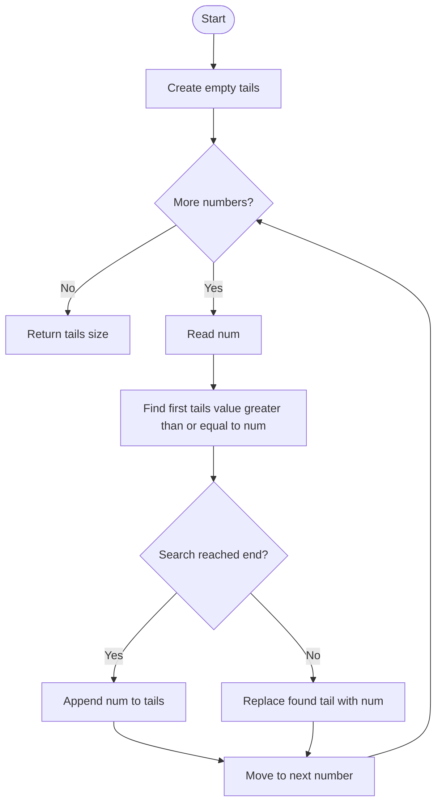

# 300. Longest Increasing Subsequence

## 1. Problem Understanding

Integer array `nums` दिला आहे. त्यातील **strictly increasing subsequence** ची maximum length return करा. Subsequence मध्ये elements skip करू शकतो, पण मूळ order बदलू शकत नाही. Strictly increasing म्हणजे पुढचा निवडलेला number मागच्या number पेक्षा मोठा हवा; equal numbers जोडता येत नाहीत.
ही sequence contiguous असण्याची गरज नाही. फक्त length विचारली आहे, actual subsequence नाही.
**Constraints:** `nums` मध्ये जास्तीत जास्त `2500` integers असतात; values negative, zero किंवा positive असू शकतात. Strict वाढ म्हणजे `nums[next] > nums[previous]`, equal values नाही.

## 2. Example Understanding

### Example 1

```text
nums = [10,9,2,5,3,7,101,18]
Output: 4
```

एक LIS `[2,3,7,18]` आहे; indices `2,4,5,7` मूळ क्रमात आहेत आणि values वाढतात. त्याची length `4`.

### Example 2

```text
nums = [0,1,0,3,2,3]
Output: 4
```

`[0,1,2,3]` ही valid subsequence आहे (दुसरा `0`, नंतर `2`, `3` निवडता येतात).

### Example 3

```text
nums = [7,7,7,7]
Output: 1
```

Equal values strictly increasing sequence बनवत नाहीत; एका element ची length `1`.

## 3. Problem Identification

“Longest increasing subsequence” हे **LIS DP** चे थेट नावच आहे. महत्त्वाची distinction: subsequence असल्याने मध्ये elements skip करता येतात; contiguous subarray नाही.
स्वतःला विचारा:

1. `nums[i]` वर संपणारी best sequence कशी मिळेल? त्याआधीचा लहान element शोधा.
2. Strictly increasing असल्यास comparison `>` आहे की `>=`? `>`.
3. फक्त length हवी का sequence reconstruct करायची? Method आणि extra state बदलतो.
4. Constraints काय सांगतात? `O(n²)` की `O(n log n)` निवडायचे.

### Pattern Recognition Cheat Sheet

| Clue in Question                   | Possible Pattern      | Why?                                           |
| ---------------------------------- | --------------------- | ---------------------------------------------- |
| Longest increasing subsequence     | LIS DP                | Order-preserving choices with value constraint |
| Elements skip करता येतात           | Subsequence DP        | Contiguous interval नसतो                       |
| Best sequence ending at each index | 1D DP                 | Previous smaller values contribute             |
| Large input, only length required  | Binary search / tails | Maintain best tail per subsequence length      |
| Strictly increasing                | `>` or `lower_bound`  | Equal values must not increase LIS length      |

Bitonic subsequence आणि envelopes sorting problems मध्ये LIS pattern पुन्हा दिसतो.

## 4. Different Approaches

### A. Recursion — take or skip

State `(index, prevIndex)`. Current element skip करा; किंवा `prevIndex` नसल्यास/`nums[index] > nums[prevIndex]` असल्यास take करा. दोन्हींपैकी maximum.

- Plain recursion exponentially many take/skip paths explore करू शकते.
- Memoization ने प्रत्येक `(index, prevIndex)` एकदा solve केला: `O(n²)` time, `O(n²)` table + recursion stack.
- Code मध्ये memoized version आहे; plain recursion-only नाही.
- Use: state derive करायला; optimized length-only version पेक्षा कमी efficient.

### B. Bottom-up DP — `O(n²)`

`dp[i]` = `nums[i]` वर संपणाऱ्या LIS ची length. सुरुवात `1`; प्रत्येक `j<i` साठी `nums[j] < nums[i]` असल्यास `dp[i] = max(dp[i], dp[j]+1)`.

- Time: `O(n²)`, space: `O(n)`.
- Pros: state आणि predecessor choice अतिशय स्पष्ट; reconstruction साठी सहज वाढवता येते.
- Cons: मोठ्या `n` साठी quadratic.
- Use: moderate input, teaching, actual sequence reconstruct करणे.

### C. Binary search / patience sorting — `O(n log n)`

`tails[k]` = length `k+1` increasing subsequence साठी शक्य असलेला **minimum ending value**. प्रत्येक number साठी `lower_bound` ने पहिली `>= num` value शोधून replace करा; end ला insert होत असेल तर वाढवा.

- Time: `O(n log n)`, space: `O(n)`.
- Pros: length जलद मिळते.
- Cons: `tails` स्वतः input मधील actual LIS असतेच असे नाही; sequence reconstruct करण्यासाठी parent/index arrays लागतात.
- Code: `lengthOfLIS_BinarySearch`; large input साठी recommended.
  | Approach | Time | Space | Pros | Cons |
  |---|---:|---:|---|---|
  | Plain take/skip recursion | Exponential | `O(n)` stack | Decisions स्पष्ट | Repeated/exponential work |
  | Memoized take/skip | `O(n²)` | `O(n²)` + stack | Top-down recurrence | 2D table |
  | Bottom-up DP | `O(n²)` | `O(n)` | Easy to understand/reconstruct | Slow for large `n` |
  | Binary search `tails` | `O(n log n)` | `O(n)` | Fast length | Tails is not necessarily the LIS itself |
  **Wrong:** equality allow करणारा `>=` comparison strict LIS बिघडवतो. **Correct but slower:** quadratic DP. **Optimal for length:** binary-search method.

## 5. Flowchart



प्रत्येक number current increasing-length candidates मधील योग्य tail replace करतो. Tail लहान करणे पुढे त्यापेक्षा मोठा number जोडण्याची शक्यता वाढवते; नवीन सर्वात मोठा tail मिळाल्यास LIS length वाढते.

## 6. Algorithm / Intuition

**Key observation:** समान length च्या increasing subsequences पैकी छोटा ending value चांगला असतो; पुढचा element जोडण्याची शक्यता जास्त. म्हणून प्रत्येक length साठी minimum possible tail ठेवा.

1. `tails` रिकामा ठेवा.
2. प्रत्येक `num` साठी `lower_bound(tails, num)` शोधा.
3. Position end असेल तर `num` ला append करा—आतापर्यंतची LIS length वाढते.
4. अन्यथा त्या position चे tail `num` ने replace करा.
5. `tails.size()` return करा.
   `lower_bound` पहिला `>= num` शोधतो; त्यामुळे duplicate `num` नवीन length तयार करत नाही आणि strictness राखली जाते.

## 7. Code Explanation

`lengthOfLIS_DP` `dp` values `1` ने initialize करते; प्रत्येक `i` साठी मागील लहान values तपासते. `lengthOfLIS_Memoization` `solve(index, prevIndex)` वापरते; table column `prevIndex+1` असल्याने `prevIndex=-1` साठीही valid slot मिळतो.
`lengthOfLIS_BinarySearch` मध्ये `tails` हा minimum-tail summary आहे. `lower_bound` position नंतर replace/append केल्यामुळे प्रत्येक position संबंधित subsequence length दर्शवते. Code मध्ये empty input तिन्ही methods handle करतात; `tails.size()` `0`.
**Submission note:** LeetCode method name `lengthOfLIS` आहे; येथे तुलना methods आणि local `main` आहेत. Judge signature ला हवा तो approach expose/rename करावा. `tails` ला actual subsequence समजू नका—code फक्त length परत करतो.

## 8. Dry Run

Input: `[10,9,2,5,3,7,101,18]`
| Step | Variables | Condition | Action | `tails` |
|---:|---|---|---|---|
| 1 | `num=10` | `lower_bound` end | Append | `[10]` |
| 2 | `num=9` | First `>=9` is `10` | Replace | `[9]` |
| 3 | `num=2` | First `>=2` is `9` | Replace | `[2]` |
| 4 | `num=5` | Search reaches end | Append | `[2,5]` |
| 5 | `num=3` | First `>=3` is `5` | Replace | `[2,3]` |
| 6 | `num=7` | Search reaches end | Append | `[2,3,7]` |
| 7 | `num=101` | Search reaches end | Append | `[2,3,7,101]` |
| 8 | `num=18` | First `>=18` is `101` | Replace | `[2,3,7,18]` |
Final `tails.size() = 4`. येथे `tails` अखेर एक valid LIS झाली, पण प्रत्येक input मध्ये तसे होईलच असे नाही.

## 9. Complexity Analysis

Quadratic DP मध्ये प्रत्येक `i` मागील `i` elements scan करतो: `1+2+...+(n-1)=O(n²)` time आणि `O(n)` DP space. Memoized `(index,prevIndex)` state count `O(n²)`, त्यामुळे `O(n²)` time/space. Binary-search method प्रत्येक element साठी `O(log n)` search आणि constant replacement/append: **`O(n log n)` time**, `tails` साठी **`O(n)` space**.
Large constraints आणि फक्त length output साठी binary search best. Actual LIS sequence हवी असल्यास `O(n log n)` राखता येते, पण predecessor/index tracking जोडावे लागते.

## 10. Why This Solution Works

`tails[k]` चा अर्थ: length `k+1` च्या increasing subsequence साठी पाहिलेला minimum possible ending value. Number `num` साठी पहिली `>=num` position `p` शोधल्यास, `num` ला आधीचा tail (`p>0` असल्यास) पेक्षा मोठा predecessor मिळतो आणि length `p+1` शक्य होते. त्याच length साठी `num` हे जुन्या tail पेक्षा लहान/समान असल्याने चांगला future candidate. End ला append झाल्यासच सर्वोत्तम शक्य length एकाने वाढते. त्यामुळे array length हा LIS length असतो.

## 11. Common Mistakes & Interview Traps

- LIS ला contiguous subarray समजणे; subsequence मध्ये skip allowed.
- Strictly increasing असताना `>=` comparison वापरणे.
- `lower_bound` ऐवजी `upper_bound` භාවිතා करणे; duplicates length वाढवू शकतात.
- `tails` array स्वतः नेहमी valid LIS आहे असे समजणे.
- `dp[i]` ची definition न सांगता transition लिहिणे.
- Empty input आणि all-equal input विसरणे.
- Follow-up: actual LIS reconstruct करा—indices, parent pointers, आणि tail index track करा.
- Follow-up: non-decreasing subsequence हवी असल्यास binary-search boundary/comparison बदला (`upper_bound` प्रकार).

## 12. Revision Notes (Quick Recall)

- **Pattern:** LIS; quadratic DP किंवा patience-sorting tails.
- **Clues:** longest increasing subsequence, skip allowed, original order fixed.
- **Intuition:** प्रत्येक length साठी smallest ending value future growth साठी best.
- **Algorithm:** each num → `lower_bound` first `>= num` → replace or append.
- **Complexity:** `O(n log n)` time, `O(n)` space.
- **Mistakes:** equal values, substring/subsequence confusion, tails is not necessarily answer sequence.
- **Takeaway:** LIS length साठी actual sequences enumerate करू नका; minimum tails maintain करा.

## 13. Similar Problem Recognition

Longest non-decreasing subsequence मध्ये equal values allow असल्याने binary-search boundary बदलतो. Longest decreasing subsequence मध्ये comparison/sign उलटवता येतो. Russian Doll Envelopes मध्ये एका dimension वर sort केल्यानंतर दुसऱ्यावर LIS वापरतात; equal first dimension मुळे चुकीची nesting होऊ नये म्हणून sorting tie-break महत्त्वाचा. Actual sequence मागितल्यास length-only tails पुरेसे नाहीत.

## 14. Final Self-Assessment

1. Subsequence आणि subarray मधील फरक काय?
2. `tails[k]` actual LIS element नसून काय दर्शवतो?
3. Strict LIS साठी `lower_bound` पहिला `>= num` का शोधतो?
4. Duplicate values आल्यास `tails.size()` का वाढू नये?
5. `O(n²)` DP च्या तुलनेत binary search काय optimize करतो?
