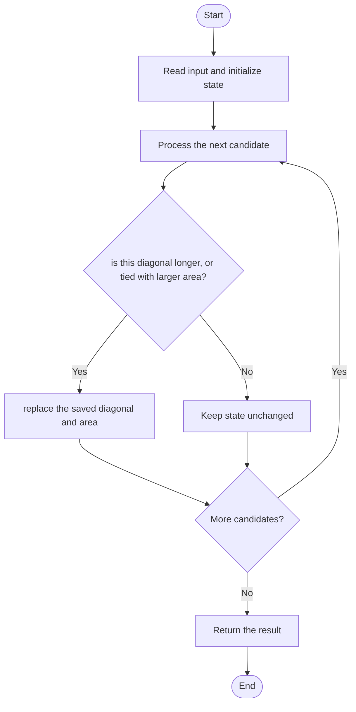

# 3000 — Maximum Area of Longest Diagonal Rectangle

## 1. Problem understanding and constraints

Among rectangles, choose the one with the longest diagonal; if diagonals tie, choose the greater area. Dimensions are positive integers. Compare squared diagonal lengths to avoid floating-point square roots. **थोडक्यात:** काय मोजायचे/निवडायचे ते आधी स्पष्ट करा; मगच code निवडा.

## 2. Stepwise example and edge cases

> **मराठी:** प्रश्नात काय दिले आहे आणि नेमके काय शोधायचे आहे, हे आधी स्पष्ट करा.
> `[[9,3],[8,6]]`: squared diagonals are 90 and 100, so choose the second rectangle; area=48. **Edge cases:** check smallest valid input, ties/boundaries, and empty/no-match outcomes where constraints allow them.

## 3. Pattern identification — clue table

One-pass lexicographic best selection using a tie-break. हा मुख्य pattern आहे.
| Clue | What it suggests |
|---|---|
| Output depends on one-pass lexicographic best selection using a tie-break. | Keep only the relevant state; avoid unrelated recomputation |
| Need to preserve the stated condition | State an invariant before coding |
| Input scan/order matters | Update once per item and test boundaries |

## 4. Multiple approaches

A nested comparison over all pairs is correct but `O(n²)` and unnecessary. The source scans once, keeping the best squared diagonal and area. **योग्य निवड:** source मध्ये असलेली method आणि तिच्या मर्यादा वेगळ्या ओळखा.

## 5. Flowchart

Flow समजताना decision condition आणि update invariant शी जुळतात का ते तपासा.

## 6. Selected algorithm and intuition

> **मराठी:** मुख्य observation समजल्यावर algorithm चे steps लक्षात ठेवणे सोपे होते.
> Pythagoras says diagonal²=`l²+w²`; maximize that value, then area when equal.

## 7. Code-specific explanation

> **मराठी:** Code मधील variable आणि condition यांचा algorithm मधील उद्देश समजून घ्या.
> `LeetCode\3000\3000.cpp` — `areaOfMaxDiagonal` updates both the winning diagonal and its area. The return type is `int`; constraints ensure the products fit.

## 8. Dry run

> **मराठी:** प्रत्येक महत्त्वाच्या step नंतर variable ची value trace करा.
> | Step | State / action |
> |---:|---|
> | 1 | For `[9,3]`, best=(90,27). For `[8,6]`, 100>90, so best=(100,48) |
> | 2 | return 48. |

## 9. Complexity

> **मराठी:** Input size आणि प्रत्येक operation कितीदा चालतो यावरून complexity ठरवा.
> `O(n)` time and `O(1)` extra space.

## 10. Correctness

> **मराठी:** Invariant किंवा तर्क वापरून algorithm योग्य उत्तर देतो हे समजून घ्या.
> The scan maintains the best rectangle seen so far under the required ordering: larger squared diagonal first, area as tie-break. Updating with the same ordering preserves that invariant; after all rectangles, the saved area is the requested one.

## 11. Mistakes and interview traps

> **मराठी:** Boundary, duplicate आणि off-by-one cases स्वतंत्रपणे तपासा.

- Do not compare area before diagonal length.
- Use `>=` only with a deliberate tie-break; update area on equal diagonal if larger.
- Squared diagonal avoids floating-point rounding.

## 12. Quick revision

**झटपट:** Pythagoras says diagonal²=`l²+w²`; maximize that value, then area when equal. Pattern ओळखा, condition तपासा, आणि answer एकदाच योग्य पद्धतीने update करा.

## 13. Related patterns and variations

> **मराठी:** या clues मुळे योग्य pattern ओळखता येतो; constraints आणि relations नीट तपासा.
> Lexicographic ranking; one-pass maximum with tie-break; Pythagorean distance.

## 14. Self-assessment

> **मराठी:** उत्तर न पाहता प्रश्न सोडवा आणि तुमच्या निवडीचे कारण सांगा.

1. Why is the square root unnecessary?
2. What is the tie-break?
3. What state must the scan preserve?
