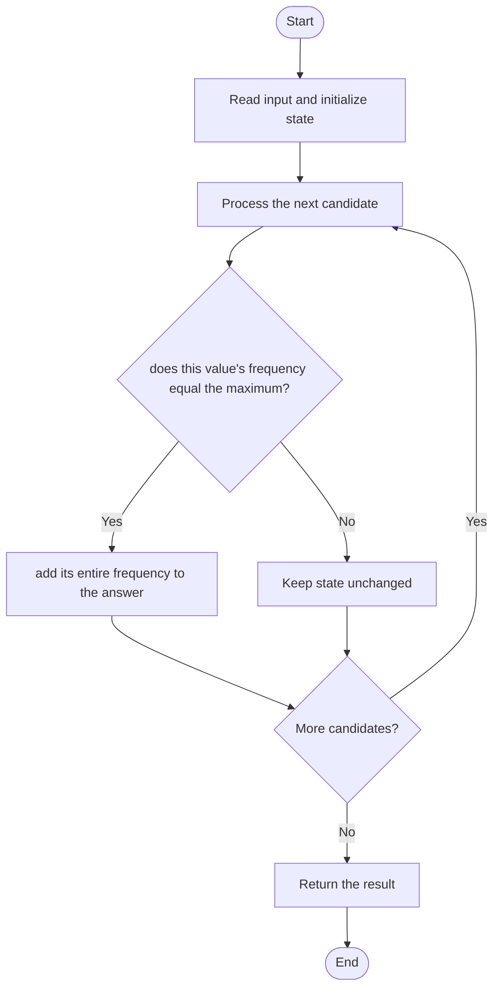

# 3005 — Count Elements With Maximum Frequency

## 1. Problem understanding and constraints

Find the greatest frequency among values, then return the total number of occurrences of every value having that frequency. Do not return the number of distinct modes. **थोडक्यात:** काय मोजायचे/निवडायचे ते आधी स्पष्ट करा; मगच code निवडा.

## 2. Stepwise example and edge cases

> **मराठी:** प्रश्नात काय दिले आहे आणि नेमके काय शोधायचे आहे, हे आधी स्पष्ट करा.
> `[1,2,2,3,1,4]`: 1 and 2 each occur twice; answer is 2+2=4. **Edge cases:** check smallest valid input, ties/boundaries, and empty/no-match outcomes where constraints allow them.

## 3. Pattern identification — clue table

Frequency map followed by max-frequency aggregation. हा मुख्य pattern आहे.
| Clue | What it suggests |
|---|---|
| Output depends on frequency map followed by max-frequency aggregation. | Keep only the relevant state; avoid unrelated recomputation |
| Need to preserve the stated condition | State an invariant before coding |
| Input scan/order matters | Update once per item and test boundaries |

## 4. Multiple approaches

Nested counting works but costs `O(n²)`. The source uses a frequency map and then totals counts equal to the maximum. **योग्य निवड:** source मध्ये असलेली method आणि तिच्या मर्यादा वेगळ्या ओळखा.

## 5. Flowchart

Flow समजताना decision condition आणि update invariant शी जुळतात का ते तपासा.

## 6. Selected algorithm and intuition

> **मराठी:** मुख्य observation समजल्यावर algorithm चे steps लक्षात ठेवणे सोपे होते.
> First determine the shared target frequency; second sum all buckets reaching it.

## 7. Code-specific explanation

> **मराठी:** Code मधील variable आणि condition यांचा algorithm मधील उद्देश समजून घ्या.
> `LeetCode\3005\3005.cpp` — `maxFrequencyElements` builds counts, finds their maximum, and sums frequencies equal to that maximum. It handles a single distinct value naturally.

## 8. Dry run

> **मराठी:** प्रत्येक महत्त्वाच्या step नंतर variable ची value trace करा.
> | Step | State / action |
> |---:|---|
> | 1 | Counts `{1:2,2:2,3:1,4:1}` → max=2 → sum 2+2=4. |

## 9. Complexity

> **मराठी:** Input size आणि प्रत्येक operation कितीदा चालतो यावरून complexity ठरवा.
> `O(n+u)` expected time and `O(u)` space for `u` distinct values.

## 10. Correctness

> **मराठी:** Invariant किंवा तर्क वापरून algorithm योग्य उत्तर देतो हे समजून घ्या.
> The map records each value's exact occurrence count. The first pass finds the largest count; summing precisely the buckets with that count includes every qualifying element and excludes all others.

## 11. Mistakes and interview traps

> **मराठी:** Boundary, duplicate आणि off-by-one cases स्वतंत्रपणे तपासा.

- Sum frequencies, not just the number of tied values.
- Repeated copies of a mode all count toward the answer.
- Empty input is outside the usual constraints.

## 12. Quick revision

**झटपट:** First determine the shared target frequency; second sum all buckets reaching it. Pattern ओळखा, condition तपासा, आणि answer एकदाच योग्य पद्धतीने update करा.

## 13. Related patterns and variations

> **मराठी:** या clues मुळे योग्य pattern ओळखता येतो; constraints आणि relations नीट तपासा.
> Frequency maps; mode counting; histogram aggregation.

## 14. Self-assessment

> **मराठी:** उत्तर न पाहता प्रश्न सोडवा आणि तुमच्या निवडीचे कारण सांगा.

1. If three values each occur four times, what is returned?
2. Why sum frequencies rather than modes?
3. What is `u` in the space bound?
