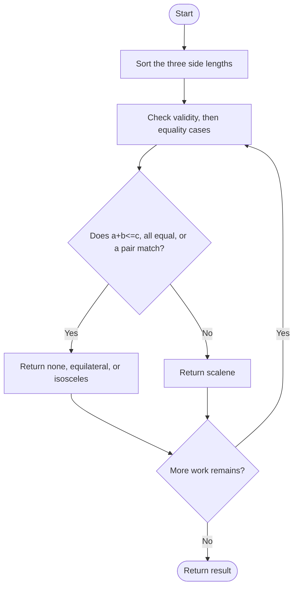
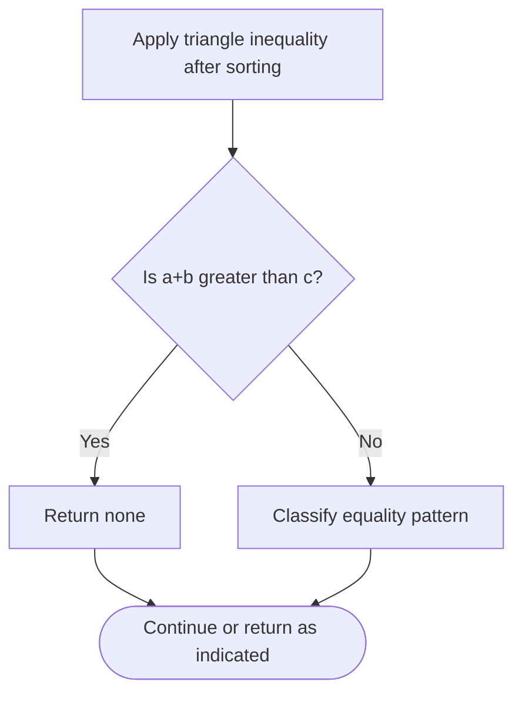

# Type of Triangle — LeetCode 3024

## Problem and judge interface

string triangleType(vector<int>& nums); classify three side lengths as none, equilateral, isosceles, or scalene.

## Identification evidence

The code sorts sides, checks triangle inequality and returns the four specified categories, identifying problem 3024.

## Main flow



## Important branch / loop



## Core logic and invariants

After sorting a<=b<=c, reject if a+b<=c. Otherwise test all equal, then either adjacent equal, else all distinct.

## Complexity

O(1) time and O(1) extra space for fixed-size three-element input; sorts nums in place.

## Comparison and optimization

Sorting reduces triangle inequality to one check and simplifies equality classification.

## Compile and run

The `.cpp` is the original standalone source, including its local `main()` demonstration where present. Compile and run from the repository root with a C++17 compiler:

```text
g++ -std=c++17 LeetCode\3024\3024.cpp -o solution.exe
.\solution.exe
```

For LeetCode, adapt the implementation to the required class/method signature and omit the local `main()` and demonstration helpers; use the judge-provided node types. Notes above identify method-name or behavior differences. The moved source bytes have not been edited.
