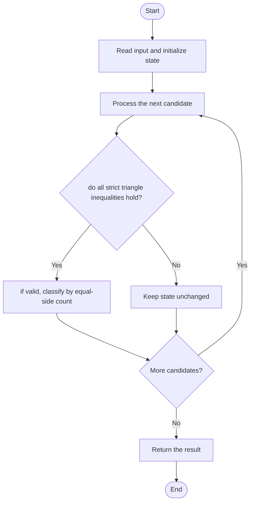

# 3024 — Type of Triangle

## 1. Problem understanding and constraints

Given three side lengths, return `none` if they cannot form a triangle; otherwise classify by equal sides as equilateral, isosceles, or scalene. Positive lengths are expected. **थोडक्यात:** काय मोजायचे/निवडायचे ते आधी स्पष्ट करा; मगच code निवडा.

## 2. Stepwise example and edge cases

> **मराठी:** प्रश्नात काय दिले आहे आणि नेमके काय शोधायचे आहे, हे आधी स्पष्ट करा.
> `[3,3,3]` → equilateral; `[1,2,3]` → none because the strict triangle inequality fails. **Edge cases:** check smallest valid input, ties/boundaries, and empty/no-match outcomes where constraints allow them.

## 3. Pattern identification — clue table

Validate feasibility before classification; constant-size case analysis. हा मुख्य pattern आहे.
| Clue | What it suggests |
|---|---|
| Output depends on validate feasibility before classification | Keep only the relevant state; avoid unrelated recomputation |
| Need to preserve the stated condition | State an invariant before coding |
| Input scan/order matters | Update once per item and test boundaries |

## 4. Multiple approaches

Checking equality first is incorrect because degenerate sides may look equal. The source correctly checks triangle inequality before counting equal pairs. **योग्य निवड:** source मध्ये असलेली method आणि तिच्या मर्यादा वेगळ्या ओळखा.

## 5. Flowchart

Flow समजताना decision condition आणि update invariant शी जुळतात का ते तपासा.

## 6. Selected algorithm and intuition

> **मराठी:** मुख्य observation समजल्यावर algorithm चे steps लक्षात ठेवणे सोपे होते.
> Sort the sides or test all three inequalities; only a valid triangle can be classified.

## 7. Code-specific explanation

> **मराठी:** Code मधील variable आणि condition यांचा algorithm मधील उद्देश समजून घ्या.
> `LeetCode\3024\3024.cpp` — `triangleType` returns the problem's exact lowercase labels. It checks the largest side against the sum of the other two, then compares side equality.

## 8. Dry run

> **मराठी:** प्रत्येक महत्त्वाच्या step नंतर variable ची value trace करा.
> | Step | State / action |
> |---:|---|
> | 1 | `[1,2,3]`: `1+2` is not greater than 3 → return `none` immediately. |

## 9. Complexity

> **मराठी:** Input size आणि प्रत्येक operation कितीदा चालतो यावरून complexity ठरवा.
> `O(1)` time and `O(1)` space.

## 10. Correctness

> **मराठी:** Invariant किंवा तर्क वापरून algorithm योग्य उत्तर देतो हे समजून घ्या.
> The strict triangle inequality is necessary and sufficient for three positive lengths to form a non-degenerate triangle. After this gate, equality patterns partition valid triangles into exactly the three requested categories.

## 11. Mistakes and interview traps

> **मराठी:** Boundary, duplicate आणि off-by-one cases स्वतंत्रपणे तपासा.

- Use strict `>`; equality is degenerate.
- Check validity before equilateral/isosceles cases.
- Return exact expected strings.

## 12. Quick revision

**झटपट:** Sort the sides or test all three inequalities; only a valid triangle can be classified. Pattern ओळखा, condition तपासा, आणि answer एकदाच योग्य पद्धतीने update करा.

## 13. Related patterns and variations

> **मराठी:** या clues मुळे योग्य pattern ओळखता येतो; constraints आणि relations नीट तपासा.
> Geometry predicates; sorting and case analysis; validation before classification.

## 14. Self-assessment

> **मराठी:** उत्तर न पाहता प्रश्न सोडवा आणि तुमच्या निवडीचे कारण सांगा.

1. Why does `[1,2,3]` fail?
2. Can an invalid equilateral classification occur if validation is skipped?
3. What string represents a degenerate case?
