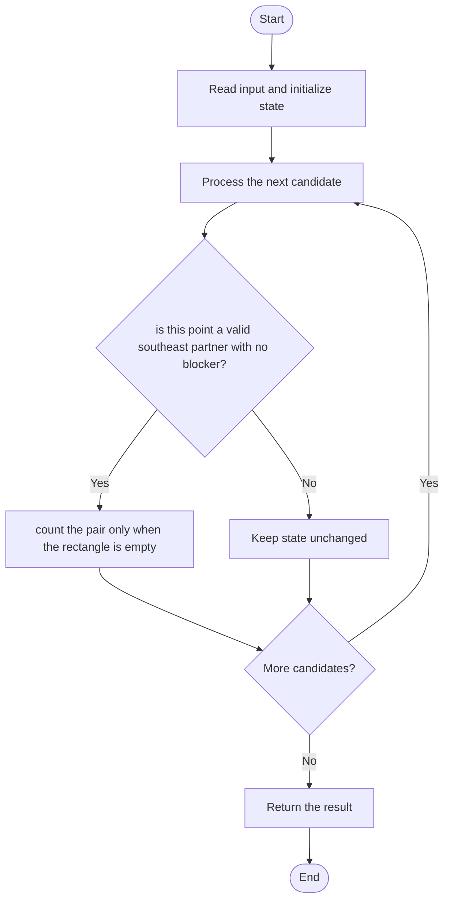

# 3027 — Find the Number of Ways to Place People II

## 1. Problem understanding and constraints

Count ordered pairs Alice/Bob where Alice is northwest of Bob and no other point lies inside or on the relevant rectangle. Coordinates may be large, so use comparisons rather than a grid sized by coordinate values. **थोडक्यात:** काय मोजायचे/निवडायचे ते आधी स्पष्ट करा; मगच code निवडा.

## 2. Stepwise example and edge cases

> **मराठी:** प्रश्नात काय दिले आहे आणि नेमके काय शोधायचे आहे, हे आधी स्पष्ट करा.
> For points `(1,3),(3,1)`, the first point is northwest of the second and, with no blocker, forms one valid pair. **Edge cases:** check smallest valid input, ties/boundaries, and empty/no-match outcomes where constraints allow them.

## 3. Pattern identification — clue table

Coordinate ordering plus rectangle emptiness; sort/prune candidates. हा मुख्य pattern आहे.
| Clue | What it suggests |
|---|---|
| Output depends on coordinate ordering plus rectangle emptiness | Keep only the relevant state; avoid unrelated recomputation |
| Need to preserve the stated condition | State an invariant before coding |
| Input scan/order matters | Update once per item and test boundaries |

## 4. Multiple approaches

The source includes a cubic point-checking brute force (correct, `O(n³)`), a coordinate-compressed prefix-grid variant (`O(n²)` time and space), and a sort/greedy candidate scan (`O(n²)` after sorting). Do not allocate a raw grid by coordinate magnitude. **योग्य निवड:** source मध्ये असलेली method आणि तिच्या मर्यादा वेगळ्या ओळखा.

## 5. Flowchart

Flow समजताना decision condition आणि update invariant शी जुळतात का ते तपासा.

## 6. Selected algorithm and intuition

> **मराठी:** मुख्य observation समजल्यावर algorithm चे steps लक्षात ठेवणे सोपे होते.
> For each possible northwest point, consider southeast candidates and reject a pair if any third point lies in the closed rectangle.

## 7. Code-specific explanation

> **मराठी:** Code मधील variable आणि condition यांचा algorithm मधील उद्देश समजून घ्या.
> `LeetCode\3027\3027.cpp` — `numberOfPairsBruteForce`, `numberOfPairsOptimized`, and `numberOfPairsGreedySort` are comparison implementations. The helper uses inclusive coordinate tests; boundary points can block a pair.

## 8. Dry run

> **मराठी:** प्रत्येक महत्त्वाच्या step नंतर variable ची value trace करा.
> | Step | State / action |
> |---:|---|
> | 1 | A=(1,3), B=(3,1): A.x≤B.x and A.y≥B.y |
> | 2 | inspect the rectangle. No third point → count 1. |

## 9. Complexity

> **मराठी:** Input size आणि प्रत्येक operation कितीदा चालतो यावरून complexity ठरवा.
> Brute force `O(n³)` time, `O(1)` extra. Prefix-grid method uses `O(n²+n log n)` time and `O(n²)` space after coordinate compression. Greedy source is `O(n²)` time plus sorting and `O(1)` auxiliary space beyond sort stack.

## 10. Correctness

> **मराठी:** Invariant किंवा तर्क वापरून algorithm योग्य उत्तर देतो हे समजून घ्या.
> A candidate pair is counted exactly when its coordinates satisfy the northwest/southeast order and every other point fails the helper's in-rectangle predicate. The exhaustive method checks all candidates and blockers; pruning methods retain only candidates satisfying the same geometric constraint.

## 11. Mistakes and interview traps

> **मराठी:** Boundary, duplicate आणि off-by-one cases स्वतंत्रपणे तपासा.

- Clarify whether the rectangle boundary is inclusive; source helper includes boundaries.
- Do not let Alice and Bob be the same point.
- Large coordinates make direct 2D arrays impractical.

## 12. Quick revision

**झटपट:** For each possible northwest point, consider southeast candidates and reject a pair if any third point lies in the closed rectangle. Pattern ओळखा, condition तपासा, आणि answer एकदाच योग्य पद्धतीने update करा.

## 13. Related patterns and variations

> **मराठी:** या clues मुळे योग्य pattern ओळखता येतो; constraints आणि relations नीट तपासा.
> Sweep line; dominance counting; coordinate compression; rectangle emptiness.

## 14. Self-assessment

> **मराठी:** उत्तर न पाहता प्रश्न सोडवा आणि तुमच्या निवडीचे कारण सांगा.

1. What does northwest mean in x/y inequalities?
2. Can a boundary point block a pair in this source?
3. Why can coordinate compression matter?
