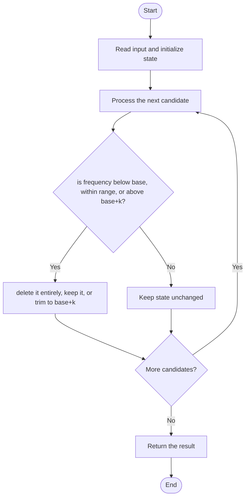

# 3085 — Minimum Deletions to Make String K-Special

## 1. Problem understanding and constraints

After deletions, every present character's frequency must differ from every other present character's frequency by at most `k`. Deletions may remove a character entirely. The source assumes lowercase English letters. **थोडक्यात:** काय मोजायचे/निवडायचे ते आधी स्पष्ट करा; मगच code निवडा.

## 2. Stepwise example and edge cases

> **मराठी:** प्रश्नात काय दिले आहे आणि नेमके काय शोधायचे आहे, हे आधी स्पष्ट करा.
> For frequencies `a:5,b:2` and `k=1`, keep `a:5` and delete b entirely (cost 2), or keep both with a reduced to 3 (cost 2). **Edge cases:** check smallest valid input, ties/boundaries, and empty/no-match outcomes where constraints allow them.

## 3. Pattern identification — clue table

Frequency histogram; enumerate a retained minimum frequency and cap others. हा मुख्य pattern आहे.
| Clue | What it suggests |
|---|---|
| Output depends on frequency histogram | Keep only the relevant state; avoid unrelated recomputation |
| Need to preserve the stated condition | State an invariant before coding |
| Input scan/order matters | Update once per item and test boundaries |

## 4. Multiple approaches

Trying all deletion subsets is exponential. Source offers naive frequency-base scans, prefix/binary-search variants, and a 26-letter greedy. The fixed-alphabet version is the practical choice; the methods should agree on valid lowercase input. **योग्य निवड:** source मध्ये असलेली method आणि तिच्या मर्यादा वेगळ्या ओळखा.

## 5. Flowchart

Flow समजताना decision condition आणि update invariant शी जुळतात का ते तपासा.

## 6. Selected algorithm and intuition

> **मराठी:** मुख्य observation समजल्यावर algorithm चे steps लक्षात ठेवणे सोपे होते.
> Choose a minimum frequency `base`. A character below base is deleted completely; a character above `base+k` is reduced to that cap; frequencies in between stay.

## 7. Code-specific explanation

> **मराठी:** Code मधील variable आणि condition यांचा algorithm मधील उद्देश समजून घ्या.
> `LeetCode\3085\3085.cpp` — `minimumDeletions(word,k,version)` dispatches to five implementations; `minDel_V5` is the greedy practical variant. Count characters once, then compare candidate bases across the 26-letter frequency set.

## 8. Dry run

> **मराठी:** प्रत्येक महत्त्वाच्या step नंतर variable ची value trace करा.
> | Step | State / action |
> |---:|---|
> | 1 | Frequencies `[5,2]`, k=1: choose base=2 → keep 2, delete `5-(2+1)=2` |
> | 2 | base=5 → delete the 2-count character entirely (2). Minimum is 2. |

## 9. Complexity

> **मराठी:** Input size आणि प्रत्येक operation कितीदा चालतो यावरून complexity ठरवा.
> For alphabet size σ=26, greedy/base enumeration is `O(n+σ²)` time and `O(σ)` space. Frequency sorting variants add `O(σ log σ)`; all are linear in string length.

## 10. Correctness

> **मराठी:** Invariant किंवा तर्क वापरून algorithm योग्य उत्तर देतो हे समजून घ्या.
> For a fixed minimum retained frequency, every lower positive frequency violates the chosen minimum and is cheapest to remove entirely; every frequency above `base+k` must be trimmed to that cap. Enumerating possible bases includes an optimum, so taking the minimum cost is correct.

## 11. Mistakes and interview traps

> **मराठी:** Boundary, duplicate आणि off-by-one cases स्वतंत्रपणे तपासा.

- The allowed difference is at most k, not exactly k.
- Deleting a character entirely is allowed.
- Include base=0/empty result cases; do not reduce a high frequency below the allowed cap unnecessarily.

## 12. Quick revision

**झटपट:** Choose a minimum frequency `base`. A character below base is deleted completely; a character above `base+k` is reduced to that cap; frequencies in between stay. Pattern ओळखा, condition तपासा, आणि answer एकदाच योग्य पद्धतीने update करा.

## 13. Related patterns and variations

> **मराठी:** या clues मुळे योग्य pattern ओळखता येतो; constraints आणि relations नीट तपासा.
> Frequency counting; histogram optimization; enumerate a threshold and clamp.

## 14. Self-assessment

> **मराठी:** उत्तर न पाहता प्रश्न सोडवा आणि तुमच्या निवडीचे कारण सांगा.

1. Why can a character below base be deleted entirely?
2. What is the maximum kept frequency for a fixed base?
3. Why is the alphabet size useful?
