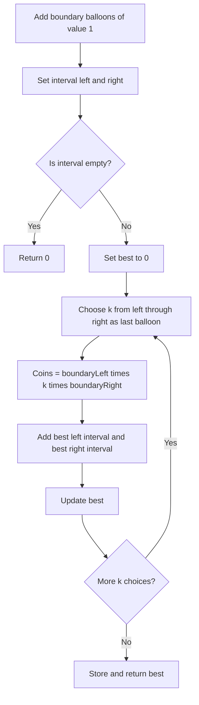

# 312. Burst Balloons

## 1. Problem Understanding

Each balloon has a number. Burst one at a time; balloon `i` gives `left * i * right` coins using its neighbors **at that moment**. Missing boundary balloons behave as value `1`. Return the maximum total coins. Order matters because neighbors change.

## 2. Example Understanding

`[3,1,5,8]` has maximum `167`. One optimal order is burst `1`, then `5`, then `3`, then `8`: scores are `3·1·5=15`, `3·5·8=120`, `1·3·8=24`, and `1·8·1=8`, total `167`. Neighbors must be recalculated after every removal. Edge `[x]` yields `x`.

## 3. Problem Identification

### Pattern Recognition Cheat Sheet

| Clue in Question                      | Possible Pattern             | Why?                                               |
| ------------------------------------- | ---------------------------- | -------------------------------------------------- |
| Choices alter future neighbors        | Interval DP                  | A subarray's best depends on the boundary balloons |
| Burst order is hard to decide forward | “Choose last” transformation | Last balloon has stable neighbors                  |
| Maximize total score over all orders  | DP optimization              | Compare every possible last balloon                |

Ask: Can I define a subproblem with fixed boundaries? Which action gives a final, unchanging context? Choosing the last balloon in an interval makes its neighbors the interval boundaries.

## 4. Different Approaches

1. **Forward brute-force order:** Try each balloon first, remove it, recurse. Correct in concept but branching factorially and boundaries keep changing.
2. **Recursive interval DP:** Add boundary `1`s; define `solve(l,r)` as best coins from bursting all balloons in `[l,r]`. Try `k` as the **last** burst: `a[l-1]*a[k]*a[r+1] + solve(l,k-1)+solve(k+1,r)`.
3. **Memoization:** Cache each interval; O(n²) intervals and O(n) last choices.
4. **Tabulation:** Fill intervals from shorter to longer dependency order. Provided code loops `left` descending, `right` ascending so subintervals are already available.
   | Approach | Time | Space | Pros | Cons |
   |---|---:|---:|---|---|
   | Enumerate burst orders | O(n!) (roughly) | O(n) stack | Literal model | Too many orders |
   | Memoized interval DP | O(n³) | O(n²)+stack | Natural recurrence | Recursive |
   | Bottom-up interval DP | O(n³) | O(n²) | Predictable iterative solution | Three nested loops |

## 5. Flowchart

Interval madhye `k` la last burst maanla ki its neighbors fixed astat: `left-1` ani `right+1`. Don side intervals independently solve hotat.

## 6. Algorithm / Intuition

Pad array with `1` at each end. For each interval, assume each balloon could be last. If `k` is last, all other balloons on its left and right are gone, so its score uses fixed interval boundaries. Add optimal scores from both sides and keep the maximum.

## 7. Code Explanation

In [`312.cpp`](./312.cpp), `solveRecursive` and `solveMemo` implement the interval recurrence; `dp[left][right]` caches results. `maxCoinsTabulation` fills the same recurrence iteratively. The comments describe the chosen-last observation, and the padding makes boundary indexing valid. Local `main` compares three versions. LeetCode typically expects an `int` method named `maxCoins`.

## 8. Dry Run

For interval `[3,1,5]` with boundary values `1` and `8`:
| Step | Variables | Condition | Action | Result |
|---|---|---|---|---|
| 1 | `l=1,r=3` | Try `k=1` last | `1·3·8 + empty + best(1,3)` | Candidate |
| 2 | `k=2` | Balloon `1` last | `1·1·8 + best(3) + best(5)` | Candidate `8 + 15 + 120 = 143` |
| 3 | `k=3` | Balloon `5` last | `1·5·8 + best(3,1) + 0` | Candidate |
| 4 | all `k` evaluated | — | Keep largest candidate | `dp[1][3]` |
The precise calculation for each candidate uses already-optimal subintervals; this is why choosing “last” avoids simulating mutable neighbor lists.

## 9. Complexity Analysis

There are O(n²) intervals; each tries up to n choices of last balloon, giving **O(n³)** time. Memo/table uses **O(n²)** memory; recursion adds O(n) stack depth. Suitable for the problem's modest `n` constraint.

## 10. Why This Solution Works

Every valid bursting order has exactly one balloon that is last within `[l,r]`. For that `k`, the remaining balloons split into independent left/right intervals, and its final neighbors are fixed boundaries. The recurrence combines their optimal scores plus `k`'s score. Taking the maximum over every possible last `k` includes every order's final choice; induction on interval length establishes optimality. Empty intervals contribute zero, and each step reduces interval size, so it terminates.

## 11. Common Mistakes & Interview Traps

- Choosing the **first** balloon in this interval recurrence gives unstable neighbor values; choose last.
- For last `k`, score uses `a[l-1]`, `a[k]`, `a[r+1]`, not immediate original neighbors.
- Forgetting sentinels causes boundary errors.
- Left/right subintervals exclude `k`.
- `int` is adequate under LeetCode constraints; for changed large values, inspect overflow bounds.
- Follow-up: reconstruct one optimal burst order by storing the best `k`.

## 12. Revision Notes (Quick Recall)

- **Pattern:** Interval DP; maximize over last choice.
- **Clue:** Removing elements changes neighbors.
- **Intuition:** Reverse the viewpoint: fix which balloon bursts last in a range.
- **Algorithm:** Pad with 1s; compute `dp[l][r]` over all last `k`.
- **Complexity:** O(n³) time, O(n²) space.
- **Trap:** The interval endpoints—not original adjacent balloons—neighbor the last burst.
- **Takeaway:** When forward effects are unstable, try choosing the final action.

## 13. Similar Problem Recognition

This is the classic “choose last” interval-DP pattern, related to Matrix Chain Multiplication, Minimum Cost to Cut a Stick, and triangulation DP. If score depended on the first action with fixed boundaries, forward recurrence could work; if interactions cross subintervals, this split recurrence may fail.

## 14. Final Self-Assessment

1. Why is choosing the last balloon easier than choosing the first?
2. What do the two boundary `1`s represent?
3. Why are left and right intervals independent after fixing `k`?
4. Explain the O(n³) count.
5. How would you recover the optimal order?
