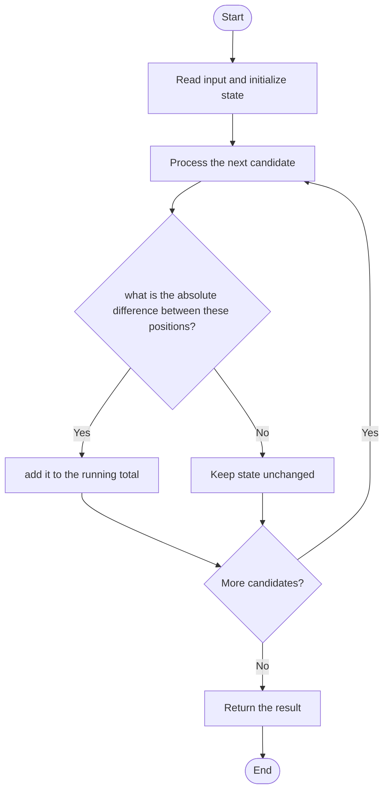

# 3146 — Permutation Difference between Two Strings

## 1. Problem understanding and constraints

The strings contain the same characters in different orders. Sum the absolute difference between each character's index in the two strings. Characters are unique under the problem constraints. **थोडक्यात:** काय मोजायचे/निवडायचे ते आधी स्पष्ट करा; मगच code निवडा.

## 2. Stepwise example and edge cases

> **मराठी:** प्रश्नात काय दिले आहे आणि नेमके काय शोधायचे आहे, हे आधी स्पष्ट करा.
> `s="abc", t="bac"`: a contributes 1, b contributes 1, c contributes 0; total 2. **Edge cases:** check smallest valid input, ties/boundaries, and empty/no-match outcomes where constraints allow them.

## 3. Pattern identification — clue table

Character-to-index mapping; sum absolute positional distances. हा मुख्य pattern आहे.
| Clue | What it suggests |
|---|---|
| Output depends on character-to-index mapping | Keep only the relevant state; avoid unrelated recomputation |
| Need to preserve the stated condition | State an invariant before coding |
| Input scan/order matters | Update once per item and test boundaries |

## 4. Multiple approaches

Repeated `find` is correct but can be quadratic. Source provides find, map/vector, and direct index approaches; direct fixed-array indexing is linear for the constrained alphabet. **योग्य निवड:** source मध्ये असलेली method आणि तिच्या मर्यादा वेगळ्या ओळखा.

## 5. Flowchart

Flow समजताना decision condition आणि update invariant शी जुळतात का ते तपासा.

## 6. Selected algorithm and intuition

> **मराठी:** मुख्य observation समजल्यावर algorithm चे steps लक्षात ठेवणे सोपे होते.
> Build or locate each character's position in both strings, then accumulate `abs(posS-posT)`.

## 7. Code-specific explanation

> **मराठी:** Code मधील variable आणि condition यांचा algorithm मधील उद्देश समजून घ्या.
> `LeetCode\3146\3146.cpp` — `findPermutationDifference_mapVector`, `_find`, and `_optimal` are alternatives. The optimal method uses character-index lookup; check the stated lowercase/unique-character assumptions.

## 8. Dry run

> **मराठी:** प्रत्येक महत्त्वाच्या step नंतर variable ची value trace करा.
> | Step | State / action |
> |---:|---|
> | 1 | s=`abc`, t=`bac`: positions for a=(0,1), b=(1,0), c=(2,2) |
> | 2 | sum=1+1+0=2. |

## 9. Complexity

> **मराठी:** Input size आणि प्रत्येक operation कितीदा चालतो यावरून complexity ठरवा.
> Index-array/map variants `O(n)` time and `O(σ)` space; repeated `find` is `O(n²)` time.

## 10. Correctness

> **मराठी:** Invariant किंवा तर्क वापरून algorithm योग्य उत्तर देतो हे समजून घ्या.
> Each character appears once in each permutation, so its mapped positions are well-defined. Summing the requested absolute difference once per character includes all and only required contributions.

## 11. Mistakes and interview traps

> **मराठी:** Boundary, duplicate आणि off-by-one cases स्वतंत्रपणे तपासा.

- Compare positions of the same character across strings.
- Use absolute difference, not signed difference.
- A character-frequency-only solution loses positional information.

## 12. Quick revision

**झटपट:** Build or locate each character's position in both strings, then accumulate `abs(posS-posT)`. Pattern ओळखा, condition तपासा, आणि answer एकदाच योग्य पद्धतीने update करा.

## 13. Related patterns and variations

> **मराठी:** या clues मुळे योग्य pattern ओळखता येतो; constraints आणि relations नीट तपासा.
> Index maps; permutation comparison; character arrays.

## 14. Self-assessment

> **मराठी:** उत्तर न पाहता प्रश्न सोडवा आणि तुमच्या निवडीचे कारण सांगा.

1. Why is frequency counting alone insufficient?
2. What is each character's contribution?
3. When is direct 26-slot indexing valid?
