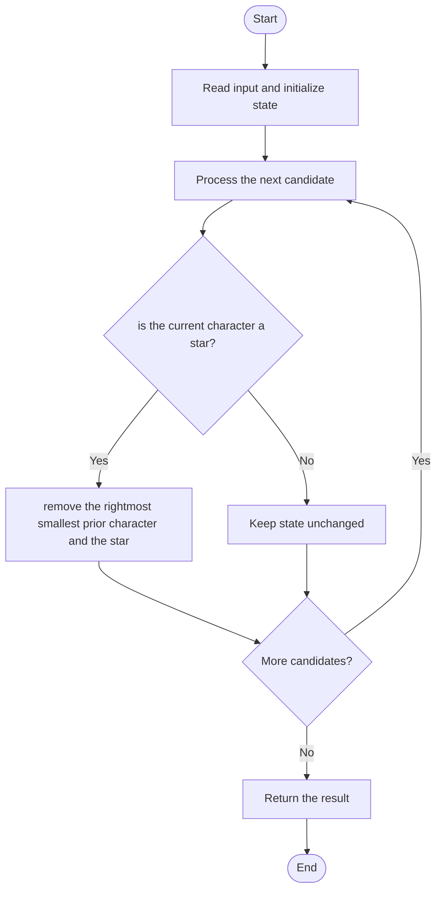

# 3170 — Lexicographically Minimum String After Removing Stars

## 1. Problem understanding and constraints

Read left to right. Each `*` removes itself and the smallest character to its left; if several smallest characters tie, remove the rightmost one. Input guarantees a removable character for each star. **थोडक्यात:** काय मोजायचे/निवडायचे ते आधी स्पष्ट करा; मगच code निवडा.

## 2. Stepwise example and edge cases

> **मराठी:** प्रश्नात काय दिले आहे आणि नेमके काय शोधायचे आहे, हे आधी स्पष्ट करा.
> `s="aaba*"`: the star removes the rightmost smallest `a` before it; result is `aab`. **Edge cases:** check smallest valid input, ties/boundaries, and empty/no-match outcomes where constraints allow them.

## 3. Pattern identification — clue table

Greedy deletion with an ordered choice and reverse reconstruction. हा मुख्य pattern आहे.
| Clue | What it suggests |
|---|---|
| Output depends on greedy deletion with an ordered choice and reverse reconstruction. | Keep only the relevant state; avoid unrelated recomputation |
| Need to preserve the stated condition | State an invariant before coding |
| Input scan/order matters | Update once per item and test boundaries |

## 4. Multiple approaches

Rescanning the current result at each star is correct and simple but worst-case `O(n²)`. The source also tracks positions by character; it has the same behavior and may reduce search but string erasure can still shift elements. **योग्य निवड:** source मध्ये असलेली method आणि तिच्या मर्यादा वेगळ्या ओळखा.

## 5. Flowchart

Flow समजताना decision condition आणि update invariant शी जुळतात का ते तपासा.

## 6. Selected algorithm and intuition

> **मराठी:** मुख्य observation समजल्यावर algorithm चे steps लक्षात ठेवणे सोपे होते.
> For each star, choose the smallest available left character; ties go to the rightmost. Mark/remove both, then emit unremoved letters in original order.

## 7. Code-specific explanation

> **मराठी:** Code मधील variable आणि condition यांचा algorithm मधील उद्देश समजून घ्या.
> `LeetCode\3170\3170.cpp` — `clearStars` scans `result` for its minimum and uses `<=` to select the rightmost tie. `clearStarsMapBased` stores positions by letter. Both return a new string.

## 8. Dry run

> **मराठी:** प्रत्येक महत्त्वाच्या step नंतर variable ची value trace करा.
> | Step | State / action |
> |---:|---|
> | 1 | Read `a,a,b,a`: result `aaba` |
> | 2 | at `*`, minimum is a and rightmost is index 3 |
> | 3 | remove it and star → `aab`. |

## 9. Complexity

> **मराठी:** Input size आणि प्रत्येक operation कितीदा चालतो यावरून complexity ठरवा.
> First method: `O(n²)` worst-case time, `O(n)` space. Position-list method depends on container erasures; worst-case can also be quadratic.

## 10. Correctness

> **मराठी:** Invariant किंवा तर्क वापरून algorithm योग्य उत्तर देतो हे समजून घ्या.
> At each star, the algorithm selects exactly the smallest eligible character and resolves equal minima by the required rightmost tie-break. Removing that character and the star leaves the optimal remaining sequence; final left-to-right emission preserves order.

## 11. Mistakes and interview traps

> **मराठी:** Boundary, duplicate आणि off-by-one cases स्वतंत्रपणे तपासा.

- Only characters to the left are eligible.
- Equal minimum letters require the rightmost occurrence.
- Do not lexicographically sort the remaining characters.

## 12. Quick revision

**झटपट:** For each star, choose the smallest available left character; ties go to the rightmost. Mark/remove both, then emit unremoved letters in original order. Pattern ओळखा, condition तपासा, आणि answer एकदाच योग्य पद्धतीने update करा.

## 13. Related patterns and variations

> **मराठी:** या clues मुळे योग्य pattern ओळखता येतो; constraints आणि relations नीट तपासा.
> Greedy with ordered candidates; monotonic stacks; heaps with lazy deletion.

## 14. Self-assessment

> **मराठी:** उत्तर न पाहता प्रश्न सोडवा आणि तुमच्या निवडीचे कारण सांगा.

1. What is the tie rule for equal minimum characters?
2. Why cannot a future character be removed by this star?
3. What data structure can speed up minimum selection?
