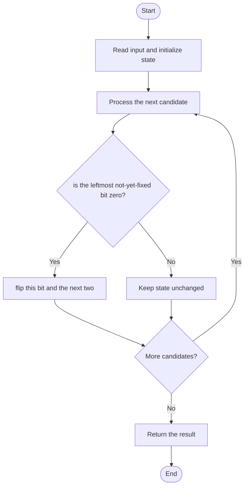

# 3191 — Minimum Operations to Make Binary Array Elements Equal to One I

## 1. Problem understanding and constraints

An operation flips exactly three consecutive bits. Find the minimum operations to make the array all ones, or return -1 if impossible. Array length is at least three by problem constraints. **थोडक्यात:** काय मोजायचे/निवडायचे ते आधी स्पष्ट करा; मगच code निवडा.

## 2. Stepwise example and edge cases

> **मराठी:** प्रश्नात काय दिले आहे आणि नेमके काय शोधायचे आहे, हे आधी स्पष्ट करा.
> `[0,0,0]`: flip indices 0–2 once → `[1,1,1]`; answer 1. **Edge cases:** check smallest valid input, ties/boundaries, and empty/no-match outcomes where constraints allow them.

## 3. Pattern identification — clue table

Greedy forced left-to-right bit fixing. हा मुख्य pattern आहे.
| Clue | What it suggests |
|---|---|
| Output depends on greedy forced left-to-right bit fixing. | Keep only the relevant state; avoid unrelated recomputation |
| Need to preserve the stated condition | State an invariant before coding |
| Input scan/order matters | Update once per item and test boundaries |

## 4. Multiple approaches

Trying arbitrary flip sequences is unnecessary. The source uses the correct greedy: when the current bit is zero, flip this triple. The choice is forced because earlier positions cannot be touched later. **योग्य निवड:** source मध्ये असलेली method आणि तिच्या मर्यादा वेगळ्या ओळखा.

## 5. Flowchart

Flow समजताना decision condition आणि update invariant शी जुळतात का ते तपासा.

## 6. Selected algorithm and intuition

> **मराठी:** मुख्य observation समजल्यावर algorithm चे steps लक्षात ठेवणे सोपे होते.
> At index i, only the triple starting at i can still change `nums[i]`; make it one immediately, then continue.

## 7. Code-specific explanation

> **मराठी:** Code मधील variable आणि condition यांचा algorithm मधील उद्देश समजून घ्या.
> `LeetCode\3191\3191.cpp` — `minOperations` mutates `ns` with XOR 1 on indices i, i+1, i+2. After scanning through n-3, the last two bits cannot be changed and decide feasibility.

## 8. Dry run

> **मराठी:** प्रत्येक महत्त्वाच्या step नंतर variable ची value trace करा.
> | Step | State / action |
> |---:|---|
> | 1 | `[0,0,0,0,1]`: flip 0–2 → `[1,1,1,0,1]` |
> | 2 | flip 3–5 unavailable, so final bit 3 remains 0 |
> | 3 | return -1. |

## 9. Complexity

> **मराठी:** Input size आणि प्रत्येक operation कितीदा चालतो यावरून complexity ठरवा.
> `O(n)` time and `O(1)` extra space; input is modified.

## 10. Correctness

> **मराठी:** Invariant किंवा तर्क वापरून algorithm योग्य उत्तर देतो हे समजून घ्या.
> Once indices before i are fixed, no future length-three operation starting after i can change them. Therefore a zero at i must be flipped using the operation starting at i; this forced choice is optimal. The final two bits are unfixable and the check detects impossibility.

## 11. Mistakes and interview traps

> **मराठी:** Boundary, duplicate आणि off-by-one cases स्वतंत्रपणे तपासा.

- The final two bits are not independently fixable.
- Do not perform a flip when the current bit is already one.
- The source assumes n≥3; that is guaranteed by the problem.

## 12. Quick revision

**झटपट:** At index i, only the triple starting at i can still change `nums[i]`; make it one immediately, then continue. Pattern ओळखा, condition तपासा, आणि answer एकदाच योग्य पद्धतीने update करा.

## 13. Related patterns and variations

> **मराठी:** या clues मुळे योग्य pattern ओळखता येतो; constraints आणि relations नीट तपासा.
> Greedy forced decisions; bit flipping; difference arrays for range toggles.

## 14. Self-assessment

> **मराठी:** उत्तर न पाहता प्रश्न सोडवा आणि तुमच्या निवडीचे कारण सांगा.

1. Why is the operation at i forced?
2. Which bits remain after the loop?
3. Why is there at most one optimal decision at each step?
