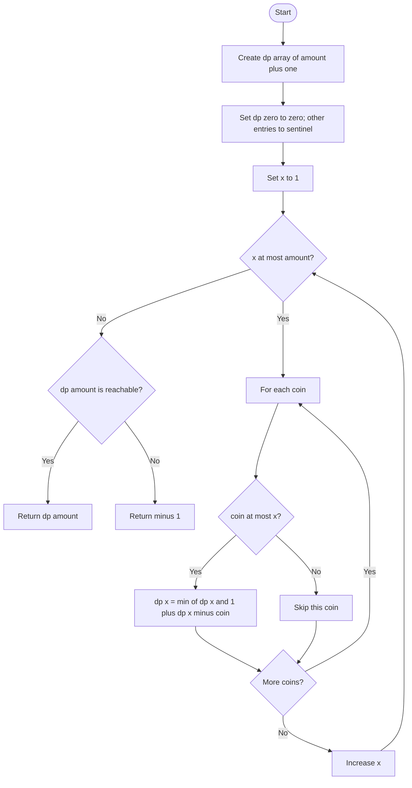

# 322. Coin Change

## 1. Problem Understanding

वेगवेगळ्या denominations चे coins `coins` आणि target `amount` दिले आहेत. **Unlimited coins** वापरून amount तयार करण्यासाठी लागणाऱ्या minimum coin count return करा. Amount तयार करता येत नसेल तर `-1`.
प्रत्येक denomination कितीही वेळा वापरता येतो. Coin count कमी करायचा आहे; वापरलेली coin combination return करायची नाही. Coins positive integers असतात; amount zero असू शकतो.

## 2. Example Understanding

### Example 1

```text
coins = [1,2,5], amount = 11
Output: 3
```

`11 = 5 + 5 + 1`, म्हणजे 3 coins. `1`-value coins वापरून 11 coins लागले असते; म्हणून 3 हे अधिक चांगले.

### Example 2

```text
coins = [2], amount = 3
Output: -1
```

फक्त even sums तयार होतात; `3` बनवता येत नाही.

### Example 3

```text
coins = [1,3,4], amount = 6
Output: 2
```

`3+3` किंवा `4+1+1` शक्य; minimum count `2`.

### Edge cases

- `amount = 0` → `0` coins.
- Coin exact amount इतका असेल → त्या coin ने answer `1`.
- Unreachable amount → `-1`.

## 3. Problem Identification

“Minimum number of coins” आणि प्रत्येक coin वापरून नवीन sum/state मिळतो—हा **minimum steps / unbounded knapsack DP** pattern आहे. प्रत्येक coin ची unlimited reuse परवानगी असल्याने state मध्ये coin index बदलत नाही किंवा amount-first DP मध्ये आधीचा amount reuse होतो.
स्वतःला विचारा:

1. State काय? तयार करायचा amount.
2. शेवटचा coin कोणता असू शकतो? प्रत्येक denomination.
3. `amount x` चा answer कसा मिळेल? `1 + answer(x - coin)`.
4. प्रत्येक transition ची cost सारखी `1` आहे का? होय; BFS देखील shortest path शोधू शकतो.
5. Greedy largest coin निवडणे सुरक्षित आहे का? सर्व coin systems मध्ये नाही.

### Pattern Recognition Cheat Sheet

| Clue in Question                              | Possible Pattern                    | Why?                                                  |
| --------------------------------------------- | ----------------------------------- | ----------------------------------------------------- |
| Minimum number of items/steps                 | BFS or DP                           | Minimum-cost unweighted transitions                   |
| Amount तयार करणे denominations मधून           | Coin-change / unbounded knapsack DP | एक coin वारंवार वापरता येतो                           |
| प्रत्येक coin निवडल्यावर remaining amount कमी | Recurrence / state transition       | `dp[x]` मागील छोटे amounts वापरतो                     |
| काही amounts unreachable                      | Sentinel / reachability state       | Impossible ला मोठे value ठेवून शेवटी detect करता येते |
| Arbitrary denominations                       | DP, not general greedy              | Largest-first choice optimal असेलच असे नाही           |

## 4. Different Approaches

### A. DFS + backtracking — brute force

प्रत्येक coin घेणे किंवा पुढच्या denomination कडे जाणे असे choices recursively तपासा. Code मधील `dfs` current coin पुन्हा घेण्यासाठी तोच `idx` ठेवतो; skip करताना `idx+1`.

- Correct: सर्व combinations मध्ये minimum निवडतो.
- Time: exponential; amount/coin composition वाढल्यास खूप slow.
- Space: recursion depth सुमारे `amount / minCoin` पर्यंत.
- उपयोग: recurrence derive करायला किंवा अतिशय लहान inputs साठीच.

### B. BFS — amounts graph म्हणून

प्रत्येक amount हा node. `x` वरून प्रत्येक coin `c` जोडून `x+c` हा next state, जर तो target पेक्षा जास्त नसेल. BFS level म्हणजे वापरलेल्या coins ची संख्या; target first reached झाल्यावर minimum मिळतो. Visited amounts repeat होऊ नयास.

- Time: `O(amount * C)`, space: `O(amount)`, `C = coins.size()`.
- Pros: shortest-path meaning स्पष्ट, amount graph वर minimum levels.
- Cons: reachable sums queue मध्ये/visited array मध्ये ठेवावे लागतात.
- Code: `coinChangeBFS`.

### C. Bottom-up DP — recommended

`dp[x]` = amount `x` बनवण्यासाठी लागणाऱ्या minimum coins. `dp[0]=0`; बाकीला impossible दर्शवणारा sentinel. प्रत्येक `x` साठी प्रत्येक coin `c <= x` पाहा:
`dp[x] = min(dp[x], 1 + dp[x-c])`

- Time: `O(amount * C)`, space: `O(amount)`.
- Pros: compact recurrence, no recursion; standard interview solution.
- Cons: amount मोठा असेल तर memory/time amount वर अवलंबून.
- Code: `coinChangeDP`.
  | Approach | Time | Space | Pros | Cons |
  |---|---:|---:|---|---|
  | DFS brute force | Exponential | Recursion depth | Choices समजायला सोपे | Repeated subproblems, slow |
  | BFS on amounts | `O(amount*C)` | `O(amount)` | Minimum coin count = BFS level | Queue/visited memory |
  | Bottom-up DP | `O(amount*C)` | `O(amount)` | Standard, direct recurrence | मोठ्या amount साठी resource-heavy |
  **Greedy** काही canonical coin systems मध्ये चालतो, पण arbitrary denominations साठी logically safe नाही. उदाहरण `[1,3,4]`, amount `6`: largest-first `4+1+1` म्हणजे 3 coins; optimum `3+3` म्हणजे 2. Brute force correct पण inefficient; DP/BFS हे constraints साठी स्वीकारार्ह.

## 5. Flowchart



Amount `x` साठी आधीचे छोटे amounts compute झालेले असतात. Coin `c` वापरल्यास `x-c` बनवण्याच्या उत्तरात एक coin जोडतो; सर्व coins मधून कमी count निवडतो.

## 6. Algorithm / Intuition

**Key observation:** amount `x` बनवणाऱ्या कोणत्याही solution मध्ये एक शेवटचा coin `c` असतो. त्याआधी `x-c` amount तयार केलेला असतो; म्हणून त्या coin च्या candidate ची किंमत `dp[x-c]+1`.

1. `dp` size `amount+1` करा.
2. `dp[0]=0`; इतर सर्व states unreachable sentinel ने initialize करा.
3. `x=1..amount` प्रत्येकासाठी सर्व coins तपासा.
4. `coin <= x` असल्यास `dp[x]` ला `dp[x-coin]+1` ने minimize करा.
5. Final state unreachable असेल तर `-1`, अन्यथा `dp[amount]`.
   Amount-first loop unlimited reuse allow करतो कारण प्रत्येक larger amount साठी आधी computed smaller amount पुन्हा वापरतो.

## 7. Code Explanation

`coinChangeDFS` मध्ये `take` हा तोच coin पुन्हा वापरण्यासाठी `idx` ठेवतो; `notTake` पुढच्या coin वर जातो. Impossible states साठी `1e9` वापरतो.
`coinChangeBFS` मध्ये `visited[sum]` प्रत्येक amount जास्तीत जास्त एकदा process होईल याची काळजी घेते. `level` म्हणजे वापरलेल्या coins ची संख्या. Sum add करताना `long long` वापरणे overflow टाळण्याचा safe guard आहे.
`coinChangeDP`-இல் sentinel `amount+1` आहे: amount तयार होत असेल तर जास्तीत जास्त `amount` coins लागतील (coin value positive integer, worst case value 1), त्यामुळे त्यापेक्षा मोठे value unreachable दर्शवते. `dp[amount] > amount` असल्यास `-1`.
**Submission note:** LeetCode signature चे नाव `coinChange` आहे. या file मध्ये comparison methods आणि local `main` आहेत; judge मध्ये DP/BFS logic अपेक्षित signature मध्ये expose करा. Code मध्ये DFS मोठ्या amount साठी expensive असल्याचे आधीच दर्शवले आहे.

## 8. Dry Run

Input: `coins=[1,2,5]`, `amount=6`
| Step | Variables | Condition | Action | Result |
|---:|---|---|---|---|
| 1 | `dp[0]=0`, बाकी sentinel | Initialize | Amount zero ला zero coins | `[0,∞,∞,∞,∞,∞,∞]` |
| 2 | `x=1` | Coins `1` fit | `dp[1]=dp[0]+1` | `dp[1]=1` |
| 3 | `x=2` | Coins `1`,`2` fit | Best `1+1` coin or `2` coin | `dp[2]=1` |
| 4 | `x=3` | Coins `1`,`2` fit | `dp[2]+1=2`, `dp[1]+1=2` | `dp[3]=2` |
| 5 | `x=4` | Coins `1`,`2` fit | `dp[3]+1=3`, `dp[2]+1=2` | `dp[4]=2` |
| 6 | `x=5` | Coin `5` fits | `dp[0]+1=1` | `dp[5]=1` |
| 7 | `x=6` | Coins `1`,`2`,`5` fit | Candidates `2`, `3`, `2` | `dp[6]=2` |
Return `2`, for example `5+1` or `2+2+2`? लक्षात घ्या `2+2+2` मध्ये 3 coins; `dp[6]=2` हे `5+1` मुळे.

## 9. Complexity Analysis

DP मध्ये `amount` states (0 ते amount) आहेत. प्रत्येक state वर `C` coins तपासतो: **`O(amount * C)` time**. `dp` मध्ये `amount+1` entries: **`O(amount)` space**. BFS ची worst-case reachable states देखील `0..amount`, प्रत्येकावर `C` transitions असल्याने त्याची bound सारखी.
LeetCode limits मधील amount साठी हे योग्य आहे. Amount अत्यंत मोठा असल्यास amount-sized DP/BFS memory महाग होऊ शकते; त्या वेळी constraints पाहून वेगळी number-theoretic/shortest-path strategy विचारावी.

## 10. Why This Solution Works

`dp[x]` हा invariant: amount `x` बनवण्यासाठी लागणाऱ्या coins ची minimum संख्या, किंवा unreachable sentinel. Induction ने: `dp[0]=0` योग्य. `x>0` साठी कोणताही valid solution शेवटी काही denomination `c` वापरतो; उरलेला amount `x-c` असतो आणि तो लहान असल्याने आधी optimalरीत्या compute केलेला. त्या solution ला एक coin जोडून candidate मिळतो. सर्व शक्य last coins तपासल्याने optimum चुकत नाही. Candidate नसल्यास state unreachable राहतो. Loop finite आहे म्हणून terminate होतो.

## 11. Common Mistakes & Interview Traps

- Largest coin first घेणारा greedy वापरणे; arbitrary denominations मध्ये fail.
- Coin unlimited असताना take branch मध्ये index पुढे नेणे; त्यामुळे coin पुन्हा वापरता येणार नाही.
- `dp[0]=0` विसरणे.
- Unreachable sentinel मधून `1 + dp[x-coin]` करताना sentinel overflow/garbage होऊ नये म्हणून state reachability तपासणे. दिलेल्या code मध्ये sentinel लहान आणि `int` safe आहे.
- `amount=0` → `0`, `-1` नाही.
- Coin `0` किंवा negative असण्याची शक्यता असल्यास recurrence/termination बदलते; समस्या positive coins देते.
- Interview follow-up: minimum combination देखील हवी असेल तर प्रत्येक update वेळी predecessor coin/state track करा.

## 12. Revision Notes (Quick Recall)

- **Pattern:** Unbounded coin-change DP / minimum transitions.
- **Clues:** minimum coins, denominations, unlimited reuse.
- **Intuition:** last coin `c` → `1 + dp[amount-c]`.
- **Algorithm:** `dp[0]=0`, others impossible; each amount, each fitting coin, minimize.
- **Complexity:** `O(amount*C)` time, `O(amount)` space.
- **Mistakes:** greedy assumption, wrong reuse logic, missing zero base case.
- **Takeaway:** Arbitrary coin denominations साठी local largest choice नव्हे, सर्व last-coin choices compare करा.

## 13. Similar Problem Recognition

Coin Change II मध्ये minimum count नाही, तर combinations मोजायच्या असतात; loop order बदलल्याने combinations/permutations मधील फरक ठरतो. Unbounded knapsack मध्ये items unlimited आणि value maximize करायची; येथे amount fixed आणि count minimize. Minimum jumps किंवा unweighted graph shortest path मध्येही BFS levels सारखी reasoning येते. Amount खूप मोठा आणि denominations कमी/विशिष्ट असतील तर amount-sized DP व्यवहार्य आहे का आधी तपासा.

## 14. Final Self-Assessment

1. `dp[x]` ची अचूक definition काय आहे?
2. Recurrence मध्ये `dp[x-coin]` ला `1` का जोडतो?
3. Amount-first DP मध्ये unlimited coin reuse कसा संभवतो?
4. `[1,3,4]` आणि amount `6` वर greedy का fail होतो?
5. Answer reachable आहे की नाही हे sentinel वापरून कसे ठरवता?
