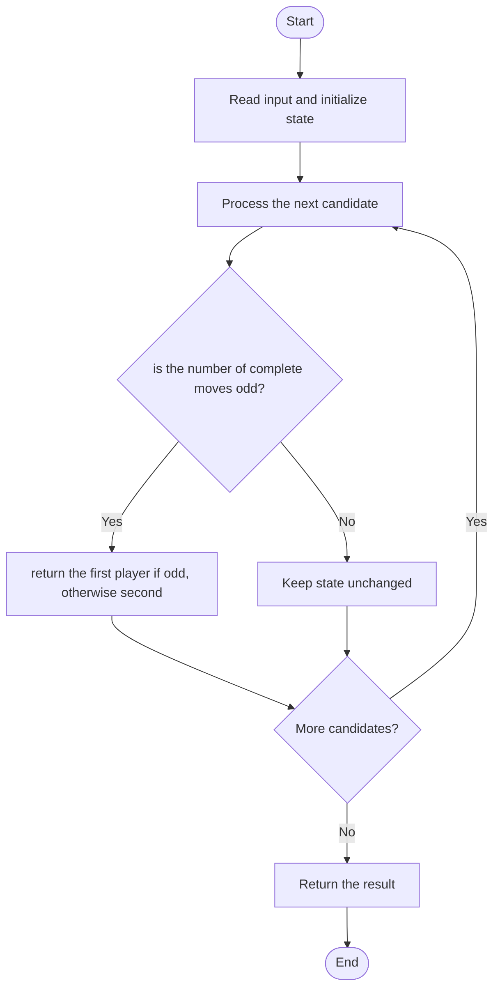

# 3222 — Find the Winning Player in Coin Game

## 1. Problem understanding and constraints

Two players alternately remove one 10-coin pile and four 1-coin piles. The player unable to move loses. Determine the winner from initial counts. **थोडक्यात:** काय मोजायचे/निवडायचे ते आधी स्पष्ट करा; मगच code निवडा.

## 2. Stepwise example and edge cases

> **मराठी:** प्रश्नात काय दिले आहे आणि नेमके काय शोधायचे आहे, हे आधी स्पष्ट करा.
> `x=2,y=7`: only one full move is possible, so Alice makes it and wins. **Edge cases:** check smallest valid input, ties/boundaries, and empty/no-match outcomes where constraints allow them.

## 3. Pattern identification — clue table

Game theory reduced to number of complete moves and parity. हा मुख्य pattern आहे.
| Clue | What it suggests |
|---|---|
| Output depends on game theory reduced to number of complete moves and parity. | Keep only the relevant state; avoid unrelated recomputation |
| Need to preserve the stated condition | State an invariant before coding |
| Input scan/order matters | Update once per item and test boundaries |

## 4. Multiple approaches

State-space game search is correct but unnecessary. The source checks the number of moves allowed by both resources and uses parity; no simulation is needed. **योग्य निवड:** source मध्ये असलेली method आणि तिच्या मर्यादा वेगळ्या ओळखा.

## 5. Flowchart

Flow समजताना decision condition आणि update invariant शी जुळतात का ते तपासा.

## 6. Selected algorithm and intuition

> **मराठी:** मुख्य observation समजल्यावर algorithm चे steps लक्षात ठेवणे सोपे होते.
> Each turn consumes exactly `(1,4)`, so at most `min(x,y/4)` turns occur. Odd number means the first player makes the final move.

## 7. Code-specific explanation

> **मराठी:** Code मधील variable आणि condition यांचा algorithm मधील उद्देश समजून घ्या.
> `LeetCode\3222\3222.cpp` — `winningPlayer` returns the named player according to the move count. Ensure integer division `y/4` is used.

## 8. Dry run

> **मराठी:** प्रत्येक महत्त्वाच्या step नंतर variable ची value trace करा.
> | Step | State / action |
> |---:|---|
> | 1 | `x=2,y=7`: min(2,1)=1 move |
> | 2 | odd → Alice wins. |

## 9. Complexity

> **मराठी:** Input size आणि प्रत्येक operation कितीदा चालतो यावरून complexity ठरवा.
> `O(1)` time and `O(1)` space.

## 10. Correctness

> **मराठी:** Invariant किंवा तर्क वापरून algorithm योग्य उत्तर देतो हे समजून घ्या.
> The game has no choices that change resource consumption; every legal move reduces x by one and y by four. Thus exactly the minimum resource quotient determines the number of moves, and alternating turns make parity determine the winner.

## 11. Mistakes and interview traps

> **मराठी:** Boundary, duplicate आणि off-by-one cases स्वतंत्रपणे तपासा.

- The game ends when either resource cannot cover a complete move.
- Use floor division for y/4.
- Zero moves means Alice loses.

## 12. Quick revision

**झटपट:** Each turn consumes exactly `(1,4)`, so at most `min(x,y/4)` turns occur. Odd number means the first player makes the final move. Pattern ओळखा, condition तपासा, आणि answer एकदाच योग्य पद्धतीने update करा.

## 13. Related patterns and variations

> **मराठी:** या clues मुळे योग्य pattern ओळखता येतो; constraints आणि relations नीट तपासा.
> Game parity; deterministic impartial games; resource batching.

## 14. Self-assessment

> **मराठी:** उत्तर न पाहता प्रश्न सोडवा आणि तुमच्या निवडीचे कारण सांगा.

1. How many coins are consumed per move?
2. Why is min used?
3. Who wins if the move count is even?
