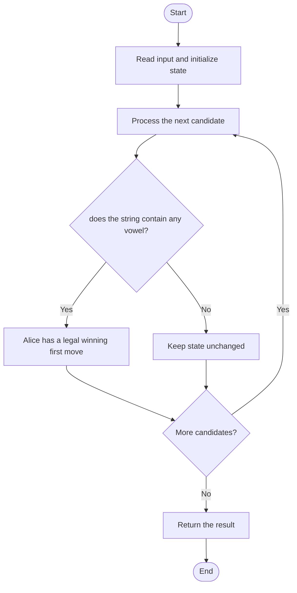

# 3227 — Vowels Game in a String

## 1. Problem understanding and constraints

Alice moves first and removes a non-empty substring containing an odd number of vowels; Bob removes one containing an even number. A player with no legal move loses. Determine whether Alice wins assuming optimal play. **थोडक्यात:** काय मोजायचे/निवडायचे ते आधी स्पष्ट करा; मगच code निवडा.

## 2. Stepwise example and edge cases

> **मराठी:** प्रश्नात काय दिले आहे आणि नेमके काय शोधायचे आहे, हे आधी स्पष्ट करा.
> `s="leetcoder"` contains vowels, so the parity argument gives Alice a winning strategy; answer true. **Edge cases:** check smallest valid input, ties/boundaries, and empty/no-match outcomes where constraints allow them.

## 3. Pattern identification — clue table

Game invariant; reduce a game to existence of a winning first move. हा मुख्य pattern आहे.
| Clue | What it suggests |
|---|---|
| Output depends on game invariant | Keep only the relevant state; avoid unrelated recomputation |
| Need to preserve the stated condition | State an invariant before coding |
| Input scan/order matters | Update once per item and test boundaries |

## 4. Multiple approaches

Recursive game simulation is possible but unnecessary. Both source methods scan for any vowel; the mathematical observation makes this an `O(n)` test. **योग्य निवड:** source मध्ये असलेली method आणि तिच्या मर्यादा वेगळ्या ओळखा.

## 5. Flowchart

Flow समजताना decision condition आणि update invariant शी जुळतात का ते तपासा.

## 6. Selected algorithm and intuition

> **मराठी:** मुख्य observation समजल्यावर algorithm चे steps लक्षात ठेवणे सोपे होते.
> If there is at least one vowel, Alice can choose an odd-vowel substring; if none, she has no legal move.

## 7. Code-specific explanation

> **मराठी:** Code मधील variable आणि condition यांचा algorithm मधील उद्देश समजून घ्या.
> `LeetCode\3227\3227.cpp` — `doesAliceWinLoop` and `doesAliceWinLambda` differ only in the scan style (`for` versus `any_of`).

## 8. Dry run

> **मराठी:** प्रत्येक महत्त्वाच्या step नंतर variable ची value trace करा.
> | Step | State / action |
> |---:|---|
> | 1 | Scan `"abc"`: a is a vowel → return true immediately. |

## 9. Complexity

> **मराठी:** Input size आणि प्रत्येक operation कितीदा चालतो यावरून complexity ठरवा.
> `O(n)` time and `O(1)` extra space.

## 10. Correctness

> **मराठी:** Invariant किंवा तर्क वापरून algorithm योग्य उत्तर देतो हे समजून घ्या.
> With no vowels, Alice has no legal move and loses. If any vowel exists, the parity-based game property guarantees a winning move for Alice; the source checks exactly this condition.

## 11. Mistakes and interview traps

> **मराठी:** Boundary, duplicate आणि off-by-one cases स्वतंत्रपणे तपासा.

- Vowels are a,e,i,o,u; consonants do not count.
- Do not count only total substring length.
- The return is a game result, not a count of vowels.

## 12. Quick revision

**झटपट:** If there is at least one vowel, Alice can choose an odd-vowel substring; if none, she has no legal move. Pattern ओळखा, condition तपासा, आणि answer एकदाच योग्य पद्धतीने update करा.

## 13. Related patterns and variations

> **मराठी:** या clues मुळे योग्य pattern ओळखता येतो; constraints आणि relations नीट तपासा.
> Game invariants; parity arguments; boolean existence scans.

## 14. Self-assessment

> **मराठी:** उत्तर न पाहता प्रश्न सोडवा आणि तुमच्या निवडीचे कारण सांगा.

1. What makes Alice have a legal move?
2. What result follows when there are no vowels?
3. Why is full game-tree simulation unnecessary?
